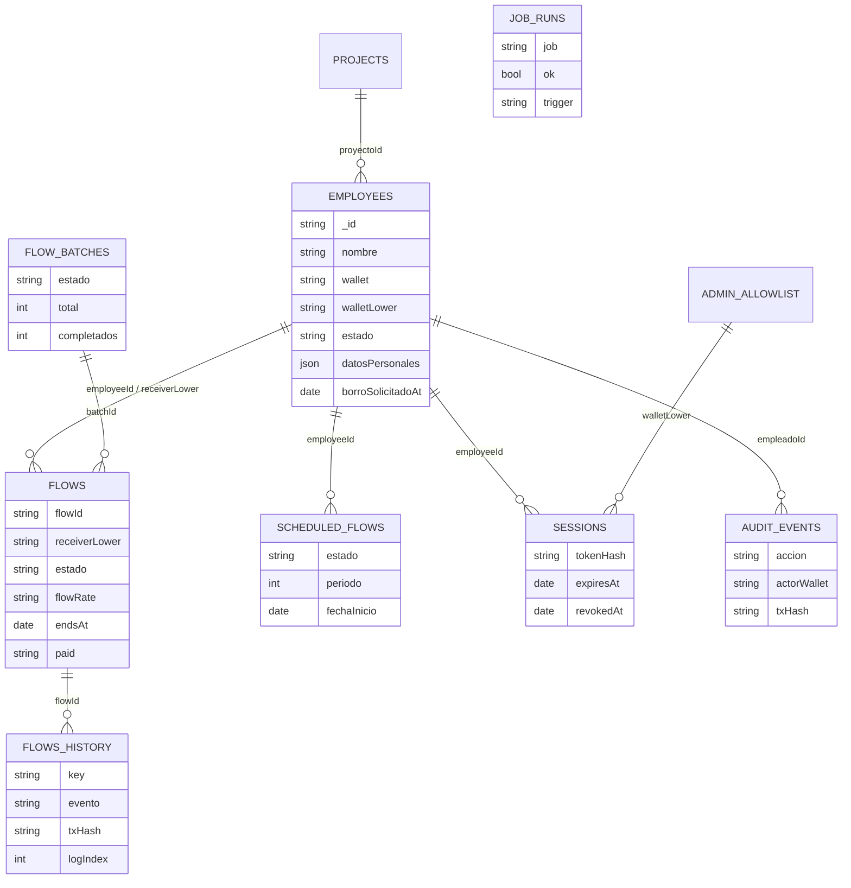

# 06 · Diagrama relacional

## Modelo de datos

### Entidades y relaciones (MongoDB)
#### Descripción textual

- `employees` n:1 → `projects` (`proyectoId` opcional; baja de proyecto bloqueada si
  tiene empleados).
- `employees` 1:n → `flows` (`employeeId` opcional; el flujo también se encuentra por
  `receiverLower` sin depender del vínculo).
- `employees` 1:n → `scheduled_flows` (programación de nómina, CU-05).
- `flow_batches` 1:n → `flows` (`batchId` marca los flujos ya creados del lote).
- `flows` 1:n → `flows_history` (por `flowId`, extraído de los eventos del tx).
- `sessions` ↔ `employees` (por `employeeId`) y ↔ `admin_allowlist` (por wallet).
- `audit_events` → actor (`actorWallet`) y `empleadoId` opcional; `txHash` al recibo.
- `job_runs` es independiente (telemetría de operación).

## Relación con la cadena

### Doble registro
#### Reglas

- MongoDB **nunca** se usa como fuente de verdad de flujos: `reconcile_flows` reescribe
  derivas y el espejo `flows_history` se re-lee desde `deployBlock` si se pierde.
- Un `changeReceiver` on-chain cierra un `flowId` y abre otro: ambos quedan en `flows`
  ligados al mismo empleado (el histórico conserva ambos `flowId`).
