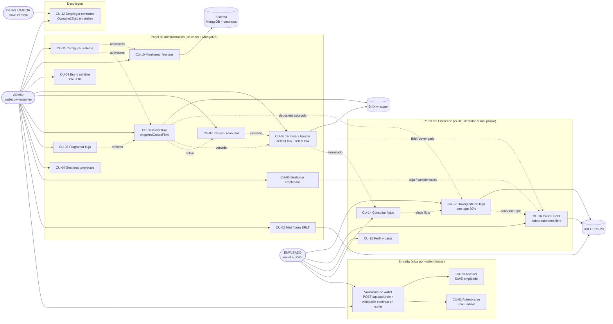

# Diagrama de casos de uso — Superfluid BRLT Streaming v2

> Vista general de actores y casos de uso (CU-01..CU-17) sobre la red de la configuración
> (Besu 81234 por defecto; el despliegue actual `brltv2-00033-dmn` opera contra Anvil
> 31337 vía proxy, ver `04-despliegue.md`).
> Fuente canónica: `../casos_uso.md`.

## Leyenda

| Relación | Significado |
|---|---|
| Flecha continua | El actor inicia el caso de uso. |
| Flecha punteada | Dependencia de estado o de datos entre casos de uso. |
| `BRLT` / `BrltX` | Contratos desplegados en la red de `system_config`. |
| `Sistema` | Backend + MongoDB; nunca firma transacciones. |
| `Validación de wallet` | Flujo de soporte (no es un CU numerado): `POST /api/auth/role` decide el portal y `/suite` revalida la cuenta activa de la wallet cada 10 s y en `accountsChanged`. |

## Notas de lectura

- La **entrada es única por wallet**: desde `/entrar` (`web/src/app/entrar/page.tsx`,
  `web/src/components/EntryLogin.tsx`) se conecta la wallet, se consulta `POST /api/auth/role`
  (`web/src/app/api/auth/role/route.ts:22-36`) y se redirige: admin → `/admin`,
  empleado → `/suite`, sin alta → error. La identidad se demuestra después con la firma SIWE
  del propósito de la suite destino (CU-01 o CU-13).
- El portal del empleado (`/suite`) tiene **identidad visual propia** (tokens Tailwind
  `empleado.*`, no AdminLTE) y valida de forma **continua** que la cuenta activa de la
  wallet coincida con la sesión (`eth_accounts` + evento `accountsChanged` + poll de 10 s,
  `web/src/app/suite/page.tsx:117-141`): si diverge, se avisa y se exige revalidar en `/entrar`.
- `CU-16` es el cobro autónomo libre: el empleado firma `downgrade` (`sc/src/BrltX.sol:144`)
  y quema BrltX a cambio de BRLT. También puede firmar `settleFlow` de un flujo vencido.
- `CU-17` es el **downgrade de flujo con tope acumulado del 80%**: descarga BRLT «desde un
  flujo concreto» y el backend exige (`web/src/lib/downgrade-limit.ts`,
  `web/src/app/api/suite/actions/route.ts:38-44`) que el acumulado cobrado no supere el 80%
  del total asignado a la cuenta; en caso contrario responde `422 tope_80_superado`.
  Se apoya en la misma transacción `downgrade` de CU-16, por lo que consumen el mismo límite.
- `CU-08` cubre dos operaciones: `deleteFlow` (corte anticipado del admin) y `settleFlow`
  (liquidación de un flujo vencido, invocable por cualquiera).

---

*Actualizado 2026-11-17 · commit aab670e*
