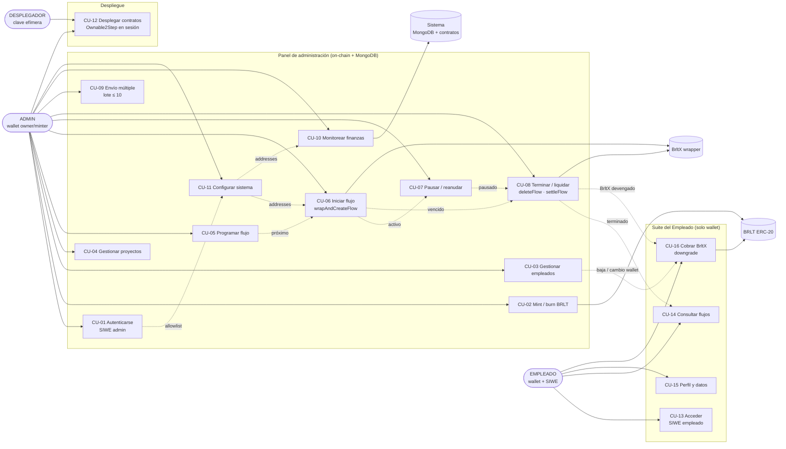

# Diagrama de casos de uso — Superfluid BRLT Streaming v2

> Vista general de actores y casos de uso (CU-01..CU-16) sobre Besu Codecrypto 81234.
> Fuente canónica: `../casos_uso.md`.

## Leyenda

| Relación | Significado |
|---|---|
| Flecha continua | El actor inicia el caso de uso. |
| Flecha punteada | Dependencia de estado o de datos entre casos de uso. |
| `BRLT` / `BrltX` | Contratos desplegados en la red 81234. |
| `Sistema` | Backend + MongoDB; nunca firma transacciones. |

## Notas de lectura

- El panel admin y la Suite son **aplicaciones separadas** con sesiones SIWE distintas.
- `CU-16` es la única vía por la que el empleado firma una transacción (cobro); también
  puede firmar `settleFlow` de un flujo vencido.
- `CU-08` cubre dos operaciones: `deleteFlow` (corte anticipado del admin) y `settleFlow`
  (liquidación de un flujo vencido, invocable por cualquiera).
