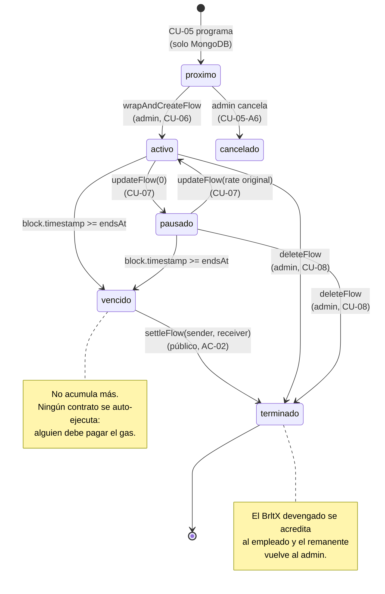
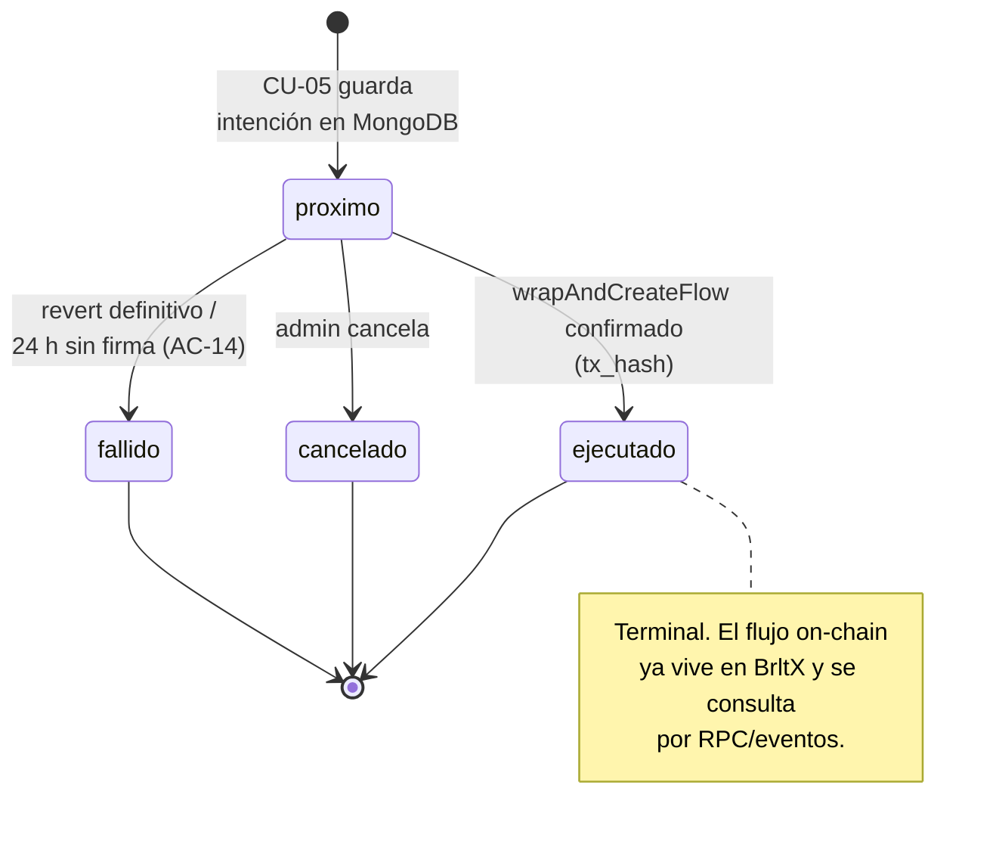

# Máquina de estados — flujo on-chain y flujo programado

> Fuente canónica: `../casos_uso.md` §3 y §3.1; `../diccionario_datos.md`.
> Decisiones aplicadas: AC-02 (liquidación perezosa) y AC-05 (estados de programación).

## 1. Ciclo de vida del flujo on-chain (BrltX)

## 2. Estados de `flujos_programados` (AC-05)

## 3. Reglas de transición

| Desde | Evento | Hacia | Quién firma |
|---|---|---|---|
| `próximo` | `wrapAndCreateFlow` confirmado | `ejecutado` (programado) + `activo` (on-chain) | ADMIN |
| `activo` | `updateFlow(0)` | `pausado` | ADMIN |
| `pausado` | `updateFlow(rate>0)` | `activo` | ADMIN |
| `activo`/`pausado` | `block.timestamp ≥ endsAt` | `vencido pendiente de liquidación` | nadie (cambio de lectura) |
| `vencido` | `settleFlow(sender, receiver)` | `terminado` | cualquiera (admin, empleado, tercero) |
| `activo`/`pausado` | `deleteFlow(receiver)` | `terminado` | ADMIN |
| `terminado` | cualquier operación | — | revierte |

## 4. Invariantes

1. Un flujo `terminado` no puede volver a `activo`.
2. `settleFlow` sobre un flujo no vencido revierte.
3. `settleFlow` dos veces sobre el mismo flujo revierte (idempotencia).
4. Lo devengado nunca supera `deposited` (shortfall explícito, AC-07).
5. La pausa de emergencia no impide `deleteFlow`, `settleFlow` ni `downgrade`.
6. `flujos_programados` nunca pasa a «terminado»: ese estado solo existe on-chain.
