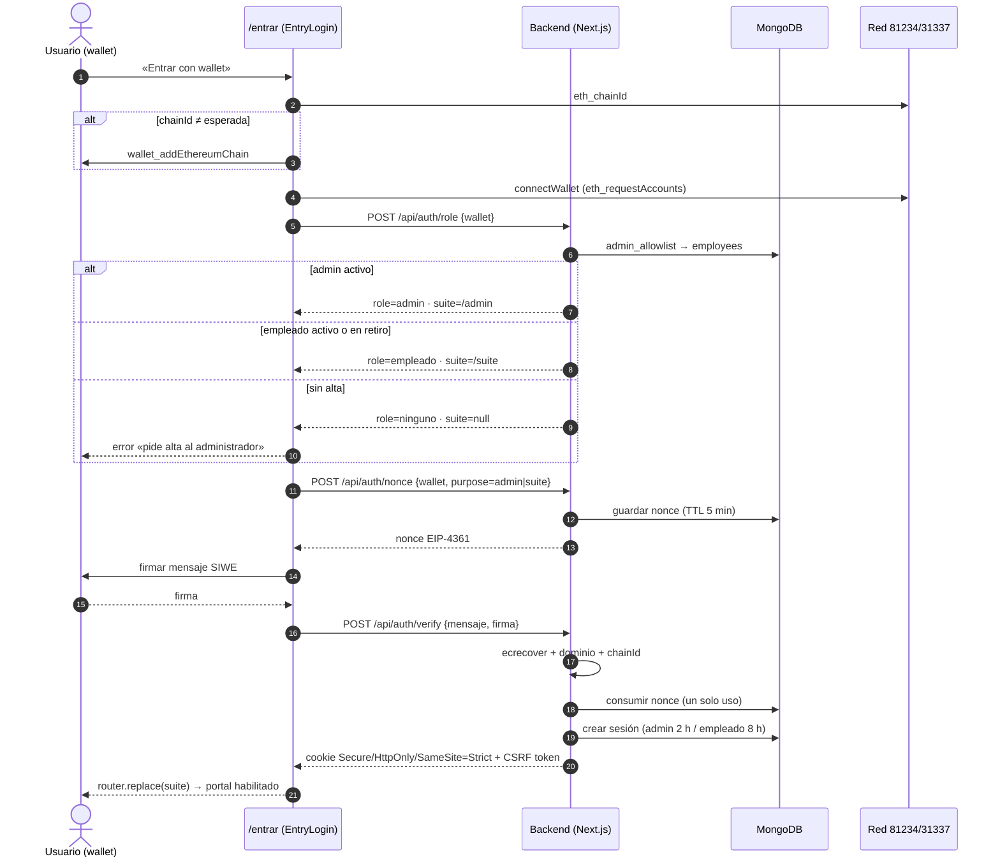
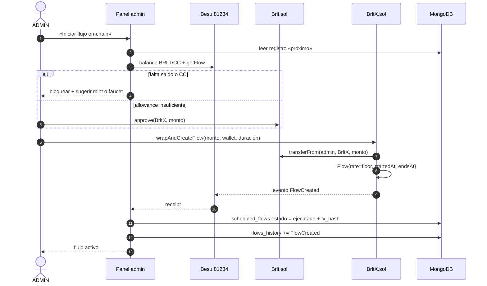
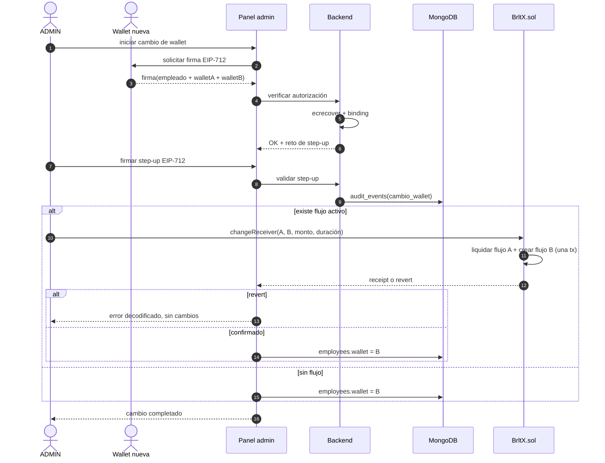
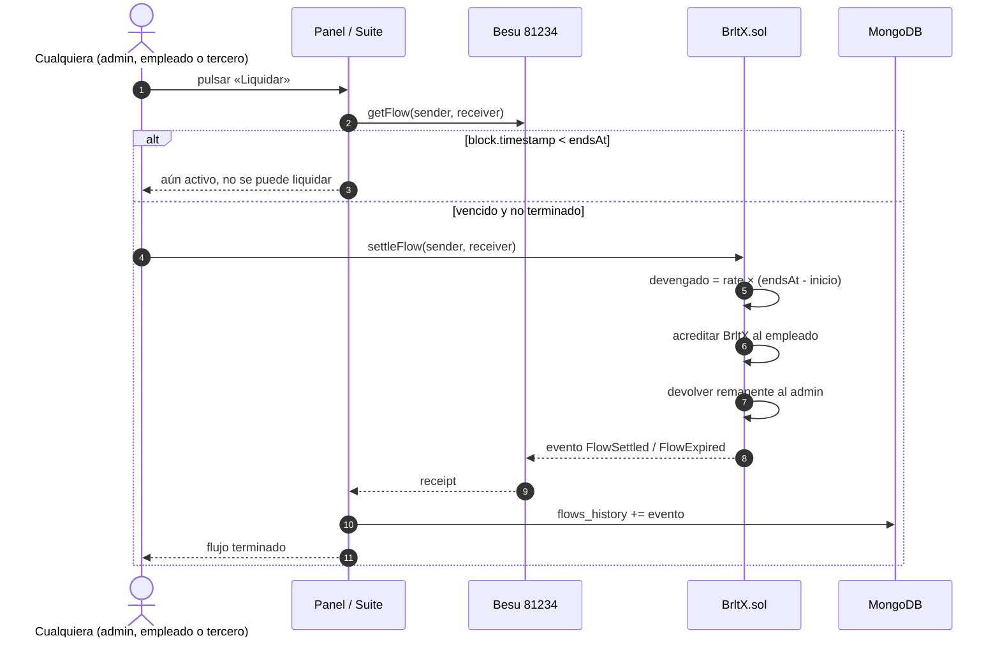
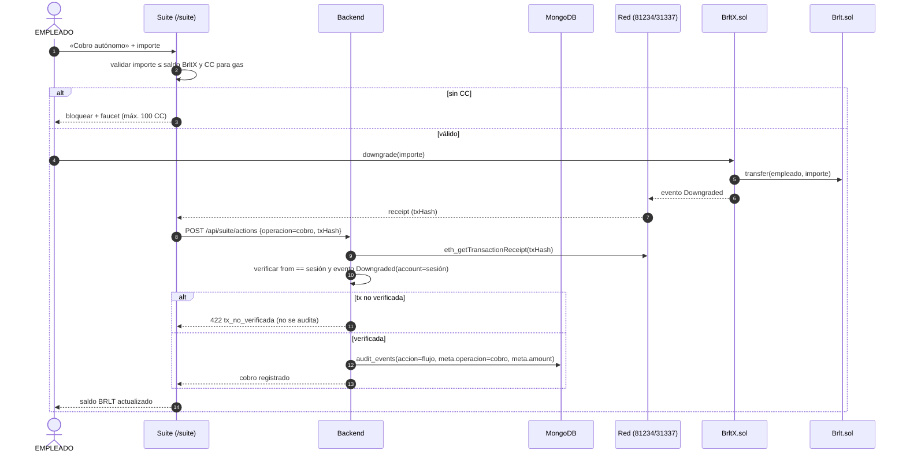
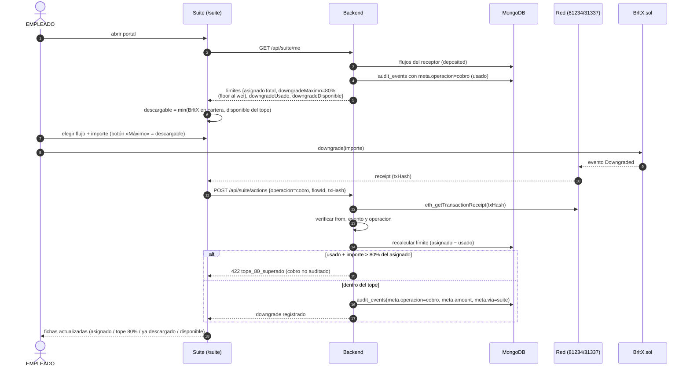
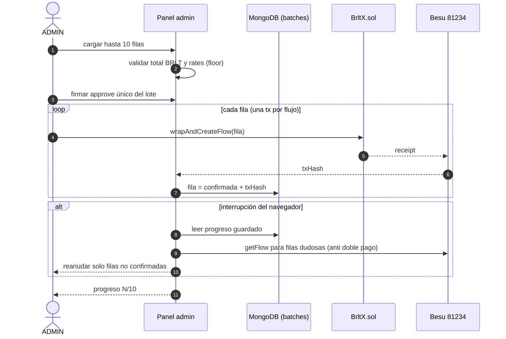
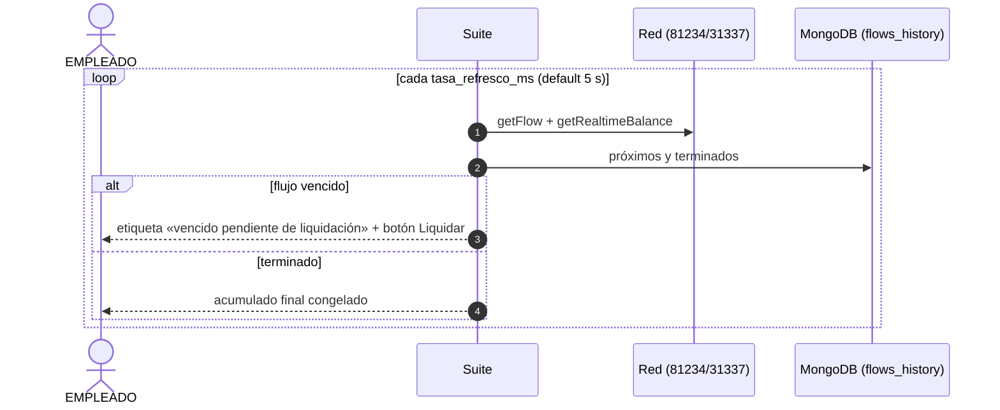
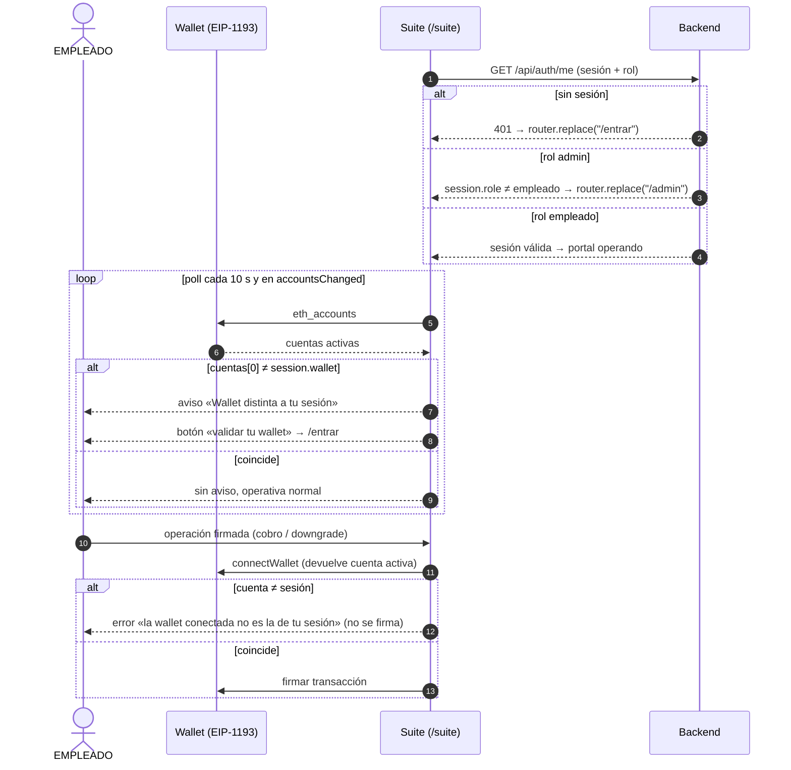

# Diagramas de secuencia — operaciones clave

> Complementan `../casos_uso.md`. Todos los firmantes son wallets del navegador; el backend
> nunca firma ni custodia transacciones.

## 1. CU-01 / CU-13 — Entrada única por wallet (`/entrar`) y autenticación SIWE

> La entrada es ahora única: la wallet conectada decide el portal **antes de firmar**
> (`POST /api/auth/role`, sin firma ni sesión), y después demuestra su identidad con la
> firma SIWE del propósito que corresponde (`web/src/components/EntryLogin.tsx:42-84`).

## 2. CU-06 — Iniciar un flujo programado

## 3. CU-03 — Cambio de wallet atómico (AC-03)

## 4. CU-08 — Liquidación de un flujo vencido (`settleFlow` público)

## 5. CU-16 — Cobro autónomo del empleado (`downgrade`, libre)

> El cobro se audita en `/api/suite/actions`, que **verifica la tx contra la cadena antes
> de registrarla** (`web/src/app/api/suite/actions/route.ts:16-63`). El cobro autónomo
> («Cobro autónomo», sin elegir flujo) **también queda sujeto al tope del 80%**: la
> verificación del tope se aplica a todo `cobro` verificado en la API
> (`actions/route.ts:41-44`), porque ambos consumen el mismo límite acumulado
> (`meta.operacion="cobro"`). Lo que hace distinto al downgrade de flujo de CU-17 es que
> exige `flowId` y su UI se guía por las fichas de límites de `/api/suite/me`.

> Nota: el devengo pendiente de un flujo **activo** solo se acredita a BrltX al liquidar
> on-chain (`settleFlow` exige vencimiento, `sc/src/BrltX.sol:208`); el cobrable real del
> empleado es el BrltX ya acreditado en su cartera.

## 6. CU-17 — Downgrade de flujo con tope acumulado del 80%

> Nuevo en commit aab670e. La limitación vive en el backend
> (`web/src/lib/downgrade-limit.ts`) y se exige **antes de auditar** el cobro
> (`web/src/app/api/suite/actions/route.ts:38-44`). El empleado elige un flujo concreto
> desde la ficha «Downgrade de flujos» del portal (`web/src/app/suite/page.tsx:373-481`).

**Reglas del tope (CU-17):**

- `asignadoTotal` = suma de `deposited` de **todos** los flujos del receptor, vivos o
  terminados (`web/src/lib/downgrade-limit.ts:65-78`); la verdad es el contrato vía Mongo
  reconciliada.
- `downgradeMaximo` = `floor(asignadoTotal × 80 / 100)` al wei (`DOWNGRADE_CAP = 80/100`,
  `web/src/lib/downgrade-limit.ts:19-36`).
- `downgradeUsado` se reconstruye de `audit_events` con `meta.operacion = "cobro"` (eventos
  `Downgraded` verificados contra la cadena; hasta 1000 eventos, importes corruptos se
  ignoran sin bloquear).
- `downgradeDisponible` = `maximo − usado`, nunca negativo.
- La API exige el tope **antes** de auditar el nuevo cobro (`assertDowngradeLimit`),
  lanzando `422 tope_80_superado` o `422 importe_invalido` (importe ≤ 0).
- Se mantiene además el «Cobro autónomo» libre de CU-16: ambos consumen el mismo tope
  porque comparten la operación `downgrade` y la auditoría `meta.operacion = "cobro"`.

## 7. CU-09 — Lote de hasta 10 flujos

## 8. CU-14 — Suite con flujo vencido

## 9. Validación continua de la wallet en `/suite` (CU-13 / CU-14 / CU-16)

> Nuevo en commit aab670e. Mientras el portal está abierto, la cuenta activa de la wallet
> se compara con la sesión (`eth_accounts`), en el evento `accountsChanged` y con un poll
> de 10 s (`web/src/app/suite/page.tsx:117-141`). Si diverge, el portal avisa y exige
> revalidar en `/entrar`; no se firma ninguna transacción nueva.

> La validación continua no interrumpe el refresco de datos de 5 s (`RF-08`); solo bloquea
> la firma de nuevas transacciones hasta que el empleado revalida en `/entrar`.

---

*Actualizado 2026-11-17 · commit aab670e*
