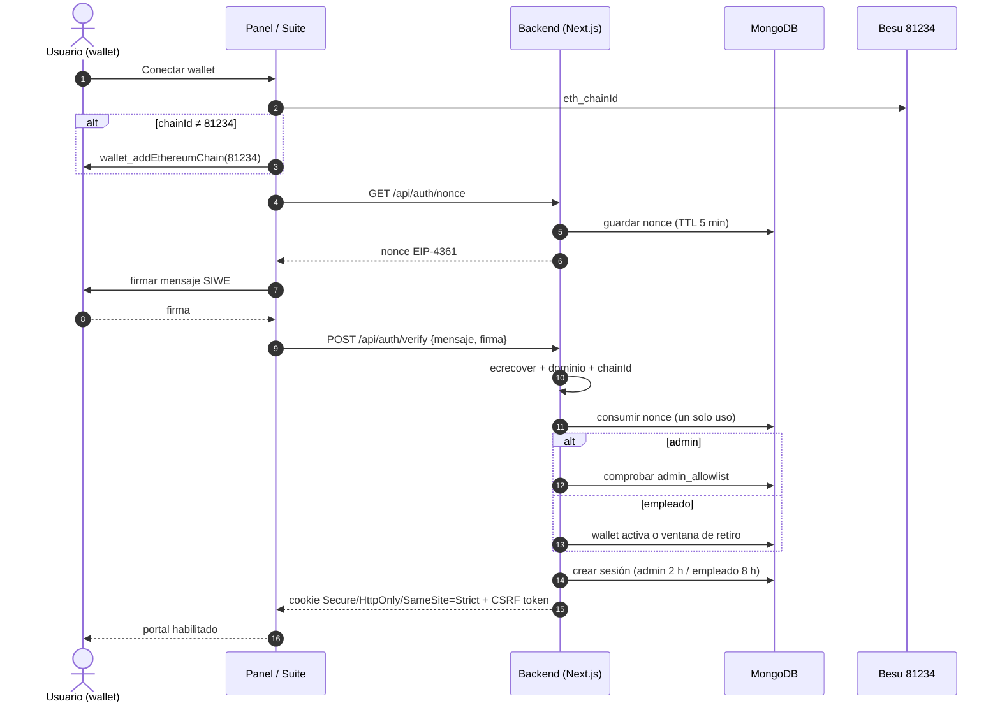
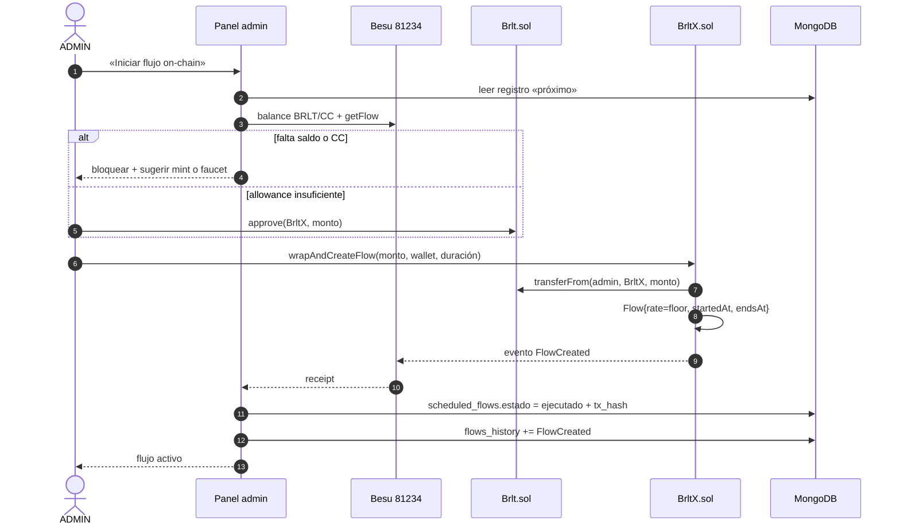
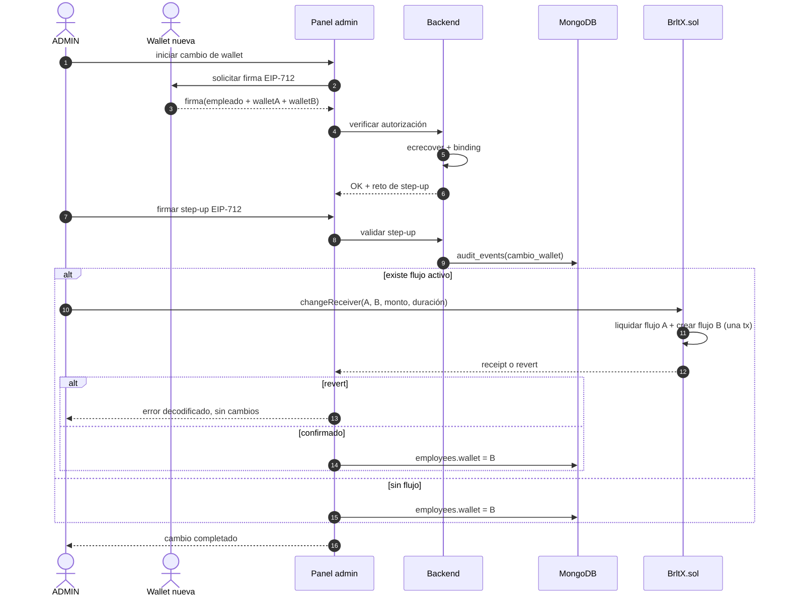
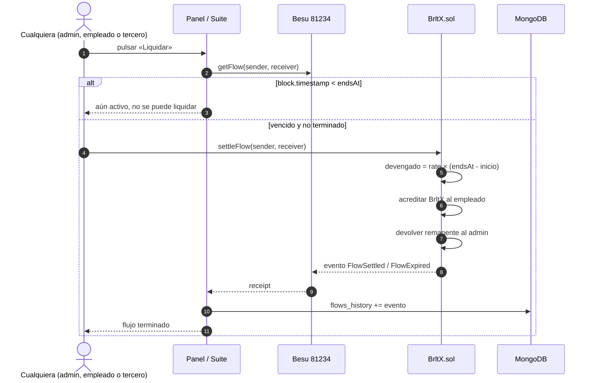
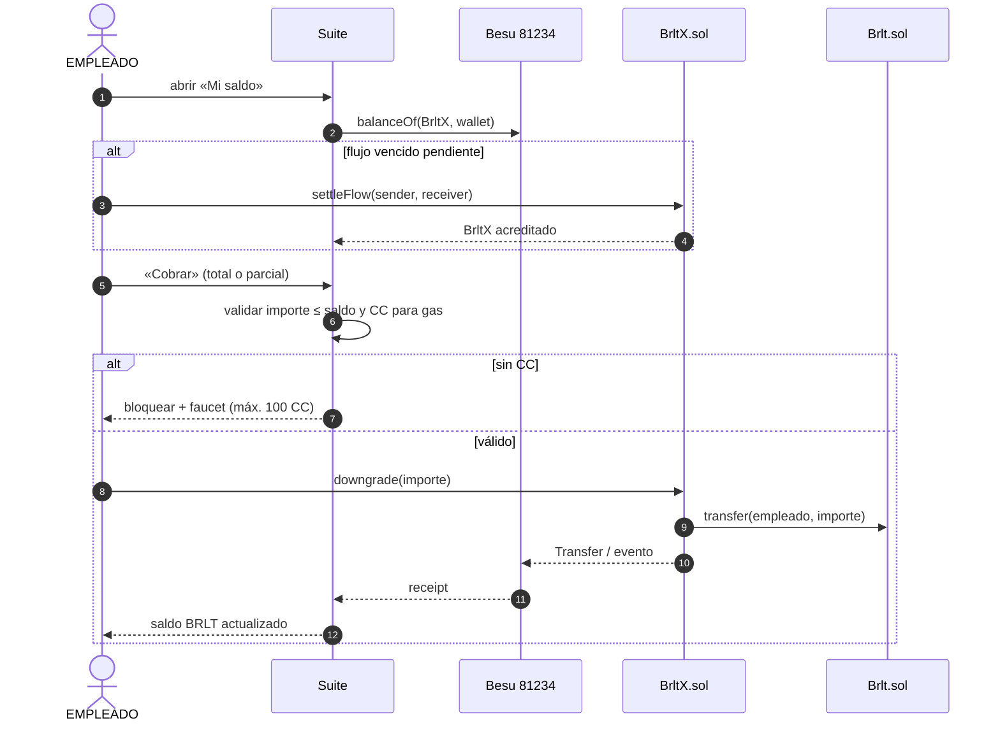
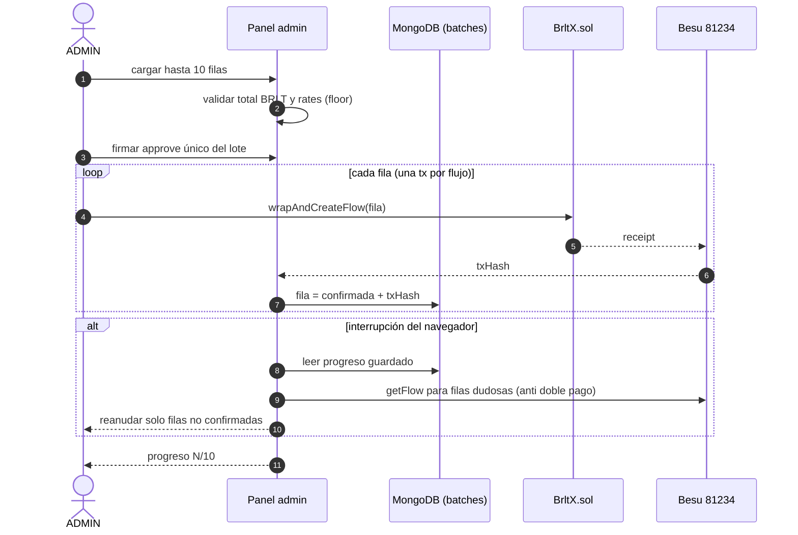
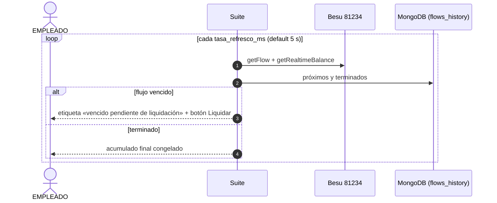

# Diagramas de secuencia — operaciones clave

> Complementan `../casos_uso.md`. Todos los firmantes son wallets del navegador; el backend
> nunca firma ni custodia transacciones.

## 1. CU-01 / CU-13 — Autenticación SIWE (admin y empleado)

## 2. CU-06 — Iniciar un flujo programado

## 3. CU-03 — Cambio de wallet atómico (AC-03)

## 4. CU-08 — Liquidación de un flujo vencido (`settleFlow` público)

## 5. CU-16 — Cobro del empleado (`downgrade`)

## 6. CU-09 — Lote de hasta 10 flujos

## 7. CU-14 — Suite con flujo vencido

