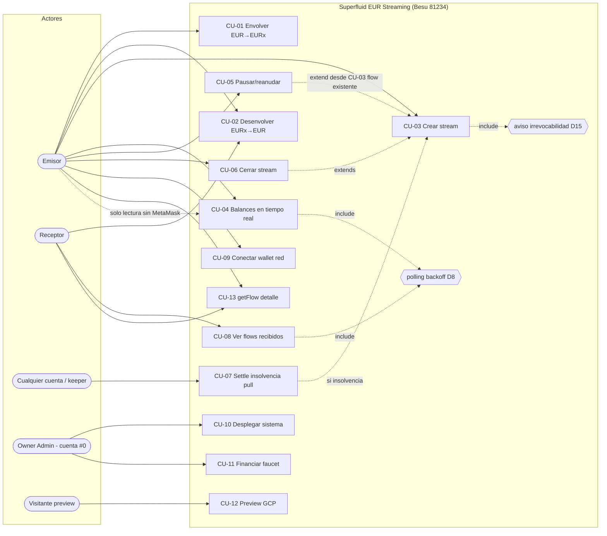
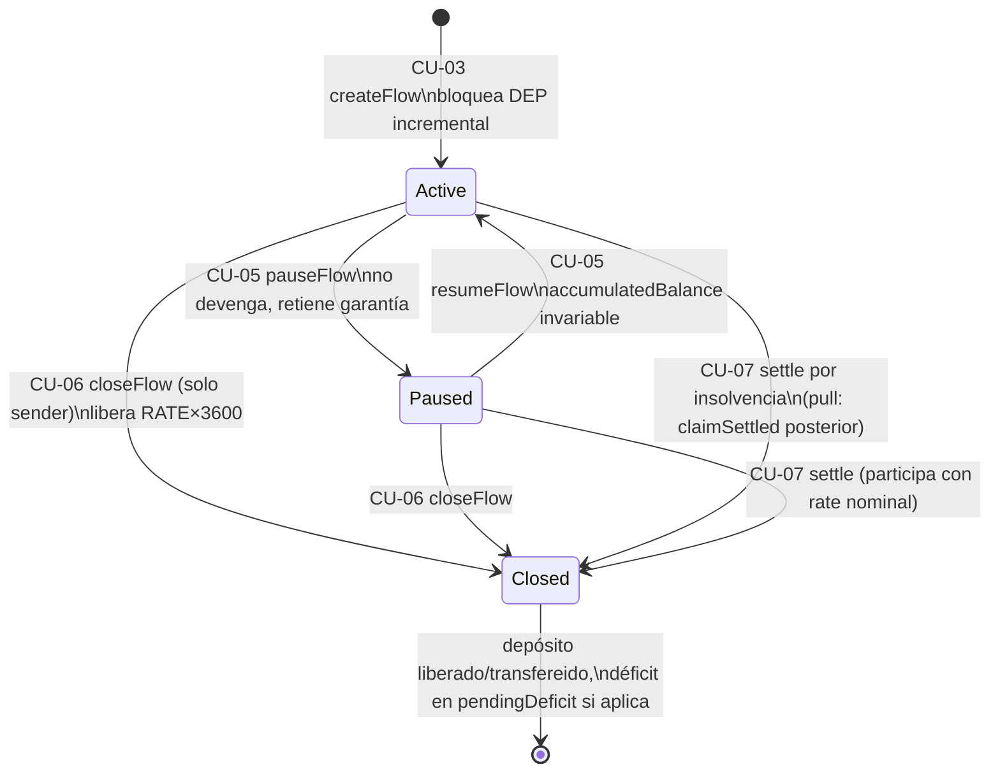
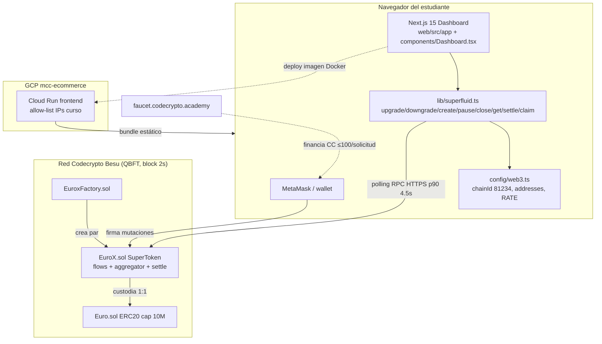

# Diagramas de Casos de Uso — Superfluid EUR Streaming v1

> Generados tras la auditoría de `casos_uso.md` (Fase 2). Coherentes con los casos auditados:
> mismos actores, mismos nombres, mismas precondiciones. Formato Mermaid (renderizable en GitLab/VS Code).

## 1. Diagrama de casos de uso UML



## 2. Secuencia — Crear stream y streaming continuo (CU-03 + CU-04)

```mermaid
sequenceDiagram
    participant W as Wallet Emisor (MetaMask)
    participant UI as Dashboard Next.js
    participant X as EuroX.sol (Besu 81234)
    participant Rec as Receptor
    UI->>W: request conectar (chainId 81234)
    W-->>UI: accounts (D2: nunca pk en bundle)
    UI->>X: createFlow(receiver, RATE)
    Note over X: valida ≠self, ≠token, saldo libre ≥ DEP_1<br/>depositTotal = netOutflowGarantizado×3600
    X-->>UI: FlowCreated(sender, receiver, RATE)
    loop cada segundo on-chain (block time QBFT 2 s)
        X->>X: devengo virtual += RATE×dt a receiver −RATE×dt a sender
    end
    loop polling base 5 s (RE-04 serializado)
        UI->>X: staticCall getAccountInfo / virtualBalanceOf
        X-->>UI: saldos en tiempo presente
        alt timeout > 25 s o error
            UI->>UI: backoff 15 s → 30 s; banner "conexión degradada"
        else 3 éxitos consecutivos
            UI->>UI: vuelve a 5 s
        end
    end
    Rec->>X: downgrade/retirada permitida (saldo libre)
```

## 3. Secuencia — Insolvencia: settle + claim (CU-07, patrón PULL)

```mermaid
sequenceDiagram
    participant K as Keeper (cualquiera)
    participant X as EuroX.sol
    participant R1 as Receptor 1
    participant R2 as Receptor 2
    Note over X: trigger V3: owed > realBalanceOf(emisor)<br/>tras materializar (⇔ virtual ≤ 0; el reloj NO habilita)
    K->>X: settle(emisor) — revert "not insolvent" si sigue solvente
    X->>X: liquidar hasta instante exacto de agotamiento
    X->>X: status=Closed en todos los salientes; settledUpTo=ts (SOLO timestamp)
    X->>X: déficit → pendingDeficit; residuos <1 wei → pendingPool
    X-->>K: Settled(emisor, settledUpTo, deficit)
    par prorrateo por flowRate nominal (orden de iteración solo para residuos wei)
        R1->>X: claimSettled()
        X-->>R1: parteNominal (rate/Σrates × real, tope debido)
    and
        R2->>X: claimSettled()
        X-->>R2: parte prorrateada
    end
    Note over X,R2: assert conservación: sum(salidas reales) == EURx disponibles<br/>settle repetido = no-op idempotente
```

## 4. Secuencia — Ciclo de vida de un flow (estados)



## 5. Diagrama de componentes (contexto para documento técnico)


