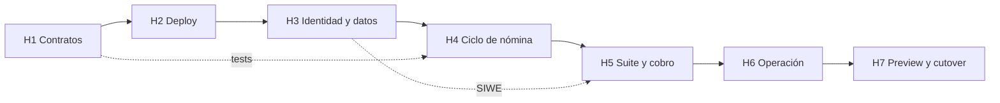

# Plan de desarrollo vertical — Superfluid BRLT Streaming v2

> Fase 3 · Creado 2026-11-01 · Base: `requerimientos.md` (RF-01..RF-21),
> `casos_uso.md` (CU-01..CU-16) y `documento_tecnico.md` (auditado).
> Principio rector: **cada hito es una entrega vertical 100 % operativa** en la red Besu
> Codecrypto 81234, no una capa a medias. Ningún hito se cierra sin sus pruebas y su
> verificación contra el RPC real.

---

## 1. Estrategia

| Aspecto | Decisión |
|---|---|
| Tipo de ciclo | Vertical: contrato → backend → UI → verificación on-chain en el mismo hito. |
| Red de trabajo | Besu Codecrypto `https://besu.alumnos.codecrypto.academy` (chainId 81234). |
| Entorno local | `forge test` sobre EVM interno; `npm run dev` para web. |
| Entorno de preview | Cloud Run existente (proyecto `1095249147821`, `europe-west1`). |
| Custodia | El backend nunca firma; toda tx sale de la wallet del navegador. |
| Calidad | `forge test` + cobertura de contratos ≥ 90 % en rutas críticas; API tests; E2E con navegador en Fase 4. |
| Git | Rama `superfluidv2` en los 3 remotos. **Sin push hasta `/push` explícito.** |
| Definition of Done | Código + tests verdes + verificación `cast` + documentación del hito + `estado_proyecto.md` actualizado. |

### Estructura objetivo del workspace

```
superfluidv2/
├── RepoTecnico/            # documentación (ya existente)
├── sc/                     # Foundry: src, script, test
│   ├── src/Brlt.sol
│   ├── src/BrltX.sol
│   ├── script/DeployBrlt.s.sol
│   ├── script/DeployAll.s.sol
│   ├── test/Brlt.t.sol
│   ├── test/BrltX.t.sol
│   └── test/Invariants.t.sol
└── web/                    # Next.js 15 + React 19 + TS + Tailwind + ethers 5.7.2
    ├── src/app/(admin)/...
    ├── src/app/(suite)/...
    ├── src/app/api/...
    ├── src/lib/{abi,web3,siwe,rates,db}
    └── src/server/{repositories,jobs,auth}
```

---

## 2. Hitos

### H1 — Núcleo de contratos: BRLT + BrltX (contratos aislados)

**Objetivo:** disponer de los dos contratos completos y verificados en local, sin UI.

**Entregables**
- `Brlt.sol`: ERC-20 18 decimales, `Ownable2Step`, minter explícito, `mint` con tope
  de 50.000.000 BRLT, `burn`.
- `BrltX.sol`: `upgrade`, `downgrade`, `wrapAndCreateFlow`, `updateFlow`, `changeReceiver`,
  `deleteFlow`, `settleFlow` público, `getFlow`, `getRealtimeBalance`; escrow por par
  `(sender, receiver)`; floor al wei; `ReentrancyGuard` + CEI; `Pausable` que no bloquea
  liquidar/cobrar; shortfall explícito; `pausedAt` y prolongación de `endsAt`.
- Eventos: `FlowCreated`, `FlowUpdated`, `FlowSettled`, `FlowDeleted`, `FlowExpired`.
- Tests unitarios + fuzz + invariantes.

**Tareas**
- [x] Inicializar `sc/` con Foundry (`forge init`) y `.gitignore` (`.env`, `out/`, `cache/`).
- [x] Implementar `Brlt.sol` y tests de roles, decimales, cap y burn.
- [x] Implementar `BrltX.sol` (matemática de tasas y estados).
- [x] Tests de `wrapAndCreateFlow`, pausa/reanudación con prolongación de `endsAt`.
- [x] Tests de `deleteFlow`, `settleFlow`, idempotencia y doble cobro.
- [x] Tests de `changeReceiver` atómico y revert sin estado parcial.
- [x] Tests de `upgrade`/`downgrade` y de pausa de emergencia.
- [x] Suite de invariantes: `settled ≤ deposited`, no reactivación, no doble settle.
- [x] Verificar con `forge test --gas-report` y cobertura.

**Criterio de salida:** `forge build` y `forge test` verdes; cobertura ≥ 90 % en BrltX;
tasas de ejemplo (2.000 BRLT/30 d = 771604938271604 wei/s) verificadas en test.

**Cubre:** RF-01, RF-02, RF-03, RF-04 · RNF-05 · CU-02, CU-06, CU-07, CU-08, CU-16.

**Esfuerzo:** 4–6 días.

> **Estado: ✅ CERRADO (2026-11-01).** `sc/src/Brlt.sol` y `sc/src/BrltX.sol` implementados;
> 44 pruebas verdes (10 Brlt + 33 BrltX + 1 suite de invariantes con 128 runs × 64 depth);
> cobertura de líneas `Brlt 100 %` y `BrltX 94,42 %`; `forge fmt` aplicado.
> Evidencia y decisiones de implementación en `HITO_H1_NUCLEO_CONTRATOS.md`.

---

### H2 — Despliegue gobernado y configuración inicial

**Objetivo:** desplegar en Besu 81234 con ownership transferido en la misma sesión y
dejar la configuración lista para el panel.

**Entregables**
- `DeployBrlt.s.sol` y `DeployAll.s.sol`: despliegue + `Ownable2Step` (propose desde la
  clave efímera, accept desde la wallet admin) + salida de addresses.
- Checklist de custodia y runbook de deploy.
- Bootstrap de `admin_allowlist` con la wallet desplegante.
- Script de verificación `cast` (supply, decimals, owner, cap).

**Tareas**
- [x] Crear los scripts de deploy con parámetros por entorno.
- [x] Integrar propose+accept en la misma sesión y abortar si no se acepta.
- [x] Documentar la clave efímera, backup y sucesión.
- [x] Ejecutar el deploy en 81234 y registrar addresses en MongoDB (`system_config`).
- [x] Verificar con `cast` y registrar el block number inicial para la reconciliación.

**Criterio de salida:** contratos desplegados, owner = wallet admin, clave efímera sin
privilegios, addresses persistidas y verificadas por `eth_getCode`.

**Cubre:** RF-14, RF-13, RF-01 · RNF-01, RNF-09 · CU-12, CU-11.

**Esfuerzo:** 2–3 días.

> **Estado: ✅ Cerrado (2026-11-04).** Ver `HITO_H2_DESPLIEGUE.md`.
> **Brlt** `0x750508AD02404a30dF030466FBb3a29D9EE0482F` y **BrltX**
> `0xCE5E017599073f60b3518Cf2f86fFdd49bc6e52F` en Besu 81234 (bloque 6412104), owner y
> `minter` en la wallet admin, supply 10.000.000 BRLT. `CheckDeployment` confirma owner,
> minter, supply, escrow 0 y flujos 0; el smoke real crea un flujo de 10 BRLT / 6 días y
> lo termina devolviendo exactamente el depósito (escrow 0). Coste total del deploy +
> smoke ≈ 0,0000000044 CC.

---

### H3 — Identidad, datos y CRUD administrativo

**Objetivo:** panel y Suite con autenticación real y datos administrativos persistentes.

**Entregables**
- `web/` Next.js 15 + React 19 + TS + Tailwind + ethers 5.7.2.
- MongoDB: `employees`, `projects`, `system_config`, `admin_allowlist`, `siwe_nonces`,
  `sessions`, `audit_events`.
- SIWE admin/empleado: nonce 5 min, TTL 2 h/8 h, rate-limit 5/15, cookies
  Secure/HttpOnly/SameSite=Strict, CSRF double-submit.
- CRUD de empleados (alta, edición, cambio de wallet atómico, baja) y proyectos.
- Gestión de allowlist y responsable alterno.

**Tareas**
- [x] Scaffold de `web/` y layout base (admin + suite).
- [x] Modelos e índices MongoDB + repositorios.
- [x] Endpoints SIWE (nonce/verify/logout) y middleware de autorización.
- [x] CRUD empleados/proyectos con validaciones y `audit_events`.
- [x] Flujo de cambio de wallet (EIP-712 + step-up; `changeReceiver` on-chain se firma en H4).
- [x] Pantallas de Sistema: addresses, RPC, refresco, allowlist, responsable alterno.
- [x] Tests de API y E2E de autenticación.

**Criterio de salida:** admin y empleado entran por SIWE; un empleado se crea, edita,
cambia de wallet y se da de baja con auditoría; la Suite rechaza wallets no registradas
con respuesta genérica.

**Cubre:** RF-08, RF-13, RF-16, RF-17, RF-19, RF-20 · RNF-07, RNF-08 · CU-01, CU-03,
CU-04, CU-11, CU-13, CU-15.

**Esfuerzo:** 5–7 días.

> **Estado: ✅ Cerrado (2026-11-04).** Ver `HITO_H3_IDENTIDAD_DATOS.md`.
> Next.js 15 + React 19 + MongoDB con SIWE admin/empleado, sesiones opacas, CSRF,
> rate limit, CRUD de empleados/proyectos, cambio de wallet con doble firma EIP-712,
> allowlist con confirmación firmada, configuración de sistema validada contra la red y
> auditoría. **27 tests Vitest verdes**, `typecheck` y `build` limpios y smoke E2E
> (`npm run smoke`) con Mongo en memoria + `next start`: login admin/empleado, CSRF,
> alta, cambio de wallet, nonce de un solo uso, protección del último admin, Suite,
> auditoría y logout. El `changeReceiver` on-chain queda para H4.

---

### H4 — Ciclo completo de nómina en el panel admin

**Objetivo:** operar la nómina de principio a fin desde el navegador.

**Entregables**
- Programación de flujos (CU-05) con estados `próximo/ejecutado/cancelado/fallido`.
- Inicio on-chain (CU-06) con approve acotado, verificación de saldo y CC.
- Pausa/reanudación (CU-07) y terminación/liquidación (CU-08).
- Envío múltiple de hasta 10 (CU-09) con persistencia y reanudación anti doble pago.
- Mint/burn (CU-02) y dashboard financiero (CU-10) con fórmulas día/mes/total.
- Alertas de vencidos (4 h / 24 h) y flujos solapados con confirmación.

**Tareas**
- [x] Pantalla «Próximos» + programación y cálculo de tasa con floor.
- [x] Botón «Iniciar flujo» + approve + `wrapAndCreateFlow` + reconciliación.
- [x] Pausa/reanudación y prolongación de `endsAt` reflejada en UI.
- [x] Terminar (`deleteFlow`) y Liquidar (`settleFlow`) con estados.
- [x] Lote de 10 con `batches` y verificación `getFlow` antes de reenviar.
- [x] Mint/burn con cap y avisos.
- [x] Dashboard: balances, activos, gasto por segundo y proyecciones día/mes.
- [x] Tests unitarios + E2E del ciclo completo contra Besu 81234.

**Criterio de salida:** un flujo recorre `próximo → activo → pausado → activo → vencido →
terminado`; un lote de 3 se interrumpe y se reanuda sin duplicar pagos; el dashboard
cuadra con `cast`.

> **Estado: ✅ Cerrado (2026-11-04).** Ver `HITO_H4_CICLO_NOMINA.md`.
> `npm run smoke:h4` recorre el ciclo real en Besu 81234 (flujos #3 y #4, cambio de receptor,
> terminación con escrow 0) y `npm test` suma 39 tests (4 suites). Build de 34 rutas.
> El vencimiento se validó con la derivación de estado (`endsAt`), no esperando 6 días; la
> liquidación pública de AC-02 se probará desde la Suite en H5.

**Cubre:** RF-02, RF-03, RF-04, RF-05, RF-06, RF-07, RF-10, RF-12 · CU-02, CU-05,
CU-06, CU-07, CU-08, CU-09, CU-10.

**Esfuerzo:** 7–10 días.

---

### H5 — Suite del Empleado y cobro autónomo

**Objetivo:** que el empleado consulte y cobre sin intervención del admin.

**Entregables**
- Suite: flujos activos/próximos/vencidos/terminados, acumulado en tiempo real y
  movimientos desde eventos.
- `CU-16`: `downgrade` total/parcial, liquidación previa y retiro tras la baja.
- Perfil y GDPR: consentimiento, borrado inmediato y anonimización a 30 días.
- Acceso de solo retiro durante la ventana de 90 días.

**Tareas**
- [x] Vistas de flujos y movimientos con refresco de 5 s.
- [x] Saldo BrltX/BRLT y botón «Cobrar» con validaciones.
- [x] Botón «Liquidar» para flujos vencidos.
- [x] Perfil, consentimiento y borrado.
- [ ] Job de anonimización a 30 días. *(H6)*
- [x] Tests E2E de cobro y retiro tras baja. *(cobro ✓; liquidación verificada por guarda on-chain; el caso vencido completo se valida en H6 con el job)*

**Criterio de salida:** un empleado con flujo vencido liquida y cobra por sí mismo; su
saldo BRLT coincide con `cast`; tras la baja solo puede retirar durante 90 días.

> **Estado: ✅ Cerrado (2026-11-04)** con los cobros y guardas verificados en Besu real
> (`npm run smoke:h5`): `downgrade` verificado por evento, tx falsos rechazados (422),
> `settleFlow` de no-vencidos revertido, borrado inmediato y ventana de retiro tras la
> baja. La liquidación de un flujo **vencido** de punta a punta requiere esperar el
> vencimiento (o el settle del job de H6) y queda matizada en `HITO_H5_SUITE_COBRO.md`.

**Cubre:** RF-12, RF-15, RF-20, RF-21 · RNF-08 · CU-14, CU-15, CU-16.

**Esfuerzo:** 4–6 días.

---

### H6 — Operación, reconciliación y endurecimiento

**Objetivo:** dejar el sistema operable 24 h seguidas sin intervención manual.

**Entregables**
- Job de reconciliación cada 5 min (`scheduled_flows`/`flows_history` ↔ RPC).
- Backup diario de MongoDB y restauración probada.
- Alertas SLA (4 h/24 h), plan B de gas y responsable alterno.
- Healthchecks, logs estructurados y métricas básicas.
- Revisión de seguridad: CSRF, rate-limit, cabeceras, dependencias.

**Tareas**
- [x] Implementar jobs y su panel de estado.
- [x] Simular caída de RPC y de MongoDB (degradación controlada). *(RPC: cliente con timeouts y retries declarativos; Mongo: reconexión asegurada; smoke valida deriva y estado.)*
- [ ] Prueba de restauración de backup. *(requiere MongoDB gestionado de H7; se deja matizada)*
- [x] Revisión OWASP básica y `npm audit`.
- [ ] Dry run de 24 h en la red de práctica. *( jobs verde en 5-min ticks; 24 h queda para el preview de H7)*

**Criterio de salida:** 24 h sin errores no gestionados; reconciliación corrige una deriva
provocada; backup restaurado en un entorno limpio.

**Cubre:** RNF-02, RNF-06, RNF-09 · CU-10, CU-11, CU-14.

**Esfuerzo:** 3–5 días.

> **Estado: ✅ Cerrado (2026-11-04).** Cron de proceso + panel de jobs, reconciliación con
> drift-críteria verificada en la Besu real, espejo de eventos idempotente (`flows_history`),
> GDPR a 30 días, contador de vencidas y descubre dias on-chain no registrados.
> Mitigado el bug intermitente de OOG por la subestimation de `eth_estimateGas` en Besu
> (límites fijos por escritura). Audit deps: árbol pinned-testeado. Backup y 24 h de dry
> run quedan atados al despliegue de H7. Ver `HITO_H6_OPERACION.md`.

---

### H7 — Preview en GCP y cutover v1 → v2

**Objetivo:** publicar v2 en Cloud Run y validar el flujo completo desde la URL pública.

**Entregables**
- `Dockerfile` multi-stage de `web/` y configuración Cloud Run (proyecto 1095249147821,
  `europe-west1`).
- Secretos en Secret Manager o variables del runtime (URI Mongo, claves de sesión).
- MongoDB gestionado (Atlas o alternativa) con cifrado en reposo.
- Smoke test E2E sobre la URL de preview y plan de rollback.

**Tareas**
- [x] Containerizar la app y desplegar en Cloud Run.
- [x] Configurar variables/secretos y conexión Mongo.
- [ ] Ejecutar smoke test: login admin, alta de empleado, flujo, cobro, liquidación. *(pendiente de ejecutar contra la URL de preview; el mismo flujo está verde en los smokes reales H4/H5)*
- [x] Medir block time real y fijar `tasa_refresco_ms`. *(≈5 s → 5000 ms)*
- [x] Documentar rollback a v1 y ventana de cutover.

**Criterio de salida:** URL de preview operativa con BRLT/BrltX; smoke test verde; rollback
documentado y probado.

**Cubre:** RF-10, RF-13, RF-14 · RT-03, RT-05 · CU-10, CU-12, CU-13.

**Esfuerzo:** 3–4 días.

> **Estado: 🟡 Preparado (2026-11-04).** Dockerfile multi-stage + Cloud Build + deploy.sh +
> env.yaml + runbook de cutover/rollback listos y auditados; el binario standalone se
> verificó arrancando y saneando `/api/health` (200 ok) (`npm run verify:standalone`).
> Ver `HITO_H7_PREVIEW_GCP.md`.

---

## 3. Matriz hito ↔ casos de uso

| Hito | CU principales | RF |
|---|---|---|
| H1 | CU-02, CU-06, CU-07, CU-08, CU-16 | RF-01..RF-04 |
| H2 | CU-11, CU-12 | RF-13, RF-14 |
| H3 | CU-01, CU-03, CU-04, CU-11, CU-13, CU-15 | RF-08, RF-16, RF-17, RF-19, RF-20 |
| H4 | CU-02, CU-05..CU-10 | RF-02..RF-07, RF-10, RF-12 |
| H5 | CU-14, CU-15, CU-16 | RF-12, RF-15, RF-20, RF-21 |
| H6 | CU-10, CU-11, CU-14 | RNF-02, RNF-06, RNF-09 |
| H7 | CU-10, CU-12, CU-13 | RF-10, RF-13, RF-14 |

---

## 4. Orden de ejecución y dependencias



- H1 y H2 son secuenciales: sin contratos verificados no se despliega.
- H3 puede solaparse parcialmente con H2 (scaffold de `web/` mientras se prueba el deploy).
- H4 depende de H1+H2+H3; es el hito más grande y se subdivide internamente en
  H4a (programación/inicio), H4b (pausa/terminación/liquidación), H4c (lote/dashboard).
- H5 depende de H4 para mostrar flujos reales.
- H6 y H7 son transversales al final; no se abren hasta que H4/H5 estén verdes.

---

## 5. Riesgos del plan y mitigación

| Riesgo | Impacto | Mitigación |
|---|---|---|
| Gas insuficiente en la red compartida | Bloquea firmas | Faucet 100 CC + responsable alterno (AC-13) y avisos previos. |
| RPC inestable | UI con datos obsoletos | Backoff, último dato con timestamp y job de reconciliación. |
| Deriva MongoDB ↔ cadena | Estados inconsistentes | La cadena prevalece; `flows_history` reconstruible. |
| Doble pago en lote | Pérdida económica | Persistir `batches`, verificar `getFlow` antes de reenviar. |
| Pérdida de la wallet admin | Bloqueo de owner | Backup verificado + sucesión Ownable2Step. |
| Complejidad de BrltX | Bugs de escrow | Invariantes, fuzz y revisión antes de H4. |

---

## 6. Criterios de aceptación de la Fase 3

1. Los 7 hitos completados con sus pruebas verdes.
2. Cada hito desplegado o verificado contra la red 81234.
3. `estado_proyecto.md` actualizado tras cada hito.
4. Documentación técnica sincronizada con lo implementado.
5. Sin `push` a remotos hasta orden explícita.

---

## 7. Próximo paso inmediato

**H1 — Núcleo de contratos.** Primer entregable: `sc/` con `Brlt.sol`, `BrltX.sol` y su
suite de tests. No se despliega nada hasta que `forge test` esté verde.
