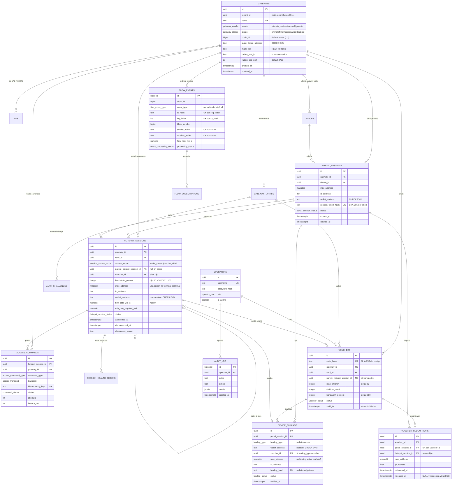
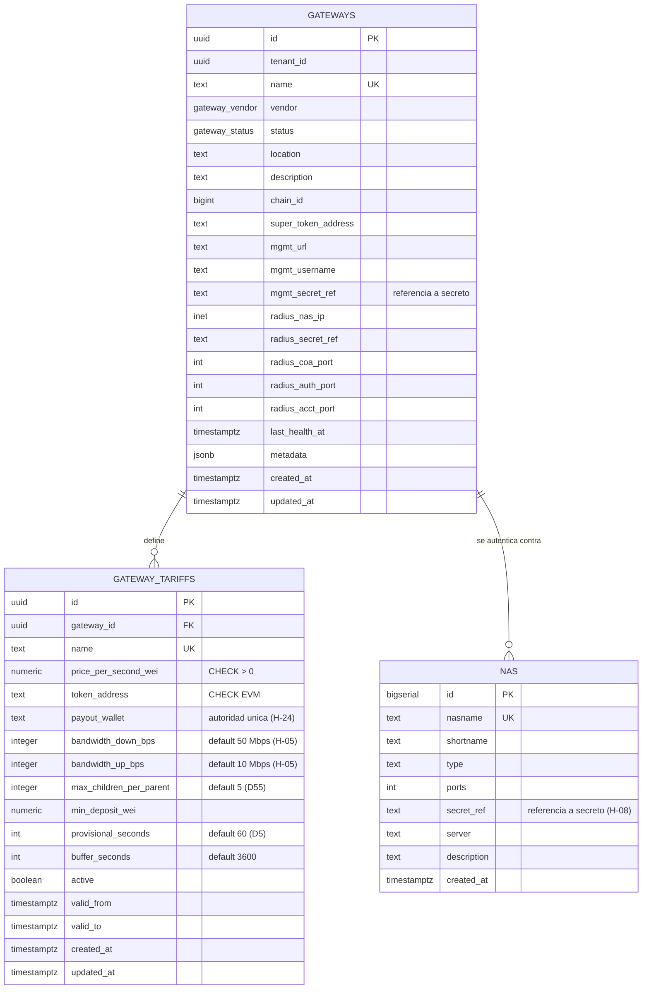
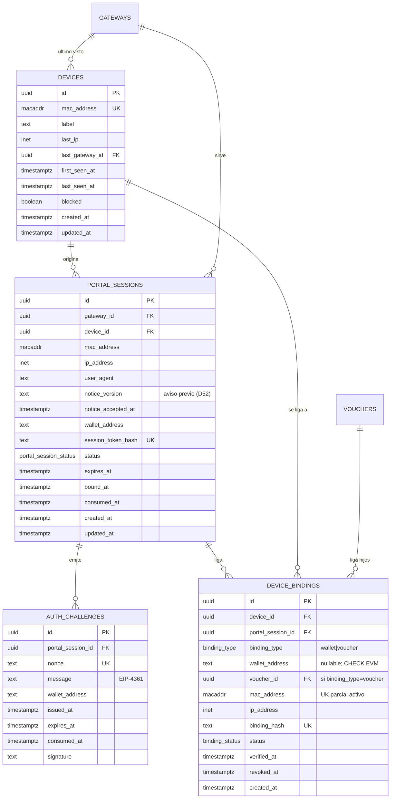
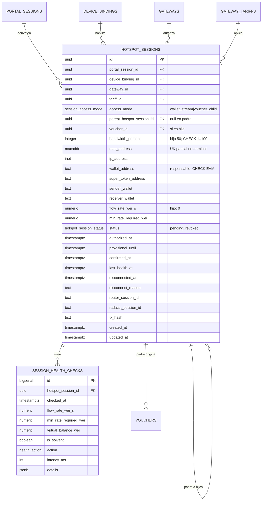
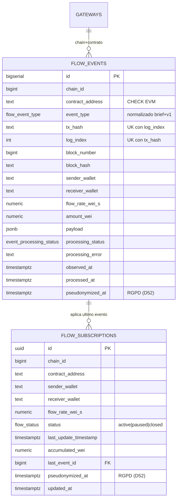
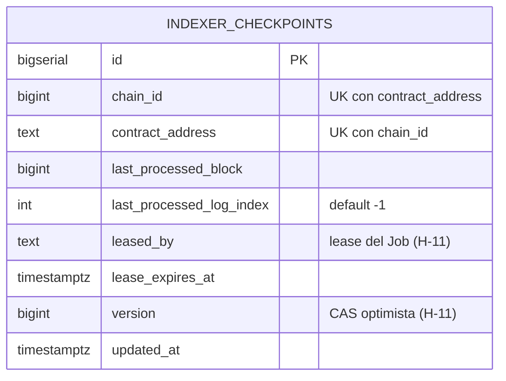
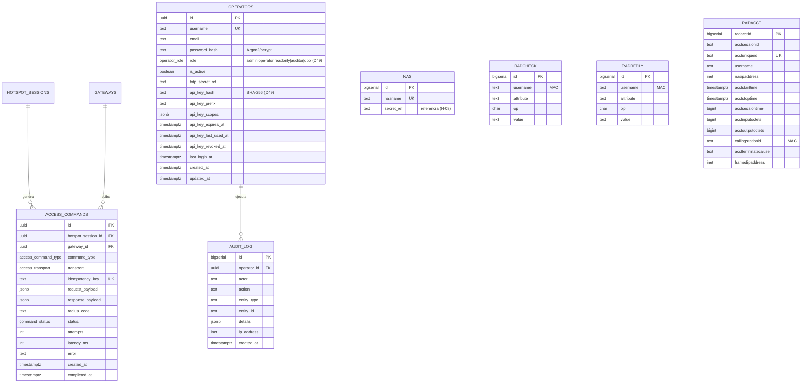
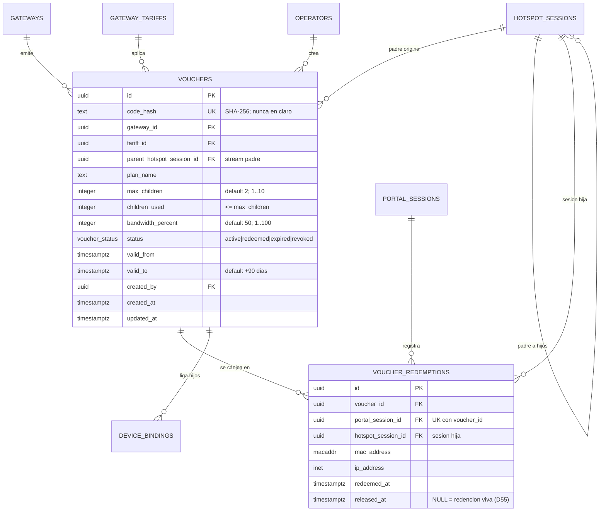

# Diagrama Entidad-Relación — SFhostpot (Superfluid Hotspot v1)

> Modelo completo, por dominios, en Mermaid (`erDiagram`). Nombres de entidades y atributos
> **idénticos** a `diccionario_datos.md` y `base_datos.sql` (sincronizados).
> Incluye el modelo lógico **on-chain** (Parte A, token propio BRLT / BRLTx adaptado de v1) y el
> modelo relacional **PostgreSQL nuevo** (Parte B, 20 tablas).

---

## 1. Vista global (entidades principales)



---

## 2. Modelo on-chain (Parte A — token propio BRLT / BRLTx, adaptado de v1)

```mermaid
erDiagram
    BRLT_TOKEN ||--o| BRLT_FACTORY : "registrado en"
    BRLT_FACTORY ||--|| BRLTX_SUPER_TOKEN : "crea par"
    BRLTX_SUPER_TOKEN ||--o{ FLOW : "transporta"
    BRLTX_SUPER_TOKEN ||--o{ AGGREGATOR : "agrega por cuenta"
    AGGREGATOR ||--o{ FLOW : "garantiza"

    BRLT_TOKEN {
        address contract_address PK "BarloventoToken.sol (BRLT)"
        uint256 total_supply "hard-cap 10_000_000e18"
        uint8 decimals "18"
        address owner "mint/burn"
    }

    BRLT_FACTORY {
        address underlying PK_FK "BRLT_TOKEN 1:1 por par"
        address superToken "BRLTx del par"
        address owner "registro de pares"
    }

    BRLTX_SUPER_TOKEN {
        address contract_address PK "BarloventoTx.sol (BRLTx)"
        address underlying FK "BRLT_TOKEN"
        uint8 decimals "18"
        uint256 totalSupplyX "== BRLT retenido (custodia)"
    }

    FLOW {
        address sender PK_FK "wallet del usuario (emisor)"
        address receiver PK_FK "payout_wallet del gateway"
        int96 flowRate "wei/s >= tariff"
        uint8 status "Active(0) Paused(1) Closed(2)"
        uint40 lastUpdateTimestamp
        uint128 accumulatedBalance
    }

    AGGREGATOR {
        address account PK
        int96 netFlowRate "solo activos"
        int96 netOutflowGarantizado "activos+pausados"
        uint256 depositTotal "netOutflowGarantizado x 3600"
        uint40 settledUpTo "solo timestamp"
        uint256 pendingDeficit
        uint128 pendingPool
    }
```

> El brief habla de `FlowUpdated`/`FlowDeleted`; el indexador los normaliza desde
> `FlowCreated/Resumed` (updated, rate>0), `FlowPaused` (updated, rate=0) y `FlowClosed`
> (deleted). Ver `flow_events.event_type`.

---

## 3. Dominio: configuración de red



---

## 4. Dominio: identidad y anti-spoofing



---

## 5. Dominio: sesión de red y solvencia



---

## 6. Dominio: puente blockchain (índice de eventos)





> `indexer_checkpoints` no tiene relaciones físicas (cursor por contrato). La **vista**
> `v_active_sessions` (definida en `base_datos.sql`) es una proyección de `hotspot_sessions` +
> `gateways` + `gateway_tariffs` + `devices`, documentada en `diccionario_datos.md` §B.9.

---

## 7. Dominio: comandos, operadores y RADIUS



> `nas`, `radcheck`, `radreply` y `radacct` no llevan FK hacia el modelo propio: FreeRADIUS los
> consume por `username` (MAC) y `nasname`/`nasipaddress`.

---

## 8. Dominio: vouchers — acceso de equipos hijos (P5, D18)



> **Regla padre/hijo**: el voucher **no** autoriza por sí solo; se crea **después** de que la wallet
> padre tenga stream activo (`parent_hotspot_session_id`). Cada canje crea una sesión
> `voucher_child` con `bandwidth_percent` del voucher (50 % por defecto) y sin stream propio. Si el
> stream del padre cae, se revocan todos los hijos.

---

## Notas de sincronía

- Clave de `FLOW` on-chain: `(sender, receiver)` dentro de cada Super Token.
- `flow_events` es idempotente por UK `(chain_id, tx_hash, log_index)`.
- `device_bindings` y `hotspot_sessions` usan **índices únicos parciales** (un binding activo por
  MAC; una sesión no terminal por MAC) — ver `base_datos.sql`.
- **Unicidad flow ↔ sesión (D56)**: `uq_hotspot_sessions_active_flow` sobre
  `(super_token_address, sender_wallet, receiver_wallet)` **solo para `access_mode='wallet_stream'`**
  (los hijos heredan la terna y no deben colisionar).
- `gateway_tariffs.payout_wallet` debe coincidir con `FLOW.receiver` on-chain; el validador lo
  verifica (RF-09).
- **Modelo padre/hijo (D18)**: `hotspot_sessions.parent_hotspot_session_id` es auto-referencia
  (`wallet_stream` → `voucher_child`); los hijos no tienen stream propio y heredan el del padre.
- Toda cantidad monetaria es `numeric(38,0)` en wei; jamás `float`/`double`.
