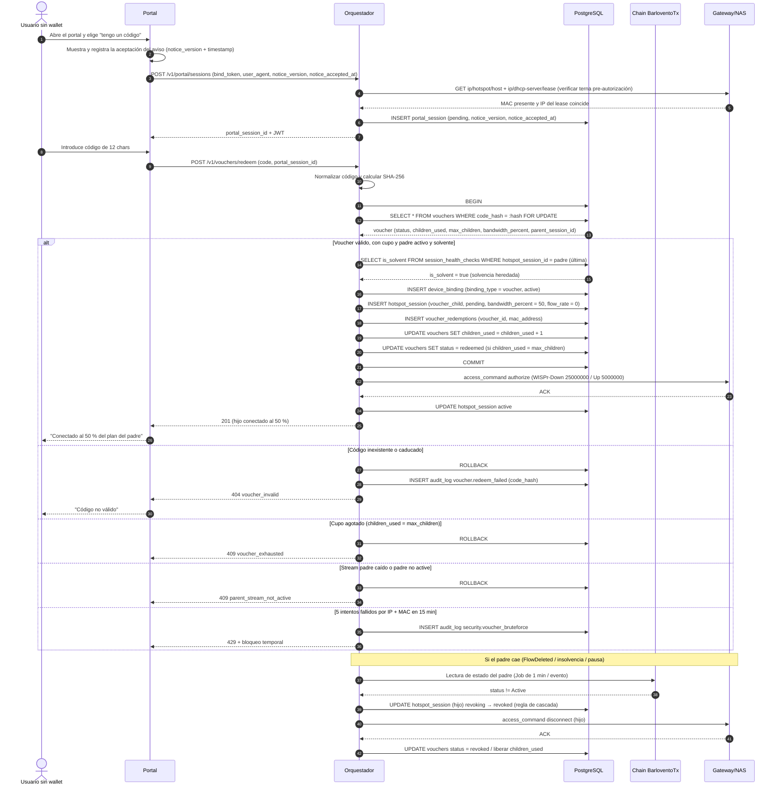
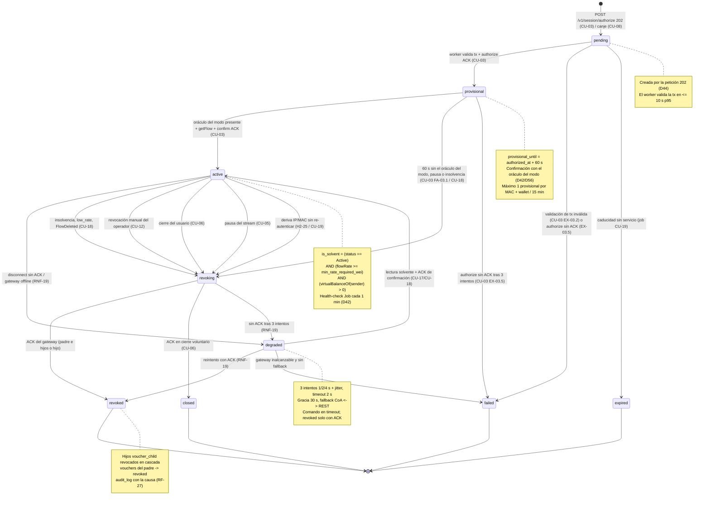
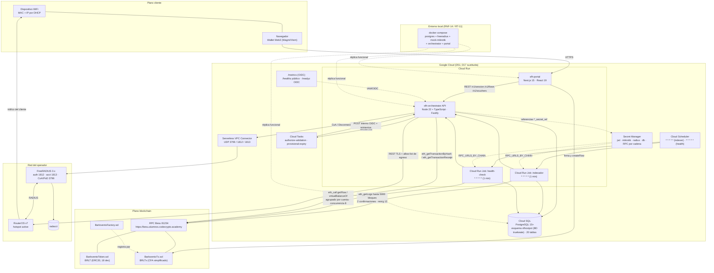

# Diagramas de Casos de Uso — SFhostpot (Superfluid Hotspot v1)

> **Propósito.** Representar visualmente la lista canónica de **19 casos de uso (CU-01…CU-19)** de
> [`casos_uso.md`](casos_uso.md): actores y relaciones, tres flujos críticos (CU-03, CU-08, CU-18),
> el ciclo de vida de la sesión y el despliegue/componentes.
> **Coherencia.** Los nombres de actores, casos de uso, estados y tablas son **exactamente** los de
> `casos_uso.md` y `diccionario_datos.md`. No se introduce ningún CU, actor ni estado nuevo.
> **Render.** Todos los bloques son Mermaid válidos (`graph`, `sequenceDiagram`, `stateDiagram-v2`,
> `flowchart`). Se recomienda Mermaid ≥ 10; los identificadores se declaran en ASCII y las etiquetas
> visibles van entre comillas.

---

## 1. Convenciones de los diagramas

| Elemento | Convención |
|---|---|
| Actor primario | Nodo con forma de actor (`U1(("Usuario con wallet"))`) |
| Caso de uso | Nodo rectangular redondeado con su ID y nombre canónico |
| `include` | Flecha discontinua etiquetada `«include»` |
| `extend` | Flecha discontinua etiquetada `«extend»` (desde la extensión hacia el caso base) |
| Sistema externo | Nodo con doble borde (`GW[["Gateway/NAS"]]`) |
| Estados de sesión | Valores del enum `hotspot_session_status`: `pending`, `provisional`, `active`, `degraded`, `revoking`, `revoked`, `closed`, `expired`, `failed` |
| Precedencia (no UML) | Flecha discontinua `«requiere»` para dependencias de datos (p. ej. CU-07 requiere sesión padre) |

> Las relaciones `«include»` y `«extend»` se limitan a las que tienen efecto funcional verificable.
> Las dependencias de datos se marcan como `«requiere»` para no falsear la semántica UML.

---

## 2. Diagrama de casos de uso

```mermaid
graph TB
    %% ---------- Actores ----------
    U1(("Usuario con wallet"))
    U2(("Usuario sin wallet"))
    OP(("Operador"))
    DPO(("Operador/DPO"))
    TD(("Titular de los datos"))
    SIS(("Sistema"))

    %% ---------- Sistemas externos ----------
    GW[["Gateway/NAS<br/>MikroTik REST · FreeRADIUS · mock"]]
    CH[["Chain<br/>BarloventoToken BRLT · BarloventoTx BRLTx"]]
    PG[["PostgreSQL 15+<br/>20 tablas"]]

    %% ---------- Casos de uso del usuario con wallet ----------
    CU01["CU-01 Vincular wallet y abrir sesión de portal"]
    CU02["CU-02 Envolver BRLT en BRLTx"]
    CU03["CU-03 Abrir stream y obtener acceso a internet"]
    CU04["CU-04 Consultar estado de sesión y consumo"]
    CU05["CU-05 Pausar y reanudar el stream"]
    CU06["CU-06 Cerrar el stream y finalizar el acceso"]
    CU07["CU-07 Generar voucher para equipos hijos"]

    %% ---------- Caso de uso del usuario sin wallet ----------
    CU08["CU-08 Canjear un voucher y conectar un equipo hijo sin wallet"]

    %% ---------- Casos de uso del operador ----------
    CU09["CU-09 Administrar gateways"]
    CU10["CU-10 Administrar tarifas y planes"]
    CU11["CU-11 Supervisar sesiones y auditoría"]
    CU12["CU-12 Revocar una sesión manualmente"]
    CU13["CU-13 Administrar vouchers"]
    CU14["CU-14 Administrar operadores y roles"]

    %% ---------- Caso de uso del DPO ----------
    CU15["CU-15 Atender el derecho de supresión RGPD"]

    %% ---------- Casos de uso del sistema ----------
    CU16["CU-16 Indexar eventos y validar flujos"]
    CU17["CU-17 Ordenar autorización y revocación al gateway"]
    CU18["CU-18 Gestionar insolvencia/pausa y revocación en cascada"]
    CU19["CU-19 Reconciliar router ↔ BD y health-check"]

    %% ---------- Asociaciones actor → CU ----------
    U1 --> CU01
    U1 --> CU02
    U1 --> CU03
    U1 --> CU04
    U1 --> CU05
    U1 --> CU06
    U1 --> CU07

    U2 --> CU08

    OP --> CU09
    OP --> CU10
    OP --> CU11
    OP --> CU12
    OP --> CU13
    OP --> CU14

    DPO --> CU15
    TD --> CU15

    SIS --> CU16
    SIS --> CU17
    SIS --> CU18
    SIS --> CU19

    %% ---------- include / extend ----------
    CU03 -.->|"«include»"| CU01
    CU03 -.->|"«include»"| CU02
    CU04 -.->|"«extend»"| CU03
    CU05 -.->|"«include»"| CU18
    CU06 -.->|"«include»"| CU17
    CU07 -.->|"«requiere»"| CU03
    CU08 -.->|"«include»"| CU17
    CU12 -.->|"«include»"| CU17
    CU10 -.->|"«requiere»"| CU09
    CU13 -.->|"«requiere»"| CU07
    CU16 -.->|"«include»"| CU17
    CU18 -.->|"«include»"| CU17
    CU19 -.->|"«extend»"| CU18

    %% ---------- Sistemas externos ----------
    CU17 --> GW
    CU18 --> GW
    CU03 --> CH
    CU06 --> CH
    CU16 --> CH
    CU09 --> PG
    CU10 --> PG
    CU11 --> PG
    CU15 --> PG
    CU19 --> PG

    classDef actor fill:#e8f0fe,stroke:#1a73e8,stroke-width:2px
    classDef cu fill:#ffffff,stroke:#333333,stroke-width:1px
    classDef ext fill:#f3e8fd,stroke:#7b1fa2,stroke-width:2px
    class U1,U2,OP,DPO,TD,SIS actor
    class CU01,CU02,CU03,CU04,CU05,CU06,CU07,CU08,CU09,CU10,CU11,CU12,CU13,CU14,CU15,CU16,CU17,CU18,CU19 cu
    class GW,CH,PG ext
```



### 2.1 Lectura de las relaciones

| Relación | Justificación funcional |
|---|---|
| CU-03 `include` CU-01 | No puede abrirse un stream sin binding `(wallet, MAC, IP, token)` previo. |
| CU-03 `include` CU-02 | El wrap 1:1 es condición de saldo para `createFlow` cuando la wallet no tiene BRLTx. |
| CU-04 `extend` CU-03 | La consulta de estado solo tiene sentido una vez existe una sesión de red. |
| CU-05 `include` CU-18 | `pauseFlow` se trata como **corte** (RNF-21) y dispara la cascada de revocación. |
| CU-06 `include` CU-17 | Cerrar el stream exige ordenar `disconnect` al gateway. |
| CU-07 `requiere` CU-03 | El voucher solo se emite si la sesión padre está `active`. |
| CU-08 `include` CU-17 | El canje concede acceso mediante un comando `authorize` con QoS. |
| CU-10 `requiere` CU-09 | Una tarifa no existe sin un gateway asociado. |
| CU-12 `include` CU-17 | La revocación manual usa el mismo motor de comandos. |
| CU-13 `requiere` CU-07 | Reemitir/administrar vouchers presupone el modelo de emisión de CU-07. |
| CU-16 `include` CU-17 | Una validación `valid` se materializa en un comando al gateway. |
| CU-18 `include` CU-17 | La cascada se materializa con el motor de comandos al gateway. |
| CU-19 `extend` CU-18 | La reconciliación detecta divergencias y extiende el caso con la corrección. |

---

## 3. Secuencia CU-03 — Abrir stream y obtener acceso a internet

> Escenario: petición **202 Accepted** con **tarea durable en Cloud Tasks**, validación en el *worker*,
> acceso provisional de 60 s y confirmación con el **mismo oráculo del modo** (`MEMPOOL_MODE`) + lectura
> directa (no por el indexador). Actores/participantes coherentes con `casos_uso.md` (§1).

```mermaid
sequenceDiagram
    autonumber
    actor U as Usuario con wallet
    participant P as Portal
    participant O as Orquestador
    participant TQ as Cloud Tasks
    participant DB as PostgreSQL
    participant C as Chain BarloventoTx
    participant I as Indexador
    participant G as Gateway/NAS

    Note over G,O: Antes: G llama a POST /v1/internal/hotspot/bind con HMAC (IP allow-list, ±60 s, nonce) y recibe bind_token de 5 min
    G->>O: POST /v1/internal/hotspot/bind (X-Gateway-Signature, gateway_id|mac|ip|ts|nonce)
    O-->>G: bind_token (JWT 5 min ligado a gateway|mac|ip)
    U->>P: Conecta wallet y firma challenge SIWE
    P->>O: POST /v1/session/bind (wallet, firma; MAC/IP del bind_token del NAS)
    O->>G: GET ip/hotspot/host + ip/dhcp-server/lease (verificar terna pre-autorización)
    G-->>O: MAC presente y IP del lease coincide
    O->>DB: INSERT device_binding (binding_hash, active)
    DB-->>O: binding_id
    O-->>P: 200 bound + JWT httpOnly
    P-->>U: Estado "wallet vinculada" + tarifa 50/10 Mbps + mínimo 1 h

    U->>C: createFlow(payout_wallet, flowRate >= tarifa, depósito 1 h)
    P->>O: POST /v1/session/authorize (portal_session_id, tx_hash)
    O->>O: Validar binding, tarifa, gateway, cuota provisional y unicidad flow↔sesión
    O->>DB: INSERT hotspot_session (pending, tx_hash)
    O->>TQ: Encolar tarea durable authorize-validation (OIDC, idempotency_key)
    O-->>P: 202 Accepted {hotspot_session_id, status: "pending"}
    P-->>U: "Validando transacción…"
    TQ->>O: POST /v1/internal/jobs/authorize/validate (reintentos)
    O->>C: MEMPOOL_MODE=visible ? eth_getTransactionByHash : eth_getTransactionReceipt, timeout 8 s
    C-->>O: tx (from, to, method, receiver, flowRate)
    O->>DB: UPDATE hotspot_session provisional (provisional_until = now + 60 s)
    O->>G: access_command authorize (provisional, 60 s, WISPr 50/10 Mbps)
    G-->>O: ACK Access-Accept / login OK
    O->>DB: UPDATE access_commands success + latency_ms
    P->>O: GET /v1/session/{id} (polling)
    O-->>P: provisional
    P-->>U: "Acceso provisional: 60 s"

    Note over O,TQ: Al vencer la ventana, la tarea durable provisional-expiry confirma con el MISMO oráculo del modo (MEMPOOL_MODE)
    TQ->>O: POST /v1/internal/jobs/provisional/expire (OIDC, reintentos)
    O->>C: mismo oráculo (getTransactionByHash o getTransactionReceipt) + getFlow(sender, receiver)
    C-->>O: oráculo presente y status Active con flowRate >= tarifa
    O->>G: access_command confirm (login persistente / CoA)
    G-->>O: ACK
    O->>DB: UPDATE hotspot_session active + confirmed_at
    O->>DB: INSERT session_health_checks (is_solvent = true)

    I->>C: eth_getLogs (Job de 1 min, rango <= 5000, confirmaciones = 2)
    C-->>I: FlowCreated / FlowUpdated (rate > 0)
    I->>DB: INSERT flow_events (UK tx_hash + log_index) — reconciliación del read model
    O-->>P: Estado "active"
    P-->>U: "Conectado, plan 50/10 Mbps"

    alt La tx no se incluye antes de 60 s
        O->>DB: UPDATE hotspot_session revoking -> revoked (disconnect_reason = timeout)
        O->>G: access_command disconnect
        G-->>O: ACK
        O-->>P: Estado "revoked"
    else Transacción inválida (from, receiver, método o rate)
        O->>DB: UPDATE hotspot_session failed
        O->>DB: INSERT audit_log flow.validation_rejected
        O-->>P: Estado "failed" (la petición ya respondió 202)
    else Gateway sin ACK tras 3 intentos (1/2/4 s + jitter)
        O->>DB: UPDATE hotspot_session failed; access_commands.status = timeout
        O->>DB: INSERT audit_log alert.authorize_failed
        O-->>P: Estado "failed" (fail-closed)
    end

    loop Cada 1 min mientras la sesión esté active (Job de health-check)
        O->>C: getFlow + virtualBalanceOf agrupados por cuenta (timeout 8 s)
        C-->>O: status, flowRate, virtualBalance
        O->>DB: INSERT session_health_checks
    end
```

---

## 4. Secuencia CU-08 — Canjear un voucher y conectar un equipo hijo sin wallet

> Escenario: canje atómico con `SELECT ... FOR UPDATE`, cupo **por sesión viva** (`max_children` 2 por
> defecto y `max_children_per_parent` 5), QoS al 50 % (25/5 Mbps) y dependencia del stream padre
> **solvente** (solvencia heredada).



---

## 5. Secuencia CU-18 — Insolvencia/pausa y revocación en cascada

> Escenario: detección por health-check (Job de 1 min) o por evento indexado, evaluación del predicado
> cerrado, revocación del padre y de **todos** los hijos con **doble métrica** (ACK p95 < 10 s desde la
> detección; corte p95 < 75 s desde el inicio de la insolvencia).

```mermaid
sequenceDiagram
    autonumber
    participant HC as Health-check Job 1 min
    participant I as Indexador
    participant C as Chain BarloventoTx
    participant O as Orquestador
    participant DB as PostgreSQL
    participant G as Gateway/NAS
    participant P as Portal

    par Detección periódica
        HC->>C: getFlow(sender, receiver) + virtualBalanceOf(sender)
        C-->>HC: status, flowRate, virtualBalance
    and Detección por evento
        I->>C: eth_getLogs (2 confirmaciones)
        C-->>I: FlowDeleted / FlowPaused / FlowUpdated(rate=0)
        I->>O: Evento confirmado
    end

    O->>O: Evaluar is_solvent = (status == Active) AND (flowRate >= min_rate) AND (virtualBalance > 0)

    alt is_solvent = false (insolvent / low_rate / paused / flow_deleted)
        O->>DB: INSERT session_health_checks (is_solvent = false, action = disconnect)
        O->>DB: UPDATE hotspot_session (padre) status = revoking
        O->>DB: SELECT hijos WHERE parent_hotspot_session_id = padre
        par Revocación del padre
            O->>G: access_command disconnect (padre, reason)
            G-->>O: ACK (o timeout 2 s)
        and Revocación en cascada de hijos
            O->>G: access_command disconnect (hijo 1, reason)
            G-->>O: ACK
            O->>G: access_command disconnect (hijo 2, reason)
            G-->>O: ACK
        end
        O->>DB: UPDATE hotspot_session padre e hijos status = revoked
        O->>DB: UPDATE device_bindings status = revoked
        O->>DB: UPDATE vouchers status = revoked (padre sin stream; cascada única)
        O->>DB: INSERT audit_log session.auto_revoked (causa, session_id)
        O->>O: Registrar revocation_command_latency_ms y service_cutoff_latency_ms
        O-->>P: Notificar "sesión finalizada por insolvencia/pausa"
        P-->>P: Mostrar motivo y saldo restante

    else is_solvent = true
        O->>DB: INSERT session_health_checks (is_solvent = true, action = none)
        O->>O: Mantener sesión y programar el siguiente ciclo (1 min)
    end

    alt Sin ACK tras 3 intentos (1/2/4 s + jitter) y gracia de 30 s
        O->>DB: UPDATE hotspot_session status = degraded
        O->>G: Fallback CoA/PoD ↔ REST (metadata.transports)
        O->>G: Corte de emergencia (address-list)
        O->>DB: INSERT access_commands status = timeout
        O->>DB: INSERT audit_log action = alert.revocation_no_ack (severity critical)
        O->>O: alerts_total{type="revocation_no_ack"} += 1
    end

    alt RPC no responde en 8 s tras 3 reintentos
        O->>DB: Registrar ciclo fallido e incrementar healthcheck_incomplete_cycles_total
        O->>O: No revocar a ciegas (modo degradado)
        O->>DB: INSERT audit_log action = alert.rpc_degraded (severity warning)
    end
```

---

## 6. Ciclo de vida de la sesión

> **Ciclo de vida canónico (H2-08), idéntico en `casos_uso.md` y `documento_tecnico.md`.** Estados del
> enum `hotspot_session_status`; terminales: `revoked`, `closed`, `expired` y `failed`. `pending` lo
> crea `POST /v1/session/authorize` (202, CU-03) o el canje (CU-08); `provisional` lo concede el
> *worker* tras validar la tx; `expired` solo lo produce el Job de caducidad (CU-19).



### 6.1 Matriz estado ↔ evento ↔ efecto

| Desde | Evento/condición | Hacia | Efecto verificable |
|---|---|---|---|
| `[*]` | `POST /v1/session/authorize` aceptado (202) | `pending` | `hotspot_sessions` con `tx_hash`; el *worker* valida |
| `pending` | worker valida tx + `authorize` ACK | `provisional` | `provisional_until = authorized_at + 60 s` |
| `pending` | validación de tx inválida o `authorize` sin ACK | `failed` | Sin `access_command` de autorización; `audit_log` con motivo |
| `pending` | caducidad sin servicio | `expired` | Job de caducidad; cuota de provisional liberada |
| `provisional` | oráculo del modo presente + `getFlow` + `confirm` ACK | `active` | `confirmed_at`, `flow_subscriptions` `active` |
| `provisional` | 60 s sin oráculo del modo | `revoking` → `revoked` | `disconnect` + `disconnect_reason='timeout'` |
| `provisional` | `FlowPaused` | `revoking` → `revoked` | `disconnect_reason='flow_paused'` |
| `active` | insolvencia/pausa/`FlowDeleted` | `revoking` → `revoked` | Cascada a hijos + `audit_log` |
| `active` | revocación manual | `revoking` → `revoked` | `disconnect_reason='admin'` |
| `active` | `closeFlow` + ACK (cierre voluntario) | `revoking` → `closed` | `settle`/`claimSettled`, hijos `closed`, vouchers `expired`; el ACK del gateway cierra en `revoking` |
| `active` | `disconnect` sin ACK | `degraded` | Reintentos, fallback, `alert.revocation_no_ack` |
| `degraded` | ACK | `revoked` | `revoked` solo con ACK |
| `degraded` | segunda lectura solvente + ACK | `active` | Recuperación registrada |
| `revoking` | ACK del gateway | `revoked`/`closed` | `revocation_command_latency_ms` y `service_cutoff_latency_ms` |
| `revoking` | sin ACK tras 3 intentos | `degraded` | Fallback + corte de emergencia |

---

## 7. Diagrama de despliegue y componentes

> Coherente con D17 (sustituida por D51: esquema aislado `sfhostpot` en la BD `truekeate`; base
> dedicada al inicio de Fase 3) y southamerica-east1, D29/D42 (Jobs + Scheduler con cadencia de 1 min),
> D44/V2-05 (Cloud Tasks durable para validación y caducidad del provisional, Cloud Run min 0),
> D44 (lecturas agrupadas por cuenta), RT-11 (`docker-compose` local, verificado en Fase 4) y
> `entornos_globales.md` §8.



### 7.1 Componentes lógicos y su correspondencia con los CUs

> **Tabla única (H2-39):** reproduce **idéntica** la de `documento_tecnico.md` §7.1, que es la fuente
> canónica. Cualquier cambio debe aplicarse en ambos documentos y **verificarse manualmente en esta
> fase**; el validador automático de CI cubre solo los artefactos de datos (V2-08).

| Componente / módulo | Casos de uso | RF | RNF | RT |
|---|---|---|---|---|
| **`sfh-portal`** — terna MAC/IP verificada, wallet, SIWE, wrap, stream, estado, pausa/cierre, vouchers | CU-01, CU-02, CU-03, CU-04, CU-05, CU-06, CU-07, CU-08 | RF-01, RF-02, RF-03, RF-04, RF-05, RF-06, RF-17, RF-25 | RNF-13, RNF-16, RNF-25 | RT-05 |
| **`sfh-sc`** — BRLT/BRLTx/Factory, CFA, CEI | CU-02, CU-03, CU-05, CU-06, CU-16 | RF-05, RF-19, RF-22 | RNF-01, RNF-21, RNF-27 | RT-01, RT-02, RT-09 |
| **Orquestador · API y sesión** | CU-01, CU-04, CU-05, CU-06, CU-12 | RF-01, RF-02, RF-03, RF-06, RF-14, RF-17 | RNF-10, RNF-12, RNF-25 | RT-03 |
| **Orquestador · indexador** | CU-16 | RF-07, RF-08 | RNF-05, RNF-20 | RT-03 |
| **Orquestador · validador** | CU-03, CU-16, CU-18 | RF-09, RF-12, RF-19 | RNF-04, RNF-20, RNF-21 | RT-03 |
| **Orquestador · sesiones y solvencia** | CU-03, CU-04, CU-05, CU-06, CU-12, CU-18, CU-19 | RF-05, RF-11, RF-13, RF-19, RF-27 | RNF-03, RNF-07, RNF-08 | RT-03, RT-04 |
| **Orquestador · vouchers** | CU-07, CU-08, CU-13, CU-18 | RF-25, RF-26, RF-27 | RNF-26 | RT-03, RT-04 |
| **Orquestador · `GatewayAdapter` (REST/RADIUS/mock)** | CU-09, CU-17, CU-19 | RF-10, RF-11, RF-16, RF-20, RF-23, RF-26 | RNF-03, RNF-06, RNF-19 | RT-06, RT-07 |
| **Orquestador · admin/RBAC/auditoría** | CU-09, CU-10, CU-11, CU-12, CU-13, CU-14 | RF-15, RF-18, RF-23 | RNF-02, RNF-10, RNF-18, RNF-24 | RT-03, RT-04 |
| **Orquestador · observabilidad y notificaciones** | CU-11, CU-18, CU-19 | RF-13, RF-24 | RNF-08, RNF-09, RNF-17, RNF-22, RNF-23 | RT-12 |
| **Orquestador · accounting RADIUS** | CU-06, CU-17, CU-19 | RF-21 | RNF-07 | RT-07 |
| **`sfh-infra`** — Cloud Run Jobs, Scheduler, Cloud SQL, Secret Manager, VPC | CU-09, CU-15, CU-16, CU-18, CU-19 | RF-07, RF-13, RF-15 | RNF-12, RNF-14, RNF-17, RNF-18 | RT-04, RT-08, RT-11 |
| **`sfh-sim`** — mock MikroTik/RADIUS | CU-09, CU-17, CU-19 | RF-16, RF-23 | RNF-14 | RT-11 |
| **Transversal (calidad, CI y legal)** | Todos | Todos | RNF-11, RNF-14, RNF-15, RNF-16 | RT-10 |

---

## 8. Coherencia con `casos_uso.md`

| Verificación | Resultado |
|---|---|
| Nº de CUs representados | **19/19** (CU-01…CU-19), sin renombrar |
| Nombres de actores | **6** exactos: Usuario con wallet, Usuario sin wallet, Operador, Operador/DPO, **Titular de los datos**, Sistema |
| Estados del ciclo de vida | **9** exactos del enum `hotspot_session_status` (+ estado inicial `[*]`), con productor y criterio por transición (§6.1) |
| Rutas | `/v1/session/*`, `/v1/portal/sessions`, `/v1/internal/hotspot/bind`, `/v1/internal/jobs/*`, `/v1/vouchers/*`, `/v1/flows/*`, `/v1/admin/*` (D48) |
| Tablas citadas | `portal_sessions`, `device_bindings`, `hotspot_sessions`, `session_health_checks`, `flow_events`, `flow_subscriptions`, `access_commands`, `vouchers`, `voucher_redemptions`, `operators`, `audit_log`, `radacct` |
| Métricas citadas | `revocation_command_latency_ms`, `service_cutoff_latency_ms`, `authorize_validation_latency`, `reconciliation_divergences`, `healthcheck_latency_ms`, `healthcheck_incomplete_cycles_total`, `alerts_total{type,severity}` |
| Constantes | 60 s provisional · **health-check 1 min** · 2 bloques · 12 bloques · 5 000 bloques · 50/10 Mbps · 25/5 Mbps · 12 chars · **2 hijos (máx. 10) y `max_children_per_parent` 5** · 90 días · 5 intentos/15 min · 8 s RPC · 2 s timeout · 3 reintentos 1/2/4 s · 30 s gracia · lease 60 s renovado 20 s · p95 ACK 10 s · p95 corte 75 s |
| Canal hotspot→API | `POST /v1/internal/hotspot/bind` con HMAC ±60 s, nonce y allow-list → `bind_token` 5 min; verificación pre-autorización en `/ip/hotspot/host` + lease (D45) |
| Aviso de privacidad | Aceptación (`notice_version`+`notice_accepted_at`) **antes** de `POST /v1/portal/sessions`; 409 `privacy_notice_missing` si falta (D52) |

### 8.1 Referencias cruzadas

- Requisitos y decisiones: [`requerimientos.md`](requerimientos.md) (RF/RNF/RT, D1–D56) y
  [`registro_decisiones.md`](registro_decisiones.md) (P-01…P-08 y RB-31…RB-37, D53).
- Datos y estados: [`diccionario_datos.md`](diccionario_datos.md), [`diagrama_er.md`](diagrama_er.md),
  [`base_datos.sql`](base_datos.sql).
- Decisiones de auditoría: [`resolucion_auditoria_v1.md`](resolucion_auditoria_v1.md)
  (H-01, H-02, H-03, H-04, H-05, H-13, H-16, H-19, H-20, H-38; D20–D41).
- Arquitectura y flujos: [`propuesta_adaptacion.md`](propuesta_adaptacion.md) §4.
- Entornos y despliegue: [`entornos_globales.md`](entornos_globales.md) §8.
