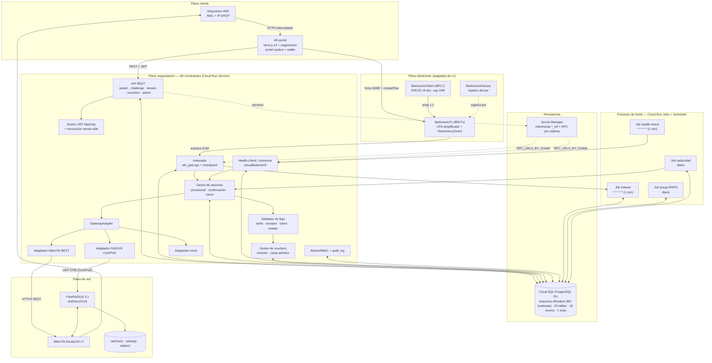
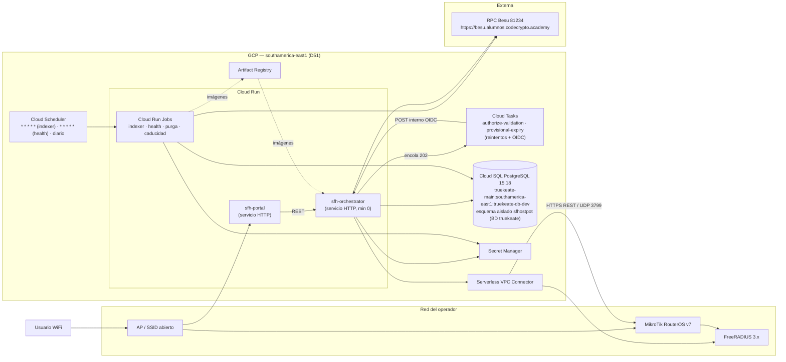

# Documento Técnico — SFhostpot (Superfluid Hotspot v1)

> **Proyecto**: SFhostpot — WiFi *pay-as-you-go* con Super Token propio **BRLTx** y CFA simplificado,
> orquestador/middleware y control de gateway MikroTik REST / RADIUS.
> **Fase**: 2 (Auditoría) — documento técnico previo a la Fase 3 (Desarrollo).
> **Fuentes de verdad** (no se redefine nada que ya esté en ellas):
> [`requerimientos.md`](requerimientos.md) (27 RF · 27 RNF · 12 RT · D1–D41),
> [`diccionario_datos.md`](diccionario_datos.md) y [`diagrama_er.md`](diagrama_er.md) (modelo on-chain
> BRLT/BRLTx + 20 tablas PostgreSQL), [`propuesta_adaptacion.md`](propuesta_adaptacion.md)
> (arquitectura y reutilización de v1), [`resolucion_auditoria_v1.md`](resolucion_auditoria_v1.md)
> (H-01…H-38 y D20–D41) y [`entornos_globales.md`](entornos_globales.md) (GCP, Cloud SQL, variables).
> **Casos de uso**: lista canónica CU-01…CU-19 (documento `casos_uso.md`, fuente canónica de la fila
> "Requisitos" y de la matriz §5); aquí solo se usan para trazabilidad, sin modificarlos.
> **Convención**: lo que no está fijado en las fuentes se marca **«Asunción»**. Este documento no
> contiene código de implementación: solo contratos de API, modelos y diagramas.
> **Decisiones aplicadas (2026-10-17):** D42–D56, con propietario y fecha en
> [`registro_decisiones.md`](registro_decisiones.md) (D53). El contrato de API de §3 está **congelado**
> al inicio de H2 (D48); los criterios de rendimiento viven en el *spec* k6 de §5.9 (D50).

---

## 1. Visión general y alcance

### 1.1 Qué es SFhostpot

SFhostpot convierte el acceso WiFi en un **servicio medido en tiempo real**. El dispositivo del
visitante se asocia a un SSID abierto; el portal cautivo captura su **MAC + IP** (`RF-01`), el usuario
conecta una wallet Web3 (`RF-02`), firma un challenge SIWE que liga `(wallet, MAC, IP, token)`
(`RF-03`) y envuelve su token subyacente **BRLT** en el Super Token **BRLTx** (`RF-04`). Después abre
un *flow* CFA hacia la `payout_wallet` de la tarifa del gateway (`RF-05`) con
`flowRate >= price_per_second_wei`. Mientras el flujo permanezca **activo y solvente**, el orquestador
mantiene autorizado el dispositivo en el router (MikroTik REST o RADIUS CoA/PoD); cuando el flujo cae,
se pausa o la garantía se agota, ordena la desconexión (`RF-11`, `RF-19`).

El sistema tiene **tres planos** (heredados de [`propuesta_adaptacion.md`](propuesta_adaptacion.md) §4):

1. **Plano cliente**: dispositivo WiFi + portal cautivo Next.js con wallet.
2. **Plano blockchain**: `BarloventoToken` (BRLT), `BarloventoTx` (BRLTx, motor CFA simplificado) y
   `BarloventoFactory`.
3. **Plano de orquestación**: API REST, indexador, validador, gestor de sesiones/vouchers,
   health-check, adaptadores de gateway y PostgreSQL.

### 1.2 Alcance incluido en v1

Derivado de [`requerimientos.md`](requerimientos.md) §4 y `propuesta_adaptacion.md` §6.1:

- Motor CFA adaptado de v1 (`BarloventoToken`/`BarloventoTx`/`BarloventoFactory`) desplegado en la red
  de desarrollo, con wrap 1:1 y flujo `wallet → payout` a `flowRate >= tarifa` (`RF-22`, `D2`).
- Portal cautivo con captura de MAC/IP, conexión de wallet, challenge firmado, wrap y apertura de
  stream (`RF-01`…`RF-06`).
- Vouchers **padre/hijo** (P5/D18): la wallet padre abre el stream y genera un código de 12 caracteres
  Crockford Base32 (SHA-256) que habilita hasta **`max_children` (2 por defecto)** hijos sin wallet al
  **50 %** de velocidad mientras dure el stream del padre, con **cupo por sesión viva** (se libera al
  desconectar y permite reconexión) y límite global `max_children_per_parent` (default 5) en
  `gateway_tariffs` (`RF-25`, `RF-26`, `RF-27`, `D55`).
- Orquestador con API REST, indexador por *polling* con checkpoint, validador de flujo, gestor de
  sesiones, health-check y auditoría (`RF-07`…`RF-14`, `RF-18`).
- **Ambos** adaptadores de gateway (MikroTik REST **y** RADIUS CoA/PoD) más el adaptador `mock`
  obligatorio, sin hardware real (`RF-10`, `RF-11`, `RF-16`, `RF-23`, `D3`, `D16`, `P3b`).
- Acceso **provisional 60 s** validado por el *worker* (la petición responde **202 Accepted** y deja
  una tarea durable en **Cloud Tasks**), confirmado al vencer la ventana con el **mismo oráculo del
  modo** (`MEMPOOL_MODE`: `eth_getTransactionByHash` o `eth_getTransactionReceipt`) + `getFlow`/
  `getAccountInfo` (sondeo directo, sin depender del indexador) y revocación con **doble métrica**:
  ACK p95 < 10 s desde la detección y corte p95 < 75 s desde el inicio de la insolvencia (`RF-12`,
  `D5`, `D21`, `D23`, `D42`, `D43`, `D44`, `D56`).
- Anti-MAC-spoofing con **canal autenticado hotspot→API**: el NAS llama a
  `POST /v1/internal/hotspot/bind` con HMAC-SHA256 desde IP en allow-list y recibe un `bind_token` de
  5 min; la terna se verifica **antes de autorizar** en `ip/hotspot/host` y `ip/dhcp-server/lease`
  (`ip/hotspot/active` solo para reconciliación), más re-autenticación al cambiar IP o MAC
  (`RF-03`, `RF-17`, `D6`, `D45`, H2-25).
- PostgreSQL con **20 tablas**, migraciones, seeds, auditoría de comandos e idempotencia (`RT-04`).
- Observabilidad (logs JSON, `/metrics` y `/readyz` **no públicos**, `/healthz` público), RGPD con
  aviso **antes** de capturar MAC/IP, matriz de retención (PII 30 días, `audit_log` de seguridad 12
  meses con MAC/IP seudonimizadas, logs con PII cifrados) y disclaimer legal (`RNF-09`, `RNF-12`,
  `RNF-16`, `RT-12`, `D52`, H2-41).
- Despliegue **todo en cloud**: Cloud Run (servicios y Jobs) + Cloud SQL (`D17`, sustituida por `D51`/`P9`).
- Un solo operador en v1, con esquema preparado para multi-tenant (`D11`) y RBAC de **5 roles**
  (`admin`, `operator`, `readonly`, `auditor`, `dpo`) con API keys persistidas en `operators` (`D49`).

### 1.3 Exclusiones explícitas

De [`requerimientos.md`](requerimientos.md) §4 y `propuesta_adaptacion.md` §6.2:

- Stablecoin real en mainnet y despliegue del protocolo Superfluid soberano completo (Host/CFA/ACL
  oficiales); **no** se integra el SDK real de Superfluid en v1 (`D2`).
- Planes de datos facturados, panel de autogestión del ISP, multi-tenant comercial, TOGA/liquidadores
  reales en mainnet (en desarrollo se emula el cierre por insolvencia).
- QoS **por plan** comercial más allá del modelo base 50/10 Mbps y su porcentaje para hijos (`D25`).
- 802.1X o agente de dispositivo en el cliente: el anti-spoofing es binding firmado, no control de
  puerto (`D6`, `RF-17`).
- Validación end-to-end contra router/NAS físico: no hay hardware (`P3b`); los adaptadores reales
  quedan implementados y verificados solo contra simuladores (ver §9).

### 1.4 Stakeholders y actores técnicos

Los de [`requerimientos.md`](requerimientos.md) §4.1 (director/titular, operador ISP, usuario final,
proveedor de red/NAS, operador de red blockchain, auditor, responsable de protección de datos y el
huésped sin wallet incorporado por H-14). A efectos de este documento, los actores técnicos son:
**portal**, **orquestador**, **indexador**, **jobs de fondo**, **gateway/NAS**, **chain** y **operador
administrador**.

---

## 2. Arquitectura

### 2.1 Diagrama de componentes



### 2.2 Diagrama de despliegue



> **Nota de red**: en Cloud Run, el tráfico saliente RADIUS (UDP 3799/1812/1813) exige
> **Serverless VPC Connector** hacia la red del NAS con firewall que permita esos puertos; sin ese
> alcance solo es viable la Opción A (REST MikroTik), tal como registran `D17` (sustituida por `D51`)
> /`P9` y [`entornos_globales.md`](entornos_globales.md) §8. Es un **riesgo residual** (§9).
> **Residencia de datos (D51):** lo validado es un **esquema aislado `sfhostpot` dentro de la base
> `truekeate`** de la instancia `truekeate-db-dev`, en **southamerica-east1**; **no** es una base real
> separada. La **base dedicada `sfhostpot`** se creará al inicio de Fase 3 y se revalidará el DDL;
> `d920` no aplica. La residencia en LatAm se acepta como decisión documentada y se refleja en el aviso
> de privacidad y en la EIPD (`RNF-12`/`RNF-25`). **D17 queda sustituida por D51.**

### 2.3 Módulos y responsabilidades

#### 2.3.1 `sfh-sc` — Contratos Solidity

| Aspecto | Definición |
|---|---|
| Contratos | `BarloventoToken` (BRLT), `BarloventoTx` (BRLTx), `BarloventoFactory` (`RF-22`, `D2`) |
| Origen | Adaptación y renombrado de `Euro.sol`, `EuroX.sol`, `EuroxFactory.sol` de v1; misma interfaz CFA |
| Stack | Solidity 0.8.28 · Foundry 1.8.3 · OpenZeppelin 5.1.0 (`RT-01`) |
| Funciones CFA | `upgradeTo`, `createFlow`, `pauseFlow`, `resumeFlow`, `closeFlow`, `settle`, `claimSettled`, `getFlow`, `getAccountInfo`, `virtualBalanceOf` |
| Eventos | `FlowCreated`, `FlowPaused`, `FlowResumed`, `FlowClosed`, `Settled`, `Claimed`; el indexador los normaliza a `flow_events.event_type` |
| Seguridad | `ReentrancyGuard` (OZ 5.1) + patrón **CEI** en toda función que transfiere o actualiza saldos (`RNF-27`, `D34`/`D40`); sin `delegatecall` ni `selfdestruct` (`RNF-01`) |
| Modelo | `realBalanceOf`, `virtualBalanceOf` (vista), `earnedUnclaimed`, `_flows[sender][receiver]`, `_aggregators[account]` (ver §4.2) |
| Restricción | No se modifica la semántica de v1; el renombrado conserva ABI y comportamiento |

**Invarianzas que el orquestador puede asumir** (documentadas en
[`diccionario_datos.md`](diccionario_datos.md) Parte A): `Σ realBalanceOf == totalSupplyX`; un flujo
pausado retiene garantía y no devenga; `depositTotal = netOutflowGarantizado × 3600`; `pendingDeficit`
refleja wei impagados tras `settle`. La autoridad del estado de los flujos es la blockchain; PostgreSQL
solo mantiene el *read model* `flow_subscriptions`.

#### 2.3.2 `sfh-orchestrator` — Middleware

| Submódulo | Responsabilidad | Requerimientos |
|---|---|---|
| **API REST** | Alta de sesión, challenge, vínculo wallet, estado/consumo, cierre, vouchers, endpoints admin, `healthz`/`readyz`/`metrics` | `RF-14`, `RT-12` |
| **Sesión/JWT** | Emisión de JWT HS256 corto en cookie `httpOnly`, fila revocable en `portal_sessions`, rotación | `D7`, `RNF-25` |
| **Indexador** | *Polling* con `eth_getLogs` por rangos, checkpoint persistente, confirmaciones = 2, reorg = 12 con compensación, lease + CAS; enumeración data-driven de contratos y RPC por `chain_id` | `RF-07`, `RNF-05`, `RNF-20`, `D8`, `D29`, H2-21, H2-23 |
| **Validador** | `flowRate >= tarifa`, sender ligado al binding, receptor = `payout_wallet`, token esperado, `status == Active`, saldo/nonce ejecutables | `RF-08`, `RF-09`, `RF-12`, `RNF-21` |
| **Gestor de sesiones** | Binding → `hotspot_sessions` (ciclo `pending`→`provisional`→`active`→`degraded`→`revoking`→terminal), provisional 60 s, confirmación con el oráculo único del modo, cierre, cascada padre→hijos | `RF-01`…`RF-06`, `RF-12`, `RF-19`, `RF-27`, `RNF-07` |
| **Health-check** | Cada **1 min**: solvencia por `virtualBalanceOf` con lecturas agrupadas por cuenta (multicall/batch, concurrencia máx. 8, ciclos incompletos como métrica) y estado del gateway; corrige divergencias y dispara revocación | `RF-13`, `RF-19`, `RNF-03`, `RNF-07`, `D42`, `D44` |
| **Gestor de vouchers** | Emisión (12 chars Crockford Base32, SHA-256, 90 días), canje atómico, cupo, QoS y cascada | `RF-25`…`RF-27`, `RNF-26`, `D31` |
| **Adaptadores de gateway** | `GatewayAdapter` con MikroTik REST, RADIUS CoA/PoD y `mock`; idempotencia y reintentos | `RF-10`, `RF-11`, `RF-16`, `RF-20`, `RF-23`, `RF-26`, `RNF-19` |
| **Admin/RBAC** | Gateways, tarifas (incl. `max_children_per_parent`), vouchers, operadores y 5 roles; API keys persistidas (`api_key_*`) + MFA opcional; auditoría | `RF-15`, `RF-18`, `RNF-10`, `RNF-24`, `D49` |
| **Observabilidad** | Logs JSON con `session_id`/`tx_hash`, métricas nombradas, alertas, runbook | `RNF-09`, `RNF-22`, `RT-12` |
| **Accounting RADIUS** | Registro de inicio/fin, octetos y causa de terminación en `radacct`; **SHOULD**: no se exige camino FreeRADIUS→Cloud SQL (D46) | `RF-21` (SHOULD) |

**Modelo de ejecución (D29 + D42 + D44/V2-05)**: la API es un **servicio** Cloud Run; indexador,
health-check, purga y caducidad son **Cloud Run Jobs** disparados por Cloud Scheduler, **sin procesos
always-on**, con **cadencia mínima real de 1 minuto** (`* * * * *`). **No existen ciclos de 4 s ni de
15 s.** La validación de `authorize` y la caducidad del provisional **no** viven en la instancia: cada
202 **encola una tarea durable** en **Cloud Tasks** —colas `authorize-validation` y
`provisional-expiry`— que invoca los endpoints internos con **OIDC y reintentos**; la idempotencia se
ancla en `access_commands.idempotency_key`. Cloud Run puede seguir con **min 0** y una instancia puede
apagarse tras el 202 sin perder la validación ni la confirmación. La exclusión mutua entre ejecuciones
del indexador se resuelve con **lease** de 60 s renovado cada 20 s (`leased_by`, `lease_expires_at`),
**CAS optimista** (`version`) y fencing en cada escritura (`H-11`/P-02).

**Configuración data-driven (H2-23):** indexador y health-check **enumeran los gateways activos**
(`chain_id` + `super_token_address`) y resuelven el RPC por cadena desde un mapa
`chain_id → RPC_URL` (tabla/Secret Manager). Dar de alta un gateway en otra cadena no exige redeploy;
la activación/desactivación refresca la configuración en el siguiente ciclo.

#### 2.3.3 `sfh-portal` — Portal cautivo

| Aspecto | Definición |
|---|---|
| Stack | Next.js 15 + React 19 + TypeScript + Tailwind + wagmi + viem (`RT-05`) |
| Origen | Adaptación de `web/` de v1 (patrones de wallet, validación, a11y, polling) |
| Pantallas | Captura MAC/IP y aviso de privacidad · conexión de wallet · firma SIWE · wrap BRLT→BRLTx · apertura de stream con coste/segundo y tiempo estimado · estado de sesión · generación de voucher (padre) · canje de voucher (hijo) · cierre |
| Requerimientos | `RF-01`…`RF-06`, `RF-25`, `RNF-13`, `RNF-16`, `RNF-25` |
| Cotas | 0 violaciones axe A/AA, i18n es/en, matriz de navegadores/SO (`H-19`) |

#### 2.3.4 `sfh-infra` — Infraestructura

| Aspecto | Definición |
|---|---|
| Cloud Run | Servicios `sfh-orchestrator` y `sfh-portal`; Jobs `indexer`, `health`, `purge`, `expiry`; **min 0** |
| Cloud Scheduler | `* * * * *` (indexer, cada 1 min), `* * * * *` (health, cada 1 min), diario (purga y caducidad) — D42 |
| Cloud Tasks | Colas `authorize-validation` y `provisional-expiry` con reintentos y OIDC hacia `/v1/internal/jobs/*` (D44/V2-05); sustituyen a cualquier worker en proceso |
| Cloud SQL | PostgreSQL 15+ (validado 15.18), **esquema aislado `sfhostpot` en la BD `truekeate`** de `truekeate-db-dev` (southamerica-east1, D51; base dedicada al inicio de Fase 3), backup diario 30 días, RTO ≤ 4 h / RPO ≤ 24 h (`RNF-17`, `D26`) |
| Secret Manager | `sfhostpot-jwt-secret`, `sfhostpot-mikrotik-password`, `sfhostpot-radius-secret`, `sfhostpot-db-password`; en BD solo referencias `*_ref` (`RNF-18`, `H-08`) |
| Red | Serverless VPC Connector + firewall UDP 3799/1812/1813 hacia el NAS (`D17`, sustituida por `D51`) |
| Local | `docker-compose` con Postgres, FreeRADIUS, mock MikroTik, orquestador y portal (`RNF-14`, `RT-11`) |

#### 2.3.5 `sfh-sim` — Simuladores

| Aspecto | Definición |
|---|---|
| Componentes | Mock MikroTik REST (autorizar/desconectar/health) y mock RADIUS (Access-Accept, CoA-ACK, Disconnect-ACK, accounting) |
| Uso | CI, Vitest, Playwright y demos sin hardware (`RF-23`, `D16`, `P3b`) |
| Contrato | Implementa el mismo `GatewayAdapter` y devuelve los mismos ACK/códigos que el adaptador real |
| Límite | No valida comportamiento del firmware RouterOS ni del NAS: es un sustituto determinista, no una prueba de integración real (§9) |

---

## 3. Contratos de API del orquestador

> **Naturaleza de esta sección (D48)**: el contrato **OpenAPI v1 queda congelado al inicio de H2** con
> prefijo `/v1/...`, propietario (Backend) y fecha (2026-10-17); estos paths, métodos y códigos son
> normativos y los Gherkin de `casos_uso.md` se alinean con ellos. Incluye los endpoints de pausa y
> reanudación (`/v1/session/pause`, `/v1/session/resume`) y el catálogo cerrado de `reason` de §3.9.
> Las rutas son relativas a `NEXT_PUBLIC_API_URL` / `API_PORT`. Cualquier cambio incompatible exige
> `/v2` o una ampliación aditiva registrada en `registro_decisiones.md`.

### 3.1 Convenciones

| Elemento | Convención (OpenAPI v1 congelado, D48) |
|---|---|
| Formato | JSON `application/json; charset=utf-8`; fechas ISO-8601 UTC; importes wei como **string decimal** (nunca number) |
| Versión | Prefijo `/v1`; cambios incompatibles → `/v2` |
| Identificadores | UUID v4 en rutas; `idempotency_key` en cabecera `Idempotency-Key` para comandos |
| Errores | `{ "error": { "code": "...", "message": "...", "request_id": "..." } }`; `code` pertenece al **catálogo cerrado de §3.9** y `reason` es un alias estable del mismo catálogo; sin detalles internos (`RNF-10`) |
| Paginación | `?limit=&cursor=` con cursor opaco |
| Correlación | `X-Request-Id` aceptado o generado; se propaga a `audit_log` y logs JSON (`RNF-09`) |

### 3.2 Autenticación y autorización por tipo de ruta

| Tipo | Mecanismo | Aplica a |
|---|---|---|
| **Interno hotspot (NAS)** | Solo desde **IP de origen en allow-list** + `X-Gateway-Signature: HMAC-SHA256(secreto_del_gateway, gateway_id\|mac\|ip\|ts\|nonce)`, ventana de **±60 s** y **nonce anti-replay**; responde `bind_token` (JWT de **5 min** ligado a `gateway\|mac\|ip`). Firma inválida o IP no permitida → **403** | `POST /v1/internal/hotspot/bind` |
| **Portal autenticado por `bind_token`** | `bind_token` obligatorio; la MAC/IP **no se aceptan del cuerpo** (se toman del token) y se verifican **antes de autorizar** en `/ip/hotspot/host` y `/ip/dhcp-server/lease` (D45). Exige `notice_version` vigente y `notice_accepted_at` (409 `privacy_notice_missing`). Rate-limit con **almacén compartido** (BD/Redis) por IP + MAC observada | `POST /v1/portal/sessions` |
| **Público limitado** | Sin credencial de sesión: `/healthz` y login de operador. Rate-limit con **almacén compartido** | `/healthz`, `POST /v1/admin/login` |
| **Sesión de portal** | JWT HS256 corto en cookie `httpOnly` + `SameSite=Lax` + token CSRF; fila revocable en `portal_sessions` | challenge, bind, revalidate, estado, pause/resume/close, vouchers del padre |
| **Canje de voucher** | Público limitado + rate-limit 5 intentos/IP+MAC **observada**/15 min (`RNF-26`, H2-28) | `POST /v1/vouchers/redeem` |
| **API key de operador** | `Authorization: Bearer <api-key>` + RBAC (`admin`/`operator`/`readonly`/`auditor`/`dpo`) + MFA opcional; la key se valida contra `operators.api_key_hash` y respeta `api_key_scopes`, `api_key_expires_at` y `api_key_revoked_at` (D49) | rutas `/v1/admin/*` (`RNF-24`) |
| **Interno** | OIDC de Cloud Scheduler/Jobs o token de servicio | jobs, reconciliación, `/metrics` y `/readyz` (H2-41) |

### 3.3 Endpoints de sesión y portal

| Método | Ruta | Auth | Propósito | Requerimientos |
|---|---|---|---|---|
| `POST` | `/v1/internal/hotspot/bind` | Interno hotspot (HMAC) | Alta del canal NAS→API: valida firma HMAC-SHA256, `ts` ±60 s, nonce y IP de origen; devuelve `bind_token` JWT de 5 min ligado a `gateway_id\|mac\|ip`. No crea PII | `RF-01`, `RF-17`, `D45` |
| `POST` | `/v1/portal/sessions` | Portal autenticado por `bind_token` | Alta de `portal_session` con `{bind_token, user_agent, notice_version, notice_accepted_at}`; **sin `mac_address`/`ip_address`** (se toman del token). Verifica la MAC en `/ip/hotspot/host` y `/ip/dhcp-server/lease` (409 `mac_not_on_nas`) y persiste `notice_version`/`notice_accepted_at`. Devuelve `portal_session_id`, token de portal (cookie) y caducidad | `RF-01`, `RF-14`, `RF-17`, `D45`, `D52` |
| `GET` | `/v1/portal/sessions/{id}` | Sesión portal | Estado del portal (`pending`, `challenge_issued`, `wallet_linked`, `bound`, `consumed`, `expired`, `rejected`) y datos del binding | `RF-06`, `RF-14` |
| `POST` | `/v1/session/challenge` | Sesión portal | Emite un `nonce` de un solo uso y el mensaje EIP-4361 (SIWE) que cubre `domain`, `uri`, `chainId`, `nonce`, `issuedAt`, `expirationTime`, MAC e IP | `RF-03`, `D6`, `D45` |
| `POST` | `/v1/session/bind` | Sesión portal | Verifica firma y terna, crea `device_bindings` con hash `(wallet + MAC + IP + token)` y deja la sesión `bound`; con MAC ya ligada a otra wallet responde **409** `mac_conflict` y **mantiene** el binding legítimo (D47) | `RF-03`, `RF-08`, `RF-17` |
| `POST` | `/v1/session/revalidate` | Sesión portal | Re-autenticación obligatoria si cambió IP o MAC (deriva detectada por CU-19); exige nueva firma SIWE sobre la terna re-verificada y no revoca el binding legítimo por un conflicto ajeno (H2-25) | `RF-03`, `RF-17`, H2-25 |
| `POST` | `/v1/session/authorize` | Sesión portal | Solicitud de acceso: valida binding, tarifa, gateway, cuota y unicidad flow↔sesión de forma síncrona, persiste `pending` y **encola en Cloud Tasks** (`authorize-validation`) antes de responder **202 Accepted** con `{hotspot_session_id, status:"pending"}`; el *worker* valida la tx y concede el provisional (D44/V2-05) | `RF-05`, `RF-09`, `RF-12`, `D56` |
| `GET` | `/v1/session/{id}` | Sesión portal / API key | Estado de la sesión (`pending`…`failed`), `provisional_until`, confirmación, motivo de corte y consumo estimado | `RF-06`, `RF-14` |
| `GET` | `/v1/session/{id}/health` | Sesión portal / API key | Última muestra de solvencia (`session_health_checks`); para un hijo, la del padre (H2-34) | `RF-13`, `RF-06` |
| `POST` | `/v1/session/pause` | Sesión portal | Notifica `pauseFlow` y dispara la revocación (pausa = corte, RNF-21) | `RF-14`, `RF-19`, CU-05 |
| `POST` | `/v1/session/resume` | Sesión portal | Notifica `resumeFlow` y exige nueva evaluación de solvencia y reautorización | `RF-14`, `RF-19`, CU-05 |
| `POST` | `/v1/session/{id}/close` | Sesión portal | Notifica cierre voluntario y dispara `disconnect` con `user_closed` (el cierre on-chain lo firma el usuario) | `RF-11`, `RF-06` |
| `POST` | `/v1/session/{id}/revoke` | API key (`operator`/`admin`) | Revocación manual con causa auditada (`disconnect_reason='admin'`) | `RF-11`, `RF-18`, CU-12 |

### 3.4 Endpoints de consulta de streams

| Método | Ruta | Auth | Propósito | Requerimientos |
|---|---|---|---|---|
| `GET` | `/v1/flows?sender=&receiver=&status=` | Sesión portal / API key | *Read model* de `flow_subscriptions` paginado | `RF-14`, CU-04 |
| `GET` | `/v1/flows/{sender}/{receiver}` | Sesión portal / API key | Último flujo conocido, `flow_rate_wei_s`, `status`, `accumulated_wei` | `RF-14`, `RF-09` |
| `GET` | `/v1/flows/{sender}/{receiver}/solvency` | Sesión portal / API key | Predicado de solvencia evaluado contra la cadena y la tarifa vigente | `RF-13`, `RF-19` |

> **Nota**: la autoridad del estado es la blockchain. Estos endpoints leen el *read model*
> (`flow_subscriptions`) y, cuando la ruta lo indica, refrescan contra la cadena; nunca escriben estado
> on-chain.

### 3.5 Endpoints de vouchers

| Método | Ruta | Auth | Propósito | Requerimientos |
|---|---|---|---|---|
| `POST` | `/v1/vouchers` | Sesión portal (padre) | Genera un voucher ligado a `parent_hotspot_session_id` con `max_children` y `bandwidth_percent`; el código se devuelve **una sola vez** | `RF-25`, CU-07 |
| `GET` | `/v1/vouchers/{id}` | Sesión portal (padre) | Metadatos del voucher: estado, cupo usado, vigencia; **nunca** el código | `RF-25`, CU-07 |
| `POST` | `/v1/vouchers/{id}/revoke` | Sesión portal (padre) / API key | Revoca el voucher y las sesiones hijas vivas | `RF-25`, `RF-27`, CU-13 |
| `POST` | `/v1/vouchers/redeem` | Público limitado | Canje atómico: `code` y `portal_session_id` (creada por el canal autenticado); la MAC/IP se toman de la terna verificada. Valida estado/vigencia/**cupo por sesión viva**/`max_children_per_parent`/stream padre solvente y crea la sesión `voucher_child` con QoS | `RF-25`, `RF-26`, `RNF-26`, CU-08, `D55` |
| `GET` | `/v1/vouchers` | API key | Listado administrativo con filtros por gateway/estado/vigencia | `RF-15`, CU-13 |

### 3.6 Endpoints administrativos

| Método | Ruta | Auth | Propósito | Requerimientos |
|---|---|---|---|---|
| `POST` | `/v1/admin/login` | Público limitado | Login de operador (usuario/contraseña + MFA opcional) y emisión de API key de sesión | `RNF-24`, `H-26` |
| `GET/POST` | `/v1/admin/gateways` | API key `admin`/`operator` | Listado y alta de gateways con `vendor`, `chain_id`, `super_token_address` y referencias de secreto | `RF-15`, `RF-16`, CU-09 |
| `GET/PATCH/DELETE` | `/v1/admin/gateways/{id}` | API key `admin` | Edición, activación/desactivación y baja lógica; validación de campos obligatorios por `vendor` | `RF-15`, CU-09 |
| `POST` | `/v1/admin/gateways/{id}/healthcheck` | API key `admin`/`operator` | Health-check bajo demanda contra el adaptador | `RF-13`, CU-09 |
| `GET/POST` | `/v1/admin/tariffs` | API key `admin`/`operator` | Listado y alta de tarifas (`price_per_second_wei`, `payout_wallet`, `bandwidth_down_bps`/`up_bps`, `provisional_seconds`, `buffer_seconds`, vigencia) | `RF-15`, CU-10 |
| `GET/PATCH` | `/v1/admin/tariffs/{id}` | API key `admin` | Edición/activación de tarifa; cambios quedan auditados y no alteran sesiones ya autorizadas salvo decisión explícita | `RF-15`, `RF-18`, CU-10 |
| `GET` | `/v1/admin/sessions` | API key (`readonly` o superior) | Listado de `v_active_sessions` con filtros y paginación | `RF-14`, `RF-18`, CU-11 |
| `GET` | `/v1/admin/vouchers` | API key (`readonly` o superior) | Listado de vouchers, cupos y redenciones | `RF-15`, CU-13 |
| `GET/POST` | `/v1/admin/operators` | API key `admin` | Alta y consulta de operadores, 5 roles, estado y metadatos de API key (`api_key_prefix`, `api_key_scopes`, `api_key_expires_at`, `api_key_last_used_at`, `api_key_revoked_at`) | `RNF-24`, `D49`, CU-14 |
| `PATCH` | `/v1/admin/operators/{id}` | API key `admin` | Cambio de rol, activación/desactivación y rotación de API key | `RNF-24`, `RF-18`, CU-14 |
| `GET` | `/v1/admin/audit` | API key `auditor`/`dpo`/`admin` | Consulta de `audit_log` y `access_commands` por entidad, actor, fecha y resultado | `RF-18`, CU-11 |
| `POST` | `/v1/admin/reconcile` | API key `admin` | Fuerza un ciclo de reconciliación router↔BD y devuelve divergencias corregidas | `RF-13`, CU-19 |
| `POST` | `/v1/admin/gdpr/erase` | API key `dpo`/`admin` | Solicitud de supresión anticipada de datos personales de un dispositivo/wallet (incl. `flow_events`/`flow_subscriptions` con `pseudonymized_at` y payloads de `access_commands`) | `RNF-12`, CU-15, `D52` |
| `POST` | `/v1/admin/gdpr/requests` | API key `dpo`/`admin` (**o canal del portal**) | Registro y acuse de una solicitud del **Titular de los datos** con `request_id`, canal, fecha y alcance | `RNF-12`, CU-15, H2-37 |

### 3.7 Endpoints operativos

| Método | Ruta | Auth | Propósito | Requerimientos |
|---|---|---|---|---|
| `GET` | `/healthz` | Público | Liveness del proceso; **sin detalle** de dependencias (sonda sintética del SLO) | `RT-12` |
| `GET` | `/readyz` | **Interno** (IAM/OIDC) o resumen agregado sin detalle | Readiness: BD, RPC y gateway por defecto; **no** público en producción (H2-41) | `RT-12`, `RNF-08` |
| `GET` | `/metrics` | **Interno** (IAM/OIDC) | Métricas Prometheus (`revocation_command_latency_ms`, `service_cutoff_latency_ms`, `alerts_total`, `healthcheck_incomplete_cycles_total`); **no** público, también en compose (H2-41) | `RT-12`, `RNF-03`, `D43` |
| `POST` | `/v1/internal/jobs/indexer` | Interno (OIDC) | Ejecuta un ciclo del indexador con lease | `RF-07`, `D29` |
| `POST` | `/v1/internal/jobs/authorize/validate` | Interno (OIDC de Cloud Tasks) | Valida la tx de una `hotspot_session` `pending` con el oráculo de `MEMPOOL_MODE`, concede el provisional y encola `provisional-expiry`; idempotente por `access_commands.idempotency_key` | `RF-12`, `D44`, `D56`, V2-05 |
| `POST` | `/v1/internal/jobs/provisional/expire` | Interno (OIDC de Cloud Tasks) | Al vencer los 60 s confirma o revoca con el **mismo oráculo del modo** y `getFlow`; idempotente y reintentable | `RF-12`, `D44`, `D56`, V2-05 |
| `POST` | `/v1/internal/jobs/health` | Interno (OIDC) | Ejecuta un ciclo de solvencia y reconciliación | `RF-13`, `D29` |
| `POST` | `/v1/internal/jobs/purge` | Interno (OIDC) | Ejecuta la purga RGPD (PII 30 días; `audit_log` de seguridad 12 meses seudonimizado) | `RNF-12`, `D27`, `D52` |
| `POST` | `/v1/internal/jobs/expiry` | Interno (OIDC) | Caducidad de vouchers y sesiones sin servicio → `expired` (productor canónico de `expired`) | `RF-25`, CU-19 |

### 3.8 Contrato `GatewayAdapter`

Interfaz común a `mikrotik_rest`, `radius` y `mock` (`RF-16`, `D3`). Toda operación recibe una
`idempotency_key` y **no** se considera completada sin ACK verificable (`RNF-06`, `RNF-19`).

| Operación | Entrada | Salida | Semántica |
|---|---|---|---|
| `authorize(session, provisional)` | `session_id`, `mac`, `ip` (de la terna verificada), `gateway_id`, `tariff`, `bandwidth_down_bps`/`up_bps` efectivos, `provisional` (bool), `idempotency_key` | `{ status: "success" \| "failed" \| "timeout", transport, radius_code?, router_session_id?, latency_ms }` | Autoriza el dispositivo. En `provisional=true` aplica la ventana de 60 s; en modo confirmación hace persistente la autorización. Fail-closed para sesiones nuevas si no hay ACK (`D14`) |
| `confirm(session)` | `session_id`, `tx_hash`, `idempotency_key` | `{ status, router_session_id?, radacct_session_id?, latency_ms }` | Convierte la autorización provisional en definitiva tras 2 bloques confirmados |
| `disconnect(session, reason)` | `session_id`, `reason` del **vocabulario cerrado de §3.9** (`flow_deleted`, `flow_paused`, `insolvent`, `low_rate`, `user_closed`, `admin`, `timeout`, `reconciliation`, `expired`), `idempotency_key` | `{ status: "success" \| "failed" \| "timeout", ack: bool, radius_code?, attempts, latency_ms }` | Revoca el acceso. `revoked` solo con `ack=true`; sin ACK → reintentos y corte de emergencia. El estado `degraded` **no** es válido para un comando (H2-26) |
| `healthcheck()` | `gateway_id` | `{ status: "online" \| "offline" \| "maintenance" \| "disabled", latency_ms, details }` | Estado del gateway para `gateways.status` y `last_health_at`; sin valor `degraded` (H2-26) |

**Mapeo por transporte**

| Operación | MikroTik REST (`mikrotik_rest`) | RADIUS (`radius`) | `mock` |
|---|---|---|---|
| `authorize` | `POST /rest/ip/hotspot/active/login` (usuario = MAC, `?address=`/perfil); alternativa `PATCH /rest/ip/firewall/address-list` | `Access-Accept` con `Calling-Station-Id`, `Framed-IP-Address`, `NAS-IP-Address`, `Session-Timeout`; CoA si la sesión ya existe | Respuesta determinista con los mismos códigos |
| `confirm` | Login persistente / perfil definitivo | CoA con atributos definitivos | ACK simulado |
| `disconnect` | `DELETE /rest/ip/hotspot/active/{id}` | **Disconnect-Request (PoD)** UDP 3799 (RFC 5176) con `Message-Authenticator` | ACK simulado |
| `healthcheck` | `GET /rest/system/resource` o `GET /rest/ip/hotspot/active` | Puerto RADIUS alcanzable / intercambio de prueba | `online` fijo o inyectable |

**QoS de hijos** (`RF-26`, `H-05`/`D25`): el adaptador recibe la magnitud **absoluta** ya calculada. Plan
base 50 Mbps bajada / 10 Mbps subida; hijo al 50 % → **25 Mbps / 5 Mbps**. En RADIUS se emiten
`WISPr-Bandwidth-Max-Down`/`Up` en **bps**; en MikroTik, `rate-limit` del perfil. El orquestador calcula
`bandwidth_*_bps × bandwidth_percent / 100` y no delega la aritmética al gateway.

**Modelo del fallback CoA/PoD ↔ REST (H2-35).** Un gateway puede declarar **dos transportes** en
`gateways.metadata.transports`, con esquema cerrado:

```json
{
  "primary": "radius",
  "fallback": "mikrotik_rest",
  "radius": { "coa_port": 3799, "acct_port": 1813 },
  "rest":   { "base_url": "https://10.0.0.2", "tls_verify": true }
}
```

Reglas: (1) el adaptador emite **un `access_command` por transporte e intento**, con
`idempotency_key = SHA-256(session_id|command_type|transport|intent)`; (2) el fallback solo se intenta
si el gateway declara ambos transportes; (3) `radius_code`/`error` se persisten **por transporte**;
(4) el ACK de cualquiera de los dos cierra la sesión; (5) `gateways.vendor` sigue siendo el adaptador
primario y `mock` no admite fallback. Sin `transports`, el gateway opera con un único transporte.

**Reglas de invocación**

- Timeout por intento: **2 s**; 3 intentos con backoff **1/2/4 s + jitter**; gracia **30 s** antes de
  marcar la sesión `degraded` y el comando en `timeout` (`D24`, `RNF-19`).
- Fallback automático **CoA/PoD ↔ REST** cuando el gateway declara ambos transports; si solo declara
  uno, la ausencia de ACK lleva a corte de emergencia por `address-list` + `alert.revocation_no_ack`.
- Toda invocación persiste en `access_commands` (transporte, `request_payload`, `response_payload`,
  `radius_code`, `attempts`, `latency_ms`, `error`), con UK en `idempotency_key`.
- El **corte de emergencia** por `address-list` se ejecuta siempre después de la gracia y **se mide
  aparte** en el SLO: los casos sin ACK no entran en el p95 de `revocation_command_latency_ms`
  (`D43`).

### 3.9 Catálogo cerrado de `reason`/`code` (D48)

| Grupo | Valores |
|---|---|
| Identidad/sesión | `signature_mismatch`, `challenge_expired`, `wrong_chain`, `mac_conflict`, `mac_not_on_nas`, `privacy_notice_missing`, `bind_token_invalid`, `invalid_gateway_signature`, `origin_not_allowed`, `nonce_replayed`, `rate_limited`, `device_has_active_session`, `already_closed`, `session_already_closed`, `reason_required`, `flow_already_bound` |
| Acceso/flow | `gateway_unavailable`, `provisional_quota`, `flow_rate_below_tariff`, `wrong_super_token`, `insufficient_funds_or_nonce`, `invalid_transaction`, `flow_validation_rejected`, `rpc_degraded`, `pair_mismatch` |
| Vouchers | `voucher_invalid`, `voucher_exhausted`, `parent_stream_not_active`, `voucher_creation_limited`, `max_children_per_parent_exceeded`, `invalid_max_children`, `valid_to_exceeds_max` |
| Administración | `rbac_denied`, `secret_unresolved`, `gateway_name_exists`, `invalid_payout_wallet`, `super_token_mismatch`, `last_active_tariff`, `min_deposit_below_opening_hour`, `invalid_max_children_per_parent`, `range_too_large`, `db_unavailable` |
| Auditoría | `security.*`, `flow.*`, `voucher.*`, `session.*`, `system.*`, `gdpr.*`, `alert.*` (acciones de `audit_log`, no códigos HTTP) |

**Vocabulario cerrado de `disconnect_reason` (H2-32):** `flow_deleted`, `flow_paused`, `insolvent`,
`low_rate`, `user_closed`, `admin`, `timeout`, `reconciliation`, `expired`. Mapeo de motivos de
operador: `fraud`/`abuse`/`maintenance`/`request`/`security` → **`admin`** (el motivo original queda en
`audit_log.details.operator_reason`); supresión RGPD → **`admin`**; caída del padre → `flow_deleted` o
`insolvent` según la causa.

---

## 4. Modelo de datos

### 4.1 Vista de dominios (20 tablas)

El detalle de campos, tipos, CHECK, índices y enums está en
[`diccionario_datos.md`](diccionario_datos.md) §B y el ER por dominios en
[`diagrama_er.md`](diagrama_er.md). Resumen de propósito:

| # | Tabla | Propósito | RF/RNF principales |
|---|---|---|---|
| 1 | `gateways` | Routers/NAS gestionados; `vendor` selecciona el adaptador; `chain_id`, `super_token_address`, referencias de secreto | `RF-16`, `RNF-18` |
| 2 | `gateway_tariffs` | Precio por segundo, `payout_wallet` (autoridad única), ancho de banda base, `provisional_seconds`, `buffer_seconds`, `max_children_per_parent` (default 5), vigencia | `RF-05`, `RF-09`, `RF-15`, `D4`, `D12`, `D55`, `H-24`, `H-05` |
| 3 | `nas` | Clientes RADIUS con `secret_ref` (nunca secreto en claro) | `RT-07`, `RNF-18` |
| 4 | `devices` | Dispositivos conocidos por MAC, última IP/gateway, flag `blocked` | `RF-01`, `RF-17` |
| 5 | `portal_sessions` | Sesión del portal con MAC/IP, wallet vinculada, hash del token, estado y evidencia del aviso (`notice_version`, `notice_accepted_at`) | `RF-01`, `D7`, `D52` |
| 6 | `auth_challenges` | Nonce SIWE de un solo uso, mensaje EIP-4361 y firma | `RF-03`, `D6` |
| 7 | `device_bindings` | Binding XOR wallet/voucher, hash de la terna, un activo por MAC | `RF-03`, `RF-08`, `RF-17`, `H-21` |
| 8 | `hotspot_sessions` | Sesión de red autorizada: padre `wallet_stream` o hijo `voucher_child`, estado, `provisional_until`, causa de corte | `RF-05`, `RF-10`…`RF-13`, `RF-19`, `RF-27` |
| 9 | `session_health_checks` | Muestras de solvencia (rate, tarifa, `virtualBalanceOf`, acción, latencia); la solvencia del hijo se **hereda** de la muestra del padre (H2-34) | `RF-13`, `RNF-03` |
| 10 | `flow_events` | Eventos EVM indexados, normalizados, idempotentes por `(chain_id, tx_hash, log_index)`; wallets seudonimizables con `pseudonymized_at` | `RF-07`, `RNF-05`, `D52` |
| 11 | `flow_subscriptions` | *Read model* del estado de cada flow; wallets seudonimizables con `pseudonymized_at` | `RF-07`, `RF-14`, `D52` |
| 12 | `indexer_checkpoints` | Cursor por contrato con `leased_by`, `lease_expires_at`, `version` | `RF-07`, `RNF-05`, `H-11` |
| 13 | `access_commands` | Comandos al gateway con transporte, ACK, intentos, latencia e idempotencia | `RF-10`, `RF-11`, `RF-18`, `RF-20` |
| 14 | `operators` | Operadores, rol RBAC de 5 valores, hash de contraseña, `totp_secret_ref` y API keys persistidas (`api_key_hash`, `api_key_prefix`, `api_key_scopes`, `api_key_expires_at`, `api_key_last_used_at`, `api_key_revoked_at`) | `RF-15`, `RNF-24`, `D49` |
| 15 | `audit_log` | Traza de acciones de operador y del sistema | `RF-18`, `RNF-12`, `RNF-26` |
| 16 | `vouchers` | Código hasheado, stream padre, `max_children`, `children_used`, `bandwidth_percent`, vigencia | `RF-25`…`RF-27`, `RF-15` |
| 17 | `voucher_redemptions` | Canjes efectivos; índice único **parcial** `uq_voucher_redemptions_live_mac` sobre `(voucher_id, mac_address) WHERE released_at IS NULL`; `released_at` marca la liberación y el trigger `sync_voucher_children()` mantiene el cupo vivo | `RF-25`, `D55`, `H2-20` |
| 18 | `radcheck` | Atributos de comprobación de FreeRADIUS (username = MAC) | `RT-07` |
| 19 | `radreply` | Atributos de respuesta (p. ej. `Session-Timeout`) | `RT-07`, `RF-21` |
| 20 | `radacct` | Accounting: inicio/fin, octetos, causa de terminación | `RF-21` |
| — | `v_active_sessions` (vista) | Proyección de sesiones no terminales para operación y health-check | `RF-13`, `RF-14` |

**Reglas transversales del modelo**: `snake_case`; PK `id`; direcciones EVM `text` con CHECK regex;
importes en `numeric(38,0)` wei (nunca coma flotante); índices únicos parciales para *un binding activo
por MAC*, *una sesión no terminal por MAC* y **unicidad flow↔sesión padre**
(`uq_hotspot_sessions_active_flow` sobre `(super_token_address, sender_wallet, receiver_wallet)` con
predicado `WHERE status IN (…) AND access_mode = 'wallet_stream'`, `D56`); `updated_at` por trigger;
enums de 16 valores sincronizados con `base_datos.sql`; en `operators` las columnas `api_key_*`
sustituyen cualquier almacén de API keys externo (`D49`).

### 4.2 Estructuras on-chain

| Estructura | Campos clave | Papel en SFhostpot |
|---|---|---|
| **BRLT_TOKEN** (`BarloventoToken`) | `totalSupply` (cap 10.000.000e18), `decimals` = 18, `owner`, `balanceOf`, `allowance` | Token subyacente que el usuario envuelve |
| **BRLTX_SUPER_TOKEN** (`BarloventoTx`) | `underlying`, `realBalanceOf`, `virtualBalanceOf` (vista), `earnedUnclaimed`, `totalSupplyX` | Super Token 1:1 que transporta el flujo y expone el saldo presente para el gate de solvencia |
| **FLOW** (`_flows[sender][receiver]`) | `sender`, `receiver`, `flowRate` (int96 wei/s), `status` (Active/Paused/Closed), `lastUpdateTimestamp`, `accumulatedBalance` | Unidad de servicio: el flujo wallet→payout es la autorización económica del acceso |
| **AGGREGATOR** (`_aggregators[account]`) | `netFlowRate`, `netOutflowGarantizado`, `depositTotal` (= garantizado × 3600), `settledUpTo`, `pendingDeficit`, `pendingPool` | Garantía de 1 h y detección de insolvencia |
| **BRLT_FACTORY** (`BarloventoFactory`) | `underlying`, `superToken`, `owner` | Registro del par BRLT/BRLTx |

**Relación off-chain ↔ on-chain**: `hotspot_sessions.sender_wallet` + `receiver_wallet` +
`super_token_address` + `flow_rate_wei_s` son la proyección de `FLOW`; `flow_events`/`flow_subscriptions`
son el espejo indexado; `gateway_tariffs.payout_wallet` **debe** coincidir con `FLOW.receiver` y el
validador lo verifica (`RF-09`). Ninguna tabla es autoridad del estado de un flujo.

---

## 5. Lógica crítica y reglas

### 5.1 Predicado de solvencia (H-01/D20)

La sesión es solvente si y solo si se cumplen **las tres** condiciones:

1. `status == Active` en el contrato (no `Paused` ni `Closed`) — `RNF-21`, `H-13`.
2. `flowRate >= gateway_tariffs.price_per_second_wei` de la tarifa aplicada.
3. `virtualBalanceOf(sender) > 0` (convención `int256`; `pendingDeficit` consultado como diagnóstico).

La **garantía** es de **1 hora**: `depositTotal = netOutflowGarantizado × 3600`, con
`buffer_seconds = 3600` por defecto. Es una **decisión de producto** que se desvía de las "4 h" del
brief y así queda registrada en `H-01`; no se reabre aquí. **La apertura exige 1 h de tarifa**
(`required = rate × 3600 + deuda pendiente`, sin tramo extra, D54). Toda muestra se persiste en
`session_health_checks` con `is_solvent`, `action` y `latency_ms`; el ciclo es de **1 min**
(Job + Scheduler, D42) y la acción posible es `none`, `grant_provisional`, `confirm`, `degrade` o
`disconnect`.

**Ciclo de solvencia dimensionado (D44/H2-24):** las lecturas se **agrupan por cuenta**
(multicall/`eth_call` batch) y se reutilizan entre sesiones del mismo `sender`; concurrencia máxima
**8**; timeout por lote 8 s; los **ciclos incompletos** se publican en
`healthcheck_incomplete_cycles_total` y no provocan revocación a ciegas. Antes de H5 se ejecuta la
prueba k6 de 100 sesiones del §5.9.

**Solvencia heredada de hijos (H2-34):** el hijo `voucher_child` tiene `flow_rate_wei_s = 0`; su
solvencia se evalúa sobre la **sesión padre viva y solvente**, usando la última muestra de
`session_health_checks` **del padre** (fuente declarada). No se insertan muestras propias del hijo ni
se consulta su flow.

### 5.2 Acceso provisional endurecido (D5/D21, H-02)

| Regla | Valor / condición |
|---|---|
| Ventana | **60 s** (`provisional_seconds`, CHECK 0..300) desde que la tx se valida |
| Oráculo (único por modo) | `MEMPOOL_MODE` (D56/ENV-02), fijado en H2 y sin ramas mezcladas: `visible` → `eth_getTransactionByHash`; `receipt` → `eth_getTransactionReceipt`. El **mismo** oráculo concede **y** confirma/revoca. En `receipt` no se concede provisional sin recibo incluido |
| Validación previa obligatoria | `from == wallet del binding`; `to == Super Token`; método `createFlow`; `receiver == payout_wallet`; `flowRate >= tarifa`; saldo y nonce ejecutables |
| Cuota anti-reincidencia | **1 provisional por MAC + wallet cada 15 min** |
| Registro | Cada intento (aceptado o rechazado) en `audit_log`; abuso reiterado → `devices.blocked = true` |
| Confirmación | **No la hace el indexador**: al vencer la ventana, la tarea durable `provisional-expiry` de Cloud Tasks consulta el **mismo oráculo del modo** + `getFlow`/`getAccountInfo`; con el oráculo presente y flow `Active` la sesión pasa a `active`, y sin él se revoca (`D42`/V2-05) |
| Reserva de petición | `POST /v1/session/authorize` persiste `pending` y **encola en Cloud Tasks** (`authorize-validation`, OIDC + reintentos) **antes** de responder **202 Accepted**; la validación de la tx ocurre en la tarea (`authorize_validation_latency` p95 < 10 s, D44). **Todo 202 deja tarea durable**: una instancia puede apagarse sin perder validación ni confirmación |
| Gateway caído | **Fail-closed**: no se concede provisional si el gateway no puede autorizar (`D14`) |
| Requisito previo | Sin `device_binding` `active`, no hay provisional (`RF-03`, `RF-08`) |

Secuencia resumida (canónica): `pending → provisional → active` (confirmación), `pending → failed`
(tx inválida), `provisional → revoking → revoked` (oráculo del modo ausente a los 60 s, pausa o
insolvencia), `active → degraded` (comando sin ACK), `revoking → revoked` con ACK y `revoking →
closed` si el cierre fue voluntario. `expired` solo lo produce el Job de caducidad para sesiones que
nunca alcanzaron servicio (ver §4 y el `stateDiagram` de `diagramas_casos_uso.md`).

### 5.3 Revocación robusta (H-04/D24, RNF-19)

| Parámetro | Valor |
|---|---|
| Disparadores | `FlowClosed`/`FlowDeleted`, `flowRate = 0`, `status != Active` (pausa), insolvencia, cierre voluntario, revocación admin, caída del padre, supresión RGPD |
| Intentos | **3** con backoff **1 / 2 / 4 s + jitter** |
| Timeout | **2 s** por intento |
| Gracia | **30 s** antes de marcar la sesión `degraded` y el comando en `timeout` |
| Fallback | Automático entre **CoA/PoD ↔ REST** si el gateway declara ambos |
| Estado final | `revoked` **solo con ACK** verificado; sin ACK → corte de emergencia (address-list) + `alert.revocation_no_ack` |
| SLA (doble métrica) | `revocation_command_latency_ms` **p95 < 10 s** desde la **detección** (inicio del Job de health-check o evento indexado) hasta el ACK; `service_cutoff_latency_ms` **p95 < 75 s** desde el **inicio de la insolvencia** (detección ≤ 60 s + comando ≤ 10 s + red). Los casos **sin ACK** se miden aparte y disparan corte de emergencia (`D43`) |
| Ancla de detección | Inicio de la ejecución del Job de health-check para insolvencia; `flow_events.observed_at` para eventos on-chain; `audit_log.created_at` para acciones humanas |
| Idempotencia | `access_commands.idempotency_key` UK; repetir no duplica autorización ni desconexión (`RNF-06`) |

**Presupuesto temporal (D43)**: el p95 < 10 s se mide **desde la detección** y presupone que el
primer intento suele tener éxito; el caso patológico (3 timeouts de 2 s + esperas 1/2 s + jitter)
puede excederlo y activa la gracia de 30 s hacia `degraded`. El presupuesto end-to-end se garantiza con
la segunda métrica: detección ≤ 60 s + comando ≤ 10 s + red ≈ **p95 < 75 s** desde el inicio de la
insolvencia. Los casos sin ACK no se excluyen: se miden por separado (tiempo hasta corte de
emergencia) y disparan `alert.revocation_no_ack`.

### 5.4 Pausa = revocación (H-13/D22, RNF-21)

`pauseFlow` deja el flujo en `Paused` y **no** lo cierra; por tanto, el validador y el health-check
**exigen `status == Active`**. Pausar revoca la sesión padre y, en cascada, todas las hijas. Reanudar
(`resumeFlow`) no reactiva nada por sí solo: se requiere una nueva evaluación del validador y una nueva
orden de autorización al gateway. La revocación por pausa deja `disconnect_reason` explícito y se
audita.

### 5.5 Voucher atómico y QoS de hijos (H-20/D31, H-05/D25)

**Emisión**: la wallet padre, con sesión `wallet_stream` viva, solicita el voucher. Se genera un código
aleatorio de **12 caracteres Crockford Base32**, se guarda solo su **SHA-256** y se devuelve **una sola
vez**; vigencia por defecto **90 días**; emisión por CLI y API admin (`P11`). El voucher **no autoriza
por sí solo**: exige `parent_hotspot_session_id` con stream vivo.

**Canje (transacción única)**:

1. `SELECT … FOR UPDATE` sobre la fila del voucher (serializa canjes concurrentes).
2. Valida `status = 'active'`, `valid_from ≤ now() < valid_to`, `children_used < max_children`
   **por sesión viva** (se libera al desconectarse y permite reconexión), `Σ hijos vivos <
   max_children_per_parent` y que el **stream padre siga vivo y solvente** (última muestra de
   `session_health_checks` del padre, H2-34).
3. Verifica que no exista una redención **viva** (`released_at IS NULL`) para
   `(voucher_id, mac_address)` mediante el índice único parcial `uq_voucher_redemptions_live_mac`: un
   mismo dispositivo no consume dos cupos vivos, pero puede reconectar tras liberar el anterior.
4. Crea `device_binding` con `binding_type = 'voucher'` (XOR con wallet, `H-21`).
5. Crea `hotspot_session` con `access_mode = 'voucher_child'`, `parent_hotspot_session_id`,
   `bandwidth_percent` del voucher y **sin stream propio** (`flow_rate_wei_s = 0`).
6. El trigger `sync_voucher_children()` mantiene `children_used` (alta con `released_at NULL` suma;
   liberación resta); pasa a `redeemed` **solo** cuando `children_used == max_children` con todas las
   sesiones vivas; al liberarse una redención el voucher vuelve a `active` si recupera cupo (D55).
7. Autoriza el gateway con la QoS absoluta calculada (25/5 Mbps para 50 %).

**Cascada y regla única (H2-06):** si el stream del padre cae, se pausa o el padre se revoca, todas
las hijas pasan a **`revoked`** y los vouchers a **`revoked`**; si el padre cierra sesión
voluntariamente, las hijas pasan a **`closed`** y los vouchers a **`expired`**. `ON DELETE CASCADE` en
`hotspot_sessions.parent_hotspot_session_id` es la red de seguridad; la revocación activa la ejecuta el
gestor de sesiones.

**Anti-fuerza-bruta** (`RNF-26`/`D36`): 5 intentos fallidos por IP+MAC cada 15 min, bloqueo temporal,
alerta y registro en `audit_log`.

### 5.6 Indexador, confirmaciones y reorg (H-16/D8, H-11/D29, RNF-05/RNF-20)

| Regla | Valor |
|---|---|
| Fuente de eventos | `eth_getLogs` por rangos; sin `eth_subscribe` (Besu no lo expone) |
| Cadencia | Cloud Run Job + Cloud Scheduler `* * * * *` (**1 min**); sin sub-minuto (`D42`); no se usa `INDEXER_POLL_MS` |
| Tamaño de rango | ≤ **5.000 bloques** por llamada |
| Confirmaciones | **2 bloques** para considerar un evento confirmado (finalidad QBFT) |
| Reorg | Ventana de **12 bloques**: los eventos dentro de la ventana se revalidan y, si desaparecen, se marcan `ignored` con `processing_error='reorg'` y se recalcula el *read model* |
| Compensación | Si el evento sostenía una sesión `active`, se revalida on-chain y, si procede, `revoking` + `disconnect` idempotente; si era un `Settled`, se revierte `accumulated_wei`/`earnedUnclaimed` del read model; se audita `flow.reorg_compensated` (H2-21) |
| Idempotencia | UK `(chain_id, tx_hash, log_index)`; reprocesar no duplica |
| Orden | Monotonicidad por `blockNumber` + `logIndex`; sin retroceso del cursor |
| RPC | Timeout duro **8 s**, 3 reintentos con backoff + jitter, anti-solapamiento; un solo RPC con modo degradado aceptado (`H-10`/`D28`) |
| Exclusión mutua | **Lease** (`leased_by`, `lease_expires_at`) y **CAS** (`version`) en `indexer_checkpoints`; un Job que no renueva el lease no escribe |
| Modelo de ejecución | Cloud Run Job disparado por Cloud Scheduler (`* * * * *`, 1 min); sin proceso siempre activo (`D29`/`D42`) |
| Configuración | Contratos y RPC resueltos **data-driven** por `chain_id` desde gateways activos (`H2-23`) |

**Regla (P-02, cerrada el 2026-10-17)**: el lease dura **60 s** y se **renueva cada 20 s**; la
escritura exige `leased_by` vigente, `version` (CAS) y **fencing** en cada actualización, de modo que
un Job que perdió el lease no escribe. La prueba de doble ejecución concurrente se ejecuta en H2. La
fuente única de estado de P-xx es [`registro_decisiones.md`](registro_decisiones.md) (D53).

### 5.7 Reconciliación router↔BD (RNF-07)

Cada ciclo de **1 min**, además de la solvencia, el orquestador compara sesiones no terminales de BD
con `GET /rest/ip/hotspot/active` (o `radacct` abierto), corrige divergencias y **compara la IP
observada** con el binding: sesión activa en BD sin correlato en el router → reautoriza o revoca según
solvencia; sesión en el router sin fila → revoca y audita; deriva de IP/MAC → `degraded` + exigencia de
`/v1/session/revalidate` antes de 60 s (H2-25). Ninguna sesión `active` puede quedar sin correlato más
de **un ciclo (60 s)**. El Job de caducidad marca `expired` vouchers vencidos y sesiones sin servicio.
La acción queda registrada en `access_commands` y `audit_log`, y expuesta en
`POST /v1/admin/reconcile`.

### 5.8 Cumplimiento del SLA y observabilidad

- Métrica `revocation_command_latency_ms`: histograma con inicio en la **detección** (inicio del Job de
  health-check o evento indexado) y fin en el **ACK**; p95 < 10 s (`RNF-03`, `D43`).
- Métrica `service_cutoff_latency_ms`: histograma desde el **inicio de la insolvencia** hasta el corte
  efectivo; p95 < 75 s (`D43`). Los casos sin ACK se contabilizan aparte.
- Métricas adicionales: `authorize_validation_latency` (p95 < 10 s, `RNF-04`/`D44`), tamaño de backlog
  del indexador, antigüedad del checkpoint, sesiones por estado, comandos fallidos por transporte,
  `healthcheck_incomplete_cycles_total`, divergencias de reconciliación, intentos de voucher
  rechazados.
- **Artefacto canónico de alerta (H2-29):** `audit_log.action='alert.<tipo>'` con
  `details.severity` ∈ `{warning,critical}` **y** métrica `alerts_total{type,severity}`. Tipos:
  `gateway_offline`, `revocation_no_ack`, `authorize_failed`, `gateway_auth_failed`,
  `checkpoint_stalled`, `event_invalid`, `rpc_degraded`, `reconciliation_divergence`,
  `provisional_abuse`, `mac_conflict`, `gdpr_erasure_failed`, `db_unavailable`,
  `revocation_slo_breach`.
- **Sonda del SLO (RNF-08):** `GET /healthz` cada 60 s desde 2 regiones, timeout 5 s, éxito = 200 en
  ≤ 2 s; SLO mensual = minutos con sonda OK / minutos del mes. `/readyz` y `/metrics` requieren
  IAM/OIDC (H2-41).

### 5.9 Spec de rendimiento k6 (versionado, D50/H2-30)

Los criterios estadísticos **no** viven en `casos_uso.md`: se verifican con este *spec* versionado
junto con el documento (versión `v1.0`, 2026-10-17). Un cambio de umbral exige nueva versión y registro
en `registro_decisiones.md`.

| ID | Escenario | Población y modelo de llegada | Calentamiento | Métrica y umbral | Tolerancia por entorno |
|---|---|---|---|---|---|
| K6-01 | Autorización asíncrona | 100 sesiones concurrentes (50 hijos), 5 ev/s, llegada constante (arrival-rate) | 60 s descartados | `authorize_validation_latency` p95 < 10 s; 5xx < 1 % | +20 % en local; CI solo *smoke* (10 VU) |
| K6-02 | Revocación individual | 50 revocaciones, `n ≥ 50` por ventana de 5 min | 30 s | `revocation_command_latency_ms` p95 < 10 s | resultado bloqueante solo contra `mock` con reloj controlado |
| K6-03 | Corte de servicio | 50 insolvencias simultáneas | 30 s | `service_cutoff_latency_ms` p95 < 75 s | ídem |
| K6-04 | Ciclo de solvencia | 100 sesiones, Job de 1 min, 10 ciclos | 2 ciclos | ciclos completados = 10/10; `healthcheck_incomplete_cycles_total` = 0 | local admite 1 ciclo incompleto |
| K6-05 | Cascada padre→hijos | 50 padres × 1 hijo, `FlowDeleted` simultáneo | 30 s | 100 % de hijos con `access_command` `success` (o `timeout` + emergencia medido aparte) | ídem |
| K6-06 | Canje de vouchers | 20 canjes concurrentes sobre un cupo de 2 | — | exactamente 2 respuestas 201 y 18 respuestas 409; `children_used = 2` | sin tolerancia (determinista) |

**Reglas del spec:** percentil calculado con `p(95)` de k6 sobre la métrica nombrada; se descarta el
calentamiento; `n` mínimo 50 por escenario salvo K6-06; se declara si interviene el Besu real o el
`mock` (K6-01/K6-02/K6-05 contra Besu real en H5); K6-04 es bloqueante antes de H5. Los escenarios
funcionales equivalentes de `casos_uso.md` solo asertan estados y comandos deterministas.

---

## 6. Seguridad y cumplimiento

### 6.1 Sesión web y API

| Control | Regla | Requerimiento |
|---|---|---|
| Token de sesión | **JWT HS256** de vida corta en cookie **`httpOnly`**, `Secure` en cloud y `SameSite=Lax`; fila server-side revocable en `portal_sessions` | `D7`, `RNF-25` |
| Revocación/rotación | Cambio de estado de `portal_sessions`, rotación al re-binding y expiración (`SESSION_TTL_SECONDS=900`) | `RNF-25` |
| CSRF | Token CSRF por sesión en cabecera para métodos mutantes; rechazo si falta o no coincide | `RNF-25` |
| CORS | Restringido al origen del portal (`CORS_ORIGIN`); sin comodín | `RNF-10` |
| Validación de entrada | Esquema estricto por endpoint, límites de tamaño, rechazo de campos desconocidos | `RNF-10` |
| Errores | Sin trazas, SQL ni rutas internas; `request_id` para correlación | `RNF-10` |
| Rate-limit | Por IP + **MAC observada por el NAS** en rutas públicas y de canje; por API key en admin; **almacén compartido** (tabla con TTL/Redis) para no eludirse entre instancias de Cloud Run; responde 429 con `Retry-After` | `RNF-26`, `RNF-10`, H2-28 |
| API admin | **API keys por operador** + **MFA opcional** (TOTP por referencia), bloqueo por intentos fallidos, login y acciones en `audit_log` | `RNF-24`, `H-26` |
| RBAC | `admin`, `operator`, `readonly`, `auditor`, `dpo`; el `auditor`/`dpo` revisan `audit_log` sin poder operar | `RNF-24`, `H-33` |
| Anti-spoofing | **Canal autenticado hotspot→API**: el NAS firma `gateway_id\|mac\|ip\|ts\|nonce` con HMAC-SHA256 desde IP en allow-list y obtiene un `bind_token` de 5 min; la terna se verifica **antes de autorizar** en `ip/hotspot/host` y `ip/dhcp-server/lease` (`ip/hotspot/active` solo para reconciliación); challenge SIWE que cubre la terna; un solo binding activo por MAC; conflicto → 409 sin revocar el binding legítimo (D47); re-auth por `/v1/session/revalidate` al cambiar IP o MAC | `RF-03`, `RF-17`, `D6`, `D45`, `H-12`, H2-25 |

### 6.2 Secretos (H-08/RNF-18)

- Ninguna clave privada ni secreto en repositorio, bundle del portal o logs; verificación en CI
  (escaneo de secretos) y `grep` de patrones prohibidos (`RNF-02`).
- En base de datos solo **referencias**: `gateways.mgmt_secret_ref`, `gateways.radius_secret_ref`,
  `nas.secret_ref`, `operators.totp_secret_ref`.
- Secret Manager para `sfhostpot-jwt-secret`, `sfhostpot-mikrotik-password`,
  `sfhostpot-radius-secret`, `sfhostpot-db-password`. La clave del deployer queda en `.env` local no
  versionado, solo red educativa (`P10`).
- RADIUS con `Message-Authenticator`; RadSec si el NAS lo soporta; allow-list de origen hacia el NAS.
- **RouterOS** se expone solo tras **allow-list de las IP de egreso de Cloud Run** o túnel/VPN; nunca
  management en WAN abierta (H2-41). El puerto de management no se publica en Internet.
- `/metrics` y `/readyz` exigen IAM/OIDC (también en `docker compose`); `/healthz` es el único
  endpoint de salud público y no devuelve detalle de dependencias.
- Rotación documentada y sin reimpresión de secretos en logs; las firmas completas nunca se registran.

### 6.3 RGPD/LOPDGDD (H-09/H-28, RNF-12/RNF-25)

| Elemento | Decisión |
|---|---|
| Base legal | Ejecución de contrato/servicio; **aviso de privacidad versionado mostrado y aceptado ANTES de llamar a `POST /v1/portal/sessions`**, con evidencia `audit_log action='privacy.notice_shown'` (D52/H2-27). El endpoint exige `notice_version` vigente y `notice_accepted_at` (409 `privacy_notice_missing`) y solo entonces persiste MAC/IP (`portal_sessions.notice_version`/`notice_accepted_at`) |
| Datos personales | MAC, IP, `user_agent`, wallet, códigos de voucher (hasheados), logs con MAC/IP, payloads de `access_commands` |
| Minimización | Solo los campos necesarios; el código de voucher nunca se almacena en claro; el token de sesión solo como hash |
| Retención | **PII 30 días**; **`audit_log` de seguridad 12 meses** con MAC/IP **seudonimizadas**; logs con PII **cifrados** (D52) |
| Purga | Orden transaccional que respeta las FK `RESTRICT`, ejecutada como Cloud Run Job (`D27`): **primero `hotspot_sessions`** (hijas y padre), después `voucher_redemptions` (marcar `released_at`/borrar), `device_bindings`, `portal_sessions`, `devices` y `auth_challenges`; por último **seudonimización** de `flow_events`/`flow_subscriptions` (`pseudonymized_at`) y payloads de `access_commands` (V2-11) |
| Derechos | Solicitud del **Titular de los datos** por el canal publicado (formulario del portal y mostrador) con `request_id` y acuse; supresión vía `POST /v1/admin/gdpr/erase` con traza en `audit_log` (H2-37) |
| Inmutabilidad on-chain | La wallet permanece en BRLT/BRLTx y en Besu de forma inmutable; el aviso informa de esa limitación del derecho de supresión y la EIPD la documenta (`D52`) |
| Logs | MAC/IP tratados como dato personal; sin direcciones completas ni firmas; retención acotada y cifrado en reposo |
| Inventario PII y EIPD | Inventario ampliado (20 tablas) y **decisión sobre EIPD documentada** (`RNF-25`, `H-28`); DPO asumido por el Director con independencia limitada registrada como riesgo aceptado (`D38`) |
| Residencia | Datos personales en `southamerica-east1`: **esquema aislado `sfhostpot` en la BD `truekeate`** (D51; base dedicada al inicio de Fase 3), decisión aceptada y reflejada en el aviso y la EIPD (D51) |

### 6.4 Contratos y cadena

- `ReentrancyGuard` (OZ 5.1) + **CEI**; Slither 0 high/medium y fuzz sin hallazgos de reentrancia
  (`RNF-01`, `RNF-27`, `D34`/`D40`).
- Sin `delegatecall`/`selfdestruct`; sin lógica de upgrade en v1.
- Direcciones y ABI sincronizadas con `tools/sync-abi.mjs` y registro de deployments (`RT-09`).
- El orquestador **no** custodia claves de usuario: solo lee la cadena; las transacciones las firma la
  wallet en el portal.

### 6.5 Legal

MIT + disclaimer visible en portal y README; red educativa; prohibido uso comercial real sin auditoría
(`RNF-16`, `D15`).

---

## 7. Trazabilidad

### 7.1 Componente/módulo → CU → RF/RNF/RT (tabla única)

> **Fuente única (H2-39):** esta tabla es la canónica y `diagramas_casos_uso.md` §7.1 la reproduce
> **idéntica**. Un cambio debe aplicarse en ambos documentos y **verificarse manualmente en esta fase**;
> el validador automático de CI cubre únicamente los artefactos de datos (V2-08).

| Componente / módulo | Casos de uso | RF | RNF | RT |
|---|---|---|---|---|
| **`sfh-portal`** — terna MAC/IP verificada, wallet, SIWE, wrap, stream, estado, pausa/cierre, vouchers | CU-01, CU-02, CU-03, CU-04, CU-05, CU-06, CU-07, CU-08 | RF-01, RF-02, RF-03, RF-04, RF-05, RF-06, RF-17, RF-25 | RNF-13, RNF-16, RNF-25 | RT-05 |
| **`sfh-sc`** — BRLT/BRLTx/Factory, CFA, CEI | CU-02, CU-03, CU-05, CU-06, CU-16 | RF-05, RF-19, RF-22 | RNF-01, RNF-21, RNF-27 | RT-01, RT-02, RT-09 |
| **Orquestador · API y sesión** | CU-01, CU-04, CU-05, CU-06, CU-12 | RF-01, RF-02, RF-03, RF-06, RF-14, RF-17 | RNF-10, RNF-12, RNF-25 | RT-03 |
| **Orquestador · indexador** | CU-16 | RF-07, RF-08 | RNF-05, RNF-20 | RT-03 |
| **Orquestador · validador** | CU-03, CU-16, CU-18 | RF-09, RF-12, RF-19 | RNF-04, RNF-20, RNF-21 | RT-03 |
| **Orquestador · sesiones y solvencia** | CU-03, CU-04, CU-05, CU-06, CU-12, CU-18, CU-19 | RF-05, RF-11, RF-13, RF-19, RF-27 | RNF-03, RNF-07, RNF-08 | RT-03, RT-04 |
| **Orquestador · vouchers** | CU-07, CU-08, CU-13, CU-18 | RF-25, RF-26, RF-27 | RNF-26 | RT-03, RT-04 |
| **Orquestador · `GatewayAdapter` (REST/RADIUS/mock)** | CU-09, CU-17, CU-19 | RF-10, RF-11, RF-16, RF-20, RF-23, RF-26 | RNF-03, RNF-06, RNF-19 | RT-06, RT-07 |
| **Orquestador · admin/RBAC/auditoría** | CU-09, CU-10, CU-11, CU-12, CU-13, CU-14 | RF-15, RF-18, RF-23 | RNF-02, RNF-10, RNF-18, RNF-24 | RT-03, RT-04 |
| **Orquestador · observabilidad y notificaciones** | CU-11, CU-18, CU-19 | RF-13, RF-24 | RNF-08, RNF-09, RNF-17, RNF-22, RNF-23 | RT-12 |
| **Orquestador · accounting RADIUS** | CU-06, CU-17, CU-19 | RF-21 | RNF-07 | RT-07 |
| **`sfh-infra`** — Cloud Run Jobs, Scheduler, Cloud SQL, Secret Manager, VPC | CU-09, CU-15, CU-16, CU-18, CU-19 | RF-07, RF-13, RF-15 | RNF-12, RNF-14, RNF-17, RNF-18 | RT-04, RT-08, RT-11 |
| **`sfh-sim`** — mock MikroTik/RADIUS | CU-09, CU-17, CU-19 | RF-16, RF-23 | RNF-14 | RT-11 |
| **Transversal (calidad, CI y legal)** | Todos | Todos | RNF-11, RNF-14, RNF-15, RNF-16 | RT-10 |

### 7.2 CU → módulos → requerimientos (regenerado desde `casos_uso.md`, H2-15)

> **Fuente canónica:** la fila **Requisitos** y la **Trazabilidad** de cada ficha de `casos_uso.md` y su
> matriz §5. Esta tabla se regenera desde ella y **no** puede contener requisitos que el CU no declare;
> en esta fase la comprobación es **manual**; el validador automático de CI cubre los artefactos de
> datos, y la comprobación CU→RF/RNF/RT está pendiente de implementación por el Lead (V2-08).

| CU | Módulos implicados | RF/RNF/RT cubiertos (primarios) |
|---|---|---|
| CU-01 Vincular wallet y sesión de portal | `sfh-portal`, API, `devices`/`portal_sessions`/`auth_challenges`/`device_bindings` | RF-01, RF-02, RF-03, RF-06, RF-17; RNF-10, RNF-12, RNF-25; RT-05 |
| CU-02 Envolver BRLT→BRLTx | `sfh-portal`, `sfh-sc` | RF-04; RNF-01, RNF-02; RT-01, RT-09 |
| CU-03 Abrir stream y acceso | portal, API, validador, sesiones, gateway | RF-05, RF-09, RF-12; RNF-03, RNF-04, RNF-20, RNF-21, RNF-27; RT-03, RT-06 |
| CU-04 Consultar estado/consumo | portal, API, `v_active_sessions`, `flow_subscriptions` | RF-06, RF-14; RNF-13; RT-03, RT-04, RT-05 |
| CU-05 Pausar/reanudar | sesiones, `sfh-sc`, `GatewayAdapter` | RF-14, RF-19; RNF-21; RT-01, RT-03 |
| CU-06 Cerrar stream | sesiones, `GatewayAdapter`, `sfh-sc` | RF-06, RF-11; RT-06, RT-07 |
| CU-07 Generar voucher | portal (padre), gestor de vouchers | RF-25, RF-27; RNF-26; RT-03, RT-04 |
| CU-08 Canjear voucher (hijo) | portal (hijo), vouchers, validador, gateway | RF-17, RF-25, RF-26, RF-27; RNF-19, RNF-26; RT-03, RT-06, RT-07 |
| CU-09 Administrar gateways | admin, `sfh-infra`, `sfh-sim`, `GatewayAdapter` | RF-15, RF-16; RNF-18; RT-06, RT-07 |
| CU-10 Administrar tarifas | admin, `gateway_tariffs` | RF-15; RNF-24; RT-04 |
| CU-11 Supervisar sesiones/auditoría | admin, observabilidad, accounting | RF-14, RF-18; RNF-22, RNF-23; RT-12 |
| CU-12 Revocar sesión manual | API admin, sesiones, gateway | RF-11, RF-19; RNF-19; RT-03 |
| CU-13 Administrar vouchers | admin, vouchers | RF-25 (incl. administración); RNF-26; RT-04 |
| CU-14 Administrar operadores/roles | admin/RBAC, `operators` (`api_key_*`), `audit_log` | RF-15; RNF-24; RT-03 |
| CU-15 Supresión RGPD | `sfh-infra` (Job de purga), API admin, `flow_events`/`flow_subscriptions`/`access_commands` | RNF-12, RNF-25; RT-04 |
| CU-16 Indexar eventos/validar flujos | indexador, validador, `flow_events`/`flow_subscriptions` | RF-07, RF-08, RF-09; RNF-05; RT-03 |
| CU-17 Ordenar autorización/revocación al gateway | `GatewayAdapter`, `access_commands` | RF-10, RF-11, RF-12, RF-20; RNF-19; RT-06, RT-07 |
| CU-18 Gestionar insolvencia/pausa y cascada | validador, sesiones, health-check, vouchers | RF-13, RF-19, RF-27; RNF-03, RNF-21; RT-03 |
| CU-19 Reconciliar router↔BD y health-check | health-check, gateway, accounting, jobs de caducidad | RF-13; RNF-07, RNF-08; RT-12 |

**Cobertura secundaria** (declarada en cada ficha, no primaria): RF-10/RF-14 en CU-01; RF-22/RNF-05 en
CU-02; RF-17/RNF-06/RNF-23 en CU-03; RNF-09/RNF-10/RF-21 en CU-04; RF-11/RF-27/RNF-06/RNF-19 en CU-05;
RF-21/RF-27/RNF-06/RNF-19 en CU-06; RF-13/RF-18/RNF-02 en CU-07; RF-01/RF-03/RF-10/RF-11/RNF-03/RNF-06
en CU-08; RF-10/RF-11/RF-13/RF-18/RF-23/RNF-08 en CU-09; RF-05/RF-09/RF-16/RF-18/RF-26/RNF-06 en CU-10;
RF-13/RNF-07/RNF-08/RNF-09/RNF-12/RNF-24 en CU-11; RF-10/RF-18/RF-24/RF-27/RNF-06/RNF-09/RNF-22 en
CU-12; RF-15/RF-18/RF-27/RNF-06/RNF-19/RNF-24 en CU-13; RF-18/RNF-02/RNF-10/RNF-12/RNF-18/RNF-25 en
CU-14; RF-01/RF-03/RF-18/RNF-02/RNF-17 en CU-15; RF-10/RF-12/RF-13/RNF-06/RNF-09/RNF-16/RNF-20 en
CU-16; RF-21/RF-23/RNF-02/RNF-06/RNF-09/RNF-18/RNF-22 en CU-17; RF-11/RF-24/RNF-07/RNF-09/RNF-19/RNF-22
en CU-18; RF-10/RF-11/RF-18/RNF-06/RNF-09/RNF-19/RNF-22/RNF-23 en CU-19.

### 7.3 Verificación de no-orfandad

- **RF**: 01–27 aparecen todos al menos una vez como primarios o secundarios en §7.1/§7.2. Portal e
  identidad (01–06, 17) en `sfh-portal`/API; indexación y validación (07–09, 12) en
  indexador/validador; comandos (10, 11, 20) en `GatewayAdapter`; operación (13–16, 18, 23, 24) en
  sesiones/admin/observabilidad; accounting (21) en el módulo RADIUS; contratos (22, 27) en `sfh-sc` y
  CU-02; vouchers (25, 26) en CU-07/CU-08/CU-13.
- **RNF**: 01, 02, 27 en `sfh-sc`/CU-02; 03 en sesiones/CU-03/CU-18; 04 en validador/CU-03; 05, 20 en
  indexador/CU-03/CU-16; 06, 19 en `GatewayAdapter`; 07, 08 en sesiones/reconciliación/CU-19; 09, 22,
  23 en observabilidad/CU-11; 10, 12, 25 en API/CU-01/CU-15; 11, 14, 15 en la fila transversal; 13 en
  portal/CU-04; 16 en portal/CU-04 (secundaria); 17 en infra/CU-15 (secundaria); 18 en admin/CU-09; 21
  en `sfh-sc`/CU-05/CU-18; 24 en CU-10/CU-14; 26 en vouchers/CU-07/CU-08/CU-13.
- **RT**: 01, 02, 09 en `sfh-sc`; 03 en orquestador; 04, 08, 11 en infra; 05 en portal; 06, 07 en
  adaptadores/accounting; 10 en la fila transversal; 12 en observabilidad.
- **CU**: los 19 casos de la lista canónica tienen fila propia en §7.2. Sus **RF/RNF primarios**
  coinciden **exactamente** con la fila "Requisitos" de `casos_uso.md`; la columna RT refleja los
  módulos implicados e incluye RT de la traza secundaria del CU (H2-15). No se renombra, fusiona ni
  reordena ninguno.

### 7.4 Correspondencia FA/EX ↔ escenarios (H2-36)

No se exige un escenario por cada flujo alternativo/excepción: se exige que **todo flujo con efecto
observable tenga oráculo** (escenario Gherkin, test Vitest nombrado o test Forge). Los flujos críticos
sin escenario propio y su cobertura se declaran aquí:

| Flujo | Cobertura | Motivo |
|---|---|---|
| CU-02 FA-02.2, FA-02.3 | Forge (`upgradeTo` idempotente) + Vitest `wrap.skip` | Efecto on-chain, sin comportamiento HTTP nuevo |
| CU-02 EX-02.2, EX-02.3 | Forge (revert/par incorrecto) | Condición de contrato |
| CU-03 FA-03.3 (fallback RADIUS→REST) | Vitest `gateway.fallback` + escenario CU-17 | Se verifica en el motor de comandos |
| CU-03 FA-03.4, EX-03.3, EX-03.4 | Vitest `flow.validation.*` | Mismo oráculo (`failed` + motivo) que EX-03.2 |
| CU-03 EX-03.7 (RPC caído) | Vitest `rpc.degraded` | Degradación de infraestructura |
| CU-07 EX-07.3, EX-07.4 | Vitest `voucher.persist_fail` / `voucher.creation_limited` | Fallo de persistencia y límite global |
| CU-09 FA-09.4 (multi-gateway) | Vitest `gateway.multi` | Enrutado por `gateway_id`, sin UI |
| CU-12 FA-12.2 (revocación masiva) | Vitest `revoke.bulk` | Lote con una auditoría por sesión |
| CU-16 FA-16.2, FA-16.4 | Vitest `indexer.idempotent` | Idempotencia y rango vacío |
| CU-18 EX-18.1…EX-18.5 | Vitest `solvency.degrade` | Casos de degradación sin nuevo estado final |
| CU-19 EX-19.4 (lease tomado) | Vitest `job.lease` | Anti-solapamiento |

**Regla:** en esta fase la cobertura FA/EX se verifica **manualmente** (el validador automático de CI
cubre artefactos de datos); el Lead implementará la comprobación CU→RF/RNF/RT y la lista cerrada FA/EX.
Los flujos sin efecto observable (p. ej. normalización de código en FA-08.1) se cubren dentro del
escenario del flujo principal.

## 8. Entornos, variables y despliegue previsto

### 8.1 Entornos

| Entorno | Orquestador + BD | Portal | Gateway | Chain |
|---|---|---|---|---|
| **Local** | `docker compose` (PostgreSQL 15+, FreeRADIUS, mock MikroTik, orquestador) | `docker compose` | `mock` / FreeRADIUS local | Besu 81234 |
| **Dev cloud** | Cloud Run `sfh-orchestrator` + Cloud SQL (esquema `sfhostpot`) | Cloud Run `sfh-portal` | `mock` | Besu 81234 |
| **Producción (prevista)** | Cloud Run + Cloud SQL + VPC Connector | Cloud Run | MikroTik / FreeRADIUS real | L2 EVM configurable por `gateways.chain_id` |

Fuente: [`entornos_globales.md`](entornos_globales.md) §8 y `D17` (sustituida por `D51`)/`P9`. **No**
hay entorno de producción operativo en v1: sin hardware real (`P3b`), la producción no se valida
end-to-end.

### 8.2 Cloud SQL validado

- Instancia: **`truekeate-main:southamerica-east1:truekeate-db-dev`**, **PostgreSQL 15.18**
  (`RUNNABLE`), IP pública `34.39.180.101`, usuario `app`.
- **Aislamiento validado: esquema aislado `sfhostpot` dentro de la base `truekeate`** (D51); **no**
  existe una base real separada. La **base dedicada `sfhostpot` se creará al inicio de la Fase 3** y
  se revalidará el DDL sobre ella. `d920` no aplica. La instancia y el esquema quedan en
  **southamerica-east1** y el uso de esa residencia para datos personales se registra como **decisión
  aceptada** (aviso de privacidad y EIPD). **D17 (GCP `mcc-ecommerce`) queda sustituida por D51**
  (`truekeate-db-dev`, `southamerica-east1`).
- Validación de [`base_datos.sql`](base_datos.sql): **137 sentencias × 2 pasadas sin errores** (20
  tablas, 16 enums, 1 vista, trigger `updated_at` OK y esquema de validación eliminado sin residuo,
  `H-35`/`D41`). Evidencia de Fase 2:
  [`pruebas/validacion_base_datos_gcp_fase2.log`](pruebas/validacion_base_datos_gcp_fase2.log)
  (`base=truekeate | esquema=sfhostpot`). La verificación se hace **vía Cloud SQL** (no con
  Docker/PostgreSQL local, D53).
- El proyecto `mcc-ecommerce` **no** tiene instancias Cloud SQL; su endpoint `mcc-postgres-*.run.app`
  responde 503. El único PostgreSQL global real es el anterior.
- Conexión documentada vía **Cloud SQL Python Connector** + `pg8000` con el token de
  `gcloud auth print-access-token`; el proxy falla con 403 con ADC sin permiso y el `gcloud` de snap
  está roto (usar `~/google-cloud-sdk`).

### 8.3 Variables (sin secretos, por referencia)

| Grupo | Variables | Fuente |
|---|---|---|
| BD | `DATABASE_URL` | Secret Manager `sfhostpot-db-password` |
| Chain | `RPC_URL`, `CHAIN_ID=81234`, `SUPER_TOKEN_ADDRESS`, `UNDERLYING_ADDRESS` | `.env` / despliegue |
| Indexador | `INDEXER_START_BLOCK=0`, `INDEXER_CONFIRMATIONS=2`, `INDEXER_REORG_WINDOW=12` | [`entornos_globales.md`](entornos_globales.md) §3.1 |
| Ciclos | `EXECUTION_MODEL=cloudrun-jobs`, `SCHEDULER_CRON_INDEXER=* * * * *`, `SCHEDULER_CRON_HEALTH=* * * * *`, `REVOCATION_SLA_MS=10000`, `SERVICE_CUTOFF_SLA_MS=75000` (D42/D43) | ídem |
| Tareas | `TASKS_QUEUE_AUTHORIZE=authorize-validation`, `TASKS_QUEUE_EXPIRY=provisional-expiry`, `TASKS_OIDC_AUDIENCE`, `TASKS_MAX_ATTEMPTS=5` (D44/V2-05) | ídem |
| Oráculo | `MEMPOOL_MODE=visible\|receipt` (fijado en H2, ENV-02/D56); un solo modo para conceder y confirmar/revocar | ídem |
| Multi-cadena | `RPC_URLS_BY_CHAIN` (mapa `chain_id→RPC_URL` en Secret Manager) | D51/H2-23 |
| API | `API_PORT=8080`, `JWT_SECRET` (ref), `SESSION_TTL_SECONDS=900`, `CORS_ORIGIN` | ídem |
| Gateway | `DEFAULT_GATEWAY_VENDOR=mock`, `MIKROTIK_BASE_URL`, `MIKROTIK_USERNAME`, `MIKROTIK_SECRET_REF`, `RADIUS_NAS_IP`, `RADIUS_AUTH_PORT=1812`, `RADIUS_ACCT_PORT=1813`, `RADIUS_COA_PORT=3799`, `RADIUS_SECRET_REF` | ídem |
| Portal | `NEXT_PUBLIC_API_URL`, `NEXT_PUBLIC_RPC_URL`, `NEXT_PUBLIC_CHAIN_ID`, `NEXT_PUBLIC_SUPER_TOKEN_ADDRESS`, `NEXT_PUBLIC_UNDERLYING_ADDRESS` | `.env.local` |
| Observabilidad | `LOG_LEVEL=info`, `METRICS_PORT=9100` | ídem |

### 8.4 Repositorio y artefactos

- **Repositorio nuevo e independiente** (`D19`/`P13`): código en `sfh-sc/`, `sfh-orchestrator/`,
  `sfh-portal/`, `sfh-infra/`, `sfh-sim/`; documentación en `SFhostpot/`. No se reutiliza la historia
  de v1.
- Imágenes en Artifact Registry; despliegue de servicios y Jobs con revisiones inmutables.
- Migraciones versionadas y aplicación del DDL idempotente (`base_datos.sql`) en el **esquema
  `sfhostpot`** (D51); la **base dedicada `sfhostpot`** se crea al inicio de la Fase 3.
- `docker-compose` local como criterio de portabilidad (`RNF-14`): Postgres 5432, FreeRADIUS
  1812/1813/3799 udp, mock MikroTik 8728/8729, orquestador 8080/9100 (con `/metrics` y `/readyz`
  protegidos también aquí), portal 3000. **Su verificación (`docker compose up` en limpio) pasa a la
  Fase 4** (D53), porque el entorno de Fase 3 no dispone de Docker/PostgreSQL y la BD se valida vía
  Cloud SQL.

### 8.5 Configuración de red para control real

- **RADIUS CoA/Disconnect (UDP 3799)** y auth/acct (UDP 1812/1813) desde Cloud Run exigen **Serverless
  VPC Connector** hacia la red del NAS **o** VPN/Interconnect, con firewall que permita UDP 3799.
- **MikroTik REST** se expone solo tras **allow-list de las IP de egreso de Cloud Run** o túnel/VPN;
  nunca management en WAN abierta (H2-41). El certificado TLS se verifica.
- Cloud SQL con IP privada + TLS verificado en todos los entornos; la instancia de validación es una
  excepción documentada y cerrada (`D41`/`D51`). Secretos solo por referencia.
- `/metrics` y `/readyz` con IAM/OIDC; `/healthz` es el único endpoint público de salud.

---

## 9. Riesgos técnicos residuales y decisiones pendientes

### 9.1 Riesgos residuales

| # | Riesgo | Impacto | Estado / mitigación |
|---|---|---|---|
| R-01 | **RPC único** (un solo endpoint Besu, p90 ≈ 4,5 s y ~4 % de timeouts en v1) | Eventos tardíos → revocación errónea o retrasada | **Aceptado** (`H-10`/`D28`): timeout 8 s, 3 reintentos, anti-solapamiento, monotonicidad y modo degradado documentado (`RNF-20`) |
| R-02 | **Sin hardware real** (P3b): MikroTik y NAS solo contra `mock`/FreeRADIUS local | Comportamiento del firmware y del NAS no verificado | `mock` obligatorio + `docker-compose`; adaptadores listos para validación futura; **aceptado** con brecha declarada |
| R-03 | **CoA/PoD desde Cloud Run** requiere VPC Connector + UDP 3799 o VPN | Sin ese alcance, RADIUS no puede revocar y solo funciona la Opción A | Requisito de infraestructura; verificar en **H3**; riesgo **alto** si el operador no abre UDP 3799 |
| R-04 | **MAC spoofing residual**: la terna se verifica en `/ip/hotspot/host` y el lease DHCP (pre-autorización) y el bind exige HMAC del NAS, pero un cliente que controle la MAC puede intentar reclamarla | Robo de servicio en la ventana de validez | Canal autenticado hotspot→API con `bind_token` (D45), conflicto → 409 sin revocar el binding legítimo + alerta al titular + cooldown 15 min (D47/RB-36) y bloqueo 24 h (RB-37), port-security si el AP lo permite (`H-12`/`D30`); residuo **aceptado** |
| R-05 | **Dependencia de Cloud SQL**: instancia única, sin HA | Caída → API y Jobs sin estado operativo | Backup diario 30 días, RTO ≤ 4 h / RPO ≤ 24 h, restauración probada (`RNF-17`); HA fuera de alcance v1 |
| R-06 | **Latencia de confirmación**: 2 bloques × ~2 s + propagación del RPC | Provisional largo, UX irregular, ventana de servicio sin pago confirmado | Provisional 60 s validado por Cloud Tasks (202 con tarea durable) + cuota 1/15 min + confirmación/revocación con el oráculo único de `MEMPOOL_MODE` (`D5`/`D21`/`D44`/D56); modo fijado en H2 (ENV-02) |
| R-07 | **Presupuesto de revocación vs SLA**: 3 intentos × 2 s + 3 s de espera puede rozar o superar 10 s | Incumplimiento del p95 en el peor caso | **Cerrado por D43**: doble métrica (`revocation_command_latency_ms` p95 < 10 s desde detección; `service_cutoff_latency_ms` p95 < 75 s desde insolvencia) y casos sin ACK medidos aparte; gracia 30 s → `degraded`, fallback CoA↔REST, corte de emergencia |
| R-08 | **Consumo mostrado sin modelo persistido**: `radacct` no tiene FK al modelo propio y `accumulated_wei` es on-chain; no hay tabla de consumo de datos por sesión | CU-04 podría no poder mostrar datos facturables/octetos de forma fiable | Se resuelve con `hotspot_sessions.radacct_session_id` como enlace lógico y consulta a `radacct`; **hueco de modelo** para el detalle de consumo (§9.2) |
| R-09 | **Fuerza bruta de vouchers** | Canje no autorizado | Código de 12 chars + SHA-256 + rate-limit 5/15 min + `audit_log` (`RNF-26`) |
| R-10 | **Revocación en cascada** puede cortar a todos los hijos si cae el padre | Corte masivo percibido | Aviso al padre, health-check y causa auditada; es el comportamiento definido (`D18`) |

### 9.2 Registro de decisiones P-01…P-08

| # | Decisión | Estado (2026-10-17) | Propietario / siguiente paso |
|---|---|---|---|
| P-01 | Contrato de API definitivo y versionado (OpenAPI) | **Cerrada por D48**: OpenAPI v1 congelado con prefijo `/v1`, pausa/reanudación y catálogo de `reason` | Backend · cliente tipado en H2 |
| P-02 | Parámetros del **lease** del indexador (duración, renovación, fencing) | **Cerrada 2026-10-17**: lease **60 s** con renovación cada **20 s**, `leased_by` + `version` (CAS) y fencing en cada actualización; prueba de doble ejecución en H2 | Backend · D42/D53 |
| P-03 | **Presupuesto temporal de revocación** | **Cerrada por D43**: doble métrica y casos sin ACK medidos aparte | Arquitectura/QA |
| P-04 | Modelo de **consumo/octetos** por sesión | **Cerrada 2026-10-17**: v1 expone estimación on-chain (`accumulated_wei`); RF-21 sigue SHOULD (D46) y no se materializa agregado propio | Producto/Backend |
| P-05 | **EIPD** e inventario PII definitivo | **Cerrada 2026-10-17**: inventario PII y decisión EIPD registradas (D38/D52); revisión externa antes de mainnet | DPO (Director) |
| P-06 | Alcance real de **VPC Connector / UDP 3799** en el operador | **Cerrada 2026-10-17 (condicionada a H3)**: REST MikroTik como camino principal; RADIUS se valida en H3 | Infraestructura |
| P-07 | Validación con **hardware real** | **Cerrada 2026-10-17 (acción H6)**: ventana con router/NAS tras H5; `mock` hasta entonces | Producto/Infra |
| P-08 | URL/rama del **repositorio nuevo** | **Cerrada 2026-10-17 (URL pendiente)**: repositorio nuevo e independiente; URL/rama las fija el Director al iniciar Fase 3 | Dirección |

> **Registro de decisiones (D53):** `registro_decisiones.md` es la **fuente única** de estado de
> P-01…P-08 y de las constantes RB-31…RB-37, con propietario, fecha (2026-10-17) y criterio de cierre.
> La BD se verifica vía Cloud SQL y el `docker compose` completo pasa a la Fase 4.

---

## 10. Criterios de aceptación técnica por hito (Fase 3)

Duración: **Fase 3 = 4 semanas** (H1–H6), **Fase 4 = 1 semana** (pruebas), **Fase 5 = 1 semana**
(manuales) — `H-36`/`D39`. Cada cierre lo valida el Director (agente ejecuta, director aprueba).

### H1 — Motor CFA adaptado y desplegado (semana 1)

| Criterio | Verificación |
|---|---|
| `BarloventoToken` (BRLT, 18 dec, cap 10.000.000), `BarloventoTx` (BRLTx, CFA simplificado) y `BarloventoFactory` compilan y despliegan en Besu 81234 | `forge build` + `DeployAll.s.sol` + registro de deployments |
| Interfaz CFA conservada: `upgradeTo`, `createFlow`, `pauseFlow`, `resumeFlow`, `closeFlow`, `settle`, `claimSettled`, `getFlow`, `getAccountInfo`, `virtualBalanceOf` | Suite Forge verde (base v1: 37 tests) |
| `ReentrancyGuard` + CEI; sin `delegatecall`/`selfdestruct` | Slither 0 high/medium; fuzz de reentrancia |
| Wrap 1:1 y `payoutWallet` configurable; emisión de eventos esperada | Test de integración + `sync-abi` actualizado |

### H2 — Orquestador + PostgreSQL (semana 2)

| Criterio | Verificación |
|---|---|
| Esquema `sfhostpot` aplicado (20 tablas, 16 enums, 1 vista) y migraciones versionadas | DDL idempotente × 2 pasadas sin error |
| Indexador con checkpoint, confirmaciones = 2, reorg = 12, lease + `version`; sin huecos ni duplicados | Reindexado + doble ejecución concurrente; UK `(chain_id, tx_hash, log_index)` |
| Validador implementa el predicado de solvencia y las condiciones de `RF-09`/`RF-12` | Tests con reloj controlado y tarifas límite |
| API `/v1/session/*`, `/v1/portal/sessions`, `/v1/vouchers`, `/v1/flows` operativa con JWT httpOnly, CSRF y rate-limit con almacén compartido | Tests de seguridad + contrato OpenAPI v1 congelado (D48) |
| `/v1/session/authorize` responde **202** y deja tarea durable en Cloud Tasks; el worker valida antes de 10 s (p95) | Test de contrato + medición `authorize_validation_latency` + test de apagado de instancia tras el 202 (V2-05) |
| Oráculo único por `MEMPOOL_MODE` fijado en Besu 81234 y decisión de provisional registrada | Prueba empírica + acta (D56/ENV-02) |
| `POST /v1/internal/hotspot/bind` con HMAC/allow-list y `POST /v1/portal/sessions` con `bind_token` + aviso previo | Tests negativos de suplantación remota, `mac_not_on_nas` y `privacy_notice_missing` (D45/D52) |
| Cobertura ≥ 80 % del orquestador en CI | `coverage-check` (`RNF-11`, `RNF-15`) |

### H3 — Ambos adaptadores de gateway + simulación (semana 3)

| Criterio | Verificación |
|---|---|
| `GatewayAdapter` con `authorize/confirm/disconnect/healthcheck` en `mikrotik_rest`, `radius` y `mock` | Tests de contrato comunes a los tres adaptadores |
| Comandos idempotentes en `access_commands` (UK) y trazabilidad de ACK/código RADIUS | Repetición de comando no duplica autorización/desconexión |
| Revocación: 3 intentos 1/2/4 s, timeout 2 s, gracia 30 s → sesión `degraded` y comando `timeout`, fallback CoA↔REST (declarado en `metadata.transports`), `revoked` solo con ACK | Integración con reloj controlado; `alert.revocation_no_ack` sin ACK |
| QoS de hijos: 25/5 Mbps para 50 % vía WISPr bps y `rate-limit` | Test contra mock RADIUS (`RF-26`, `H-05`) |
| Alcance de red verificado: UDP 3799 desde el runtime o decisión de solo-REST | Prueba de conectividad / acta (P-06) |

### H4 — Portal cautivo Web3 (semana 3–4)

| Criterio | Verificación |
|---|---|
| Terna MAC/IP por `bind_token` y verificada en `/ip/hotspot/host`+lease, aviso de privacidad **aceptado antes** de `POST /v1/portal/sessions`, conexión de wallet, SIWE, wrap y `createFlow` con coste/segundo, **mínimo de 1 h** y tiempo estimado | Playwright E2E contra orquestador y `mock` |
| Binding `(wallet, MAC, IP, token)`; conflicto → 409 sin revocar el binding legítimo (D47); re-auth por `/v1/session/revalidate` al cambiar IP/MAC | Tests de anti-spoofing (`RF-17`, H2-25) |
| Estados de sesión visibles (provisional/activa/degradada/revocada) y disclaimer legal | Revisión de UI + E2E |
| Generación y canje de voucher desde el portal, incluida la pantalla de hijo sin wallet | E2E padre→hijo |
| 0 violaciones axe A/AA, i18n es/en | axe-core en E2E (`RNF-13`, `H-19`) |

### H5 — Integración E2E y despliegue cloud (semana 4)

| Criterio | Verificación |
|---|---|
| E2E: dispositivo simulado → portal → orquestador → gateway `mock` → revocación por insolvencia | Suite E2E reproducible en CI |
| Flujo padre/hijo completo con cascada al caer el padre | Test de integración con `FlowDeleted`/pausa |
| Despliegue en Cloud Run + Cloud SQL (**esquema `sfhostpot`**; base dedicada al inicio de Fase 3) con Jobs, Scheduler y Cloud Tasks | Revisión desplegada; `/readyz` protegido verde |
| Carga: 100 sesiones concurrentes (incl. 50 hijos), 10 gateways, 5 eventos/s | k6 con población declarada (`RNF-23`) |
| `authorize_validation_latency` p95 < 10 s; `revocation_command_latency_ms` p95 < 10 s; `service_cutoff_latency_ms` p95 < 75 s | k6 §5.9 + métricas |
| Ciclo de solvencia con 100 sesiones: 10/10 ciclos completos y `healthcheck_incomplete_cycles_total` = 0 | k6 §5.9 (K6-04), bloqueante (D44/H2-24) |

### H6 — Hardening, observabilidad y RGPD (semana 4)

| Criterio | Verificación |
|---|---|
| `/metrics`, `/healthz`, `/readyz`, logs JSON con `session_id`/`tx_hash`, alertas y runbook | Revisión de dashboards + runbook (`RNF-09`, `RNF-22`) |
| Job de purga RGPD diario a 30 días con orden transaccional y test de supresión | Test de supresión + evidencia del Job (`RNF-12`, `D27`) |
| Secretos solo por referencia; escaneo de secretos en CI sin hallazgos | `grep` de patrones + CI (`RNF-02`, `RNF-18`) |
| Backup diario 30 días y restauración probada (RTO ≤ 4 h / RPO ≤ 24 h) | Prueba de restauración documentada (`RNF-17`) |
| API admin con API keys, MFA opcional, RBAC y bloqueo por intentos | Tests de seguridad (`RNF-24`) |
| Disclaimer/licencia MIT visibles y aviso de privacidad versionado antes de la captura | Playwright + revisión (`RNF-16`, `D52`) |
| `docker compose up` verde en limpio | **Fase 4** (D53), en máquina con Docker (`RNF-14`) |

### Cierre de fases posteriores

- **Fase 4 (1 semana)**: Forge (contratos + invariantes), Vitest (orquestador), integración con mock
  de gateway, Playwright E2E, pruebas de carga y latencia (spec k6 §5.9), **`docker compose up` en
  limpio** (D53) y cierre de los criterios de aceptación de `requerimientos.md` con la matriz RF↔test.
- **Fase 5 (1 semana)**: manuales de instalación, operación del ISP, usuario del portal y resolución
  de problemas, con la estructura de `@manuales`.

---

## Referencias

- [requerimientos.md](requerimientos.md) — RF/RNF/RT y decisiones D1–D41.
- [diccionario_datos.md](diccionario_datos.md) — modelo on-chain y 20 tablas.
- [diagrama_er.md](diagrama_er.md) — ER por dominios.
- [base_datos.sql](base_datos.sql) — DDL PostgreSQL validado.
- [propuesta_adaptacion.md](propuesta_adaptacion.md) — arquitectura y reutilización de v1.
- [resolucion_auditoria_v1.md](resolucion_auditoria_v1.md) — H-01…H-38 y D20–D41.
- [entornos_globales.md](entornos_globales.md) — GCP, Cloud SQL y variables.
- [estado_proyecto.md](estado_proyecto.md) — estado y próximos pasos.
- `casos_uso.md` y `diagramas_casos_uso.md` — lista canónica CU-01…CU-19 (en elaboración).
