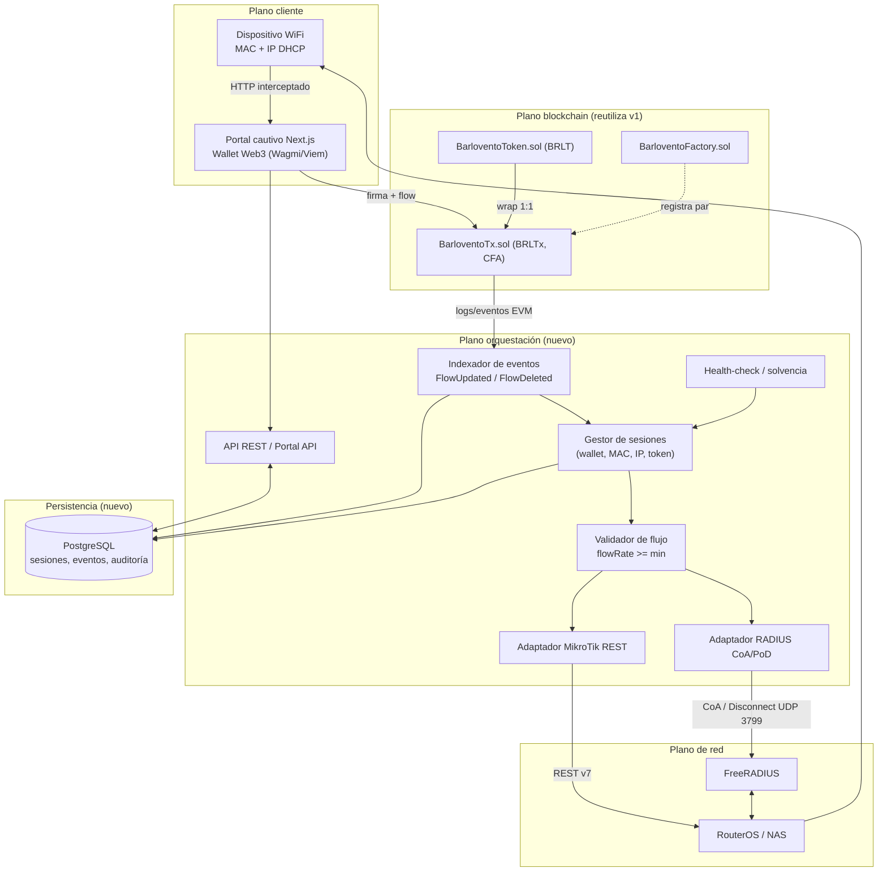
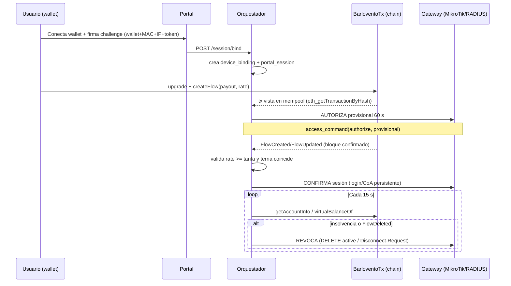
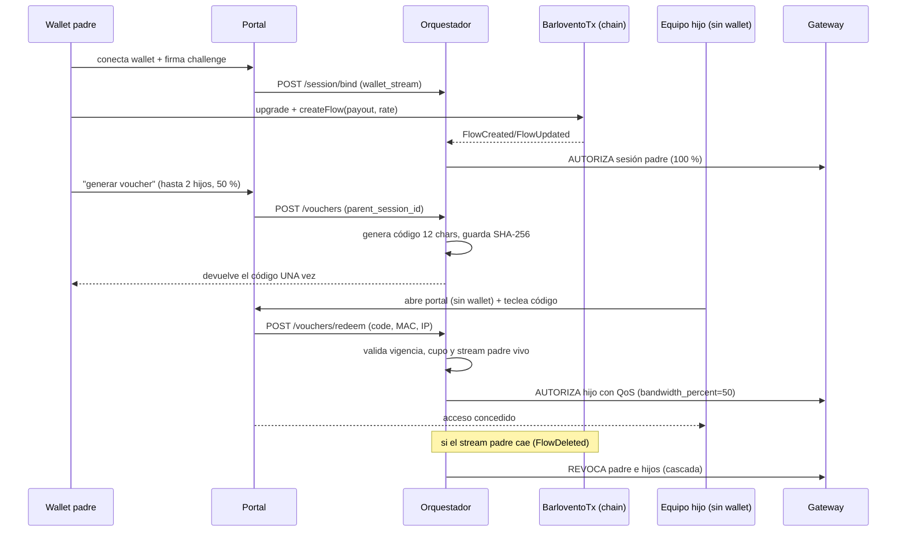

# Propuesta de Adaptación — `SFhostpot` (Superfluid Hotspot / Pay-As-You-Go WiFi)

> **Entrada**: `RepoTecnico/BRIEF_SUPERFLUID_HOSTPOT.md` (arquitectura Superfluid + MikroTik/RADIUS).
> **Base de consulta**: proyecto v1 `superfluid-DSH-GCP` (`sc/` + `web/` + `RepoTecnico/`, beta operativa).
> **Salida**: nueva versión del proyecto, documentada íntegramente en `SFhostpot/`.
> **Fase del asistente**: Fase 1 — Concepto (documentos de arranque + propuesta). Las decisiones
> abiertas están listadas al final (§12) para la entrevista del director.

---

## 1. Resumen ejecutivo

El brief HOSTPOT pide convertir el acceso WiFi en un **servicio medido en tiempo real** donde el
router mantiene los puertos abiertos **mientras** un *Constant Flow Agreement* (CFA) de Superfluid
esté activo y su `flowRate` cubra el precio por segundo. El usuario no compra bloques de tiempo:
abre un stream desde su wallet hacia la wallet del proveedor y, si el stream cae (cierre,
insolvencia, cancelación), el dispositivo se desconecta automáticamente.

El proyecto v1 ya resolvió, probó y desplegó **el 60 % de la complejidad on-chain** de ese brief:

| Ya existe en v1 | Valor para SFhostpot |
|---|---|
| Super Token propio `EuroX.sol` con CFA simplificado (flowRate int96, Active/Paused/Closed, depósito agregado, `settle()` pull, `claimSettled()`) | Es el **motor de flujo** del caso HOSTPOT; se adapta/renombra a **`BarloventoTx` (BRLTx)** |
| `Euro.sol` (ERC20 subyacente) + `EuroxFactory.sol` + `DeployAll.s.sol` | Se adaptan a **`BarloventoToken` (BRLT)** + `BarloventoFactory` + pipeline de despliegue |
| 37 tests Forge + invariantes fuzz + Slither 0 high/medium | Base de seguridad económica ya validada |
| Dashboard Next.js 15 + ethers 5.7.2 + polling con backoff + ABI sync | Reutilizable como **portal cautivo** y como patrón de cliente RPC |
| Metodología documental completa en `RepoTecnico/` (requerimientos, CU Gherkin/EARS, auditorías) | Se hereda **estructura y método**, no se copia el contenido |

Lo que **falta y define a SFhostpot** es la mitad *off-chain* / de red que el brief describe y v1 no
tiene: **orquestador/middleware**, **base de datos de sesión {Wallet, MAC, IP, Flow}**, **validador
de flujo**, **indexador de eventos FlowUpdated/FlowDeleted** y **control del gateway** (MikroTik
RouterOS REST y/o RADIUS CoA / Disconnect-Request UDP 3799), además de un **portal cautivo** con
firma de wallet y **protección anti-MAC-spoofing**.

La propuesta es, por tanto, **una extensión arquitectónica, no una reescritura**: se conserva el
núcleo blockchain y se añade una nueva capa de orquestación + una base relacional PostgreSQL real
(que en v1 era un placeholder condicional). El resultado es un sistema de 3 planos:

```
Portal (Web3) ──► Orquestador/API ──► Gateway (MikroTik / FreeRADIUS)
                       │
                       └──► Chain (Super Token + CFA: BarloventoTx.sol)  [adaptado de v1]
```

---

## 2. Análisis del brief HOSTPOT (descomposición)

### 2.1 Flujo funcional que exige el brief

1. El dispositivo se asocia al SSID abierto; el **portal cautivo** intercepta la petición HTTP y
   captura **MAC + IP** asignadas por DHCP.
2. El usuario **conecta su wallet** (Wagmi/Viem/Superfluid SDK) en el portal.
3. Con **una única transacción** el usuario envuelve el token (upgrade a Super Token, p. ej.
   `USDCx`) y abre un **flow** hacia la wallet del proveedor a la tasa acordada
   (ejemplo del brief: `0.0005 USDCx/segundo`).
4. El **middleware** escucha `FlowUpdated` / `FlowDeleted`; **empareja** wallet ↔ MAC ↔ IP; valida
   que `flowRate >= costo_mínimo` del gateway.
5. El middleware ordena al router: **autorizar** la sesión del cliente (MikroTik
   `POST /rest/ip/hotspot/active/login` o lista de firewall; o **RADIUS Access-Accept / CoA**).
6. Mientras el stream siga vivo, el tráfico navega. Al cerrarse el stream (o por insolvencia, con
   cierre por TOGA/liquidadores tomando el buffer), se emite **`FlowDeleted`** y el middleware
   **revoca**: `DELETE /rest/ip/hotspot/active/{id}` o **RADIUS Disconnect-Request (PoD)** al UDP 3799.
7. Casos límite exigidos: **acceso provisional 30–60 s** tras ver la tx en mempool; **liquidación
   por insolvencia**; **anti-suplantación MAC** mediante token de sesión criptográfico que liga
   `Wallet + MAC + IP + TokenSession` antes de abrir el router.

### 2.2 Componentes del brief → traducción a módulos del proyecto

| # | Componente brief | Módulo propuesto en SFhostpot | Origen |
|---|---|---|---|
| 1 | Cliente / portal cautivo / wallet Web3 | `portal/` (Next.js, deriva de `web/`) | adaptación |
| 2 | Capa blockchain (Super Token + Host/CFA + eventos) | `sc/` (BarloventoToken + BarloventoTx + BarloventoFactory) | **adaptación de v1** |
| 3 | Orquestador / Middleware (Node/Go) + BD de sesión + validador | `orchestrator/` (Node 22 + TS) + PostgreSQL | **nuevo** |
| 4A | MikroTik RouterOS (REST API, hotspot active, firewall) | `orchestrator/src/gateways/mikrotik.ts` | **nuevo** |
| 4B | Servidor RADIUS (FreeRADIUS, CoA/PoD, RFC 5176) | `infra/freeradius/` + `orchestrator/src/gateways/radius.ts` | **nuevo** |
| — | Simulador para desarrollo/pruebas sin hardware | `sim/` (mock MikroTik REST + mock RADIUS) | **nuevo** |

### 2.3 Ambigüedades detectadas en el brief (a resolver en la entrevista)

El brief es una arquitectura conceptual: describe dos opciones de control (A vs B), un protocolo
real de Superfluid y una red EVM genérica, pero no fija entorno, red, token, ni nivel de fidelidad.
Se resuelven con las **decisiones D1–D16** de `requerimientos.md` y quedan como **preguntas abiertas
en §12**.

---

## 3. Diagnóstico del proyecto actual (qué sirve y cómo)

### 3.1 Reutilización directa (semántica conservada)

| Activo v1 | Ruta | Uso en SFhostpot |
|---|---|---|
| `EuroX.sol` — Super Token con CFA simplificado | `sc/src/EuroX.sol` | Motor de flujos: `upgradeTo`, `createFlow`, `pauseFlow`, `resumeFlow`, `closeFlow`, `settle`, `claimSettled`, `getFlow`, `getAccountInfo`, `virtualBalanceOf`. Se **adapta a `BarloventoTx` (BRLTx)** con el mismo interfaz (P2). |
| `Euro.sol` — ERC20 subyacente | `sc/src/Euro.sol` | Se adapta a **`BarloventoToken` (BRLT)**: mismo ERC20 hard-cap, nuevo nombre/símbolo. |
| `EuroxFactory.sol` | `sc/src/EuroxFactory.sol` | Se adapta a **`BarloventoFactory`**. |
| Suite Forge (4 archivos, fuzz invariantes) | `sc/test/` | Se conserva y se amplía con tests de integración off-chain (mock gateway) |
| Herramientas CI | `tools/` | `sync-abi.mjs`, `check-deployments.mjs`, `constants-check.mjs`, `rpc-latency.mjs` |
| `LICENSE.md` + disclaimer | raíz | Se adapta al dominio hotspot (servicio medido, red educativa) |

> **Renombrado (P2)**: `Euro.sol→BarloventoToken.sol` (BRLT), `EuroX.sol→BarloventoTx.sol` (BRLTx),
> `EuroxFactory.sol→BarloventoFactory.sol`. El estudiante conserva la lógica CFA e internaliza el
> **token propio** del operador; no se integra el SDK real de Superfluid en v1.
>
> **Eventos**: v1 emite `FlowCreated / FlowPaused / FlowResumed / FlowClosed / Settled / Claimed`
> (lista cerrada de eventos del proyecto v1). El brief pide `FlowUpdated / FlowDeleted`. La adaptación **no** cambia la
> semántica: el **indexador mapea** `FlowCreated→FlowUpdated(rate>0)`, `FlowPaused→FlowUpdated(rate=0)`,
> `FlowResumed→FlowUpdated(rate>0)`, `FlowClosed→FlowDeleted` (detalle en `diccionario_datos.md`).

### 3.2 Adaptación con cambios

| Activo v1 | Ruta | Cambio necesario |
|---|---|---|
| Capa de acceso a contratos | `web/src/lib/superfluid.ts` | Extraer a paquete/`orchestrator` compartido; añadir `getFlow`/`getAccountInfo` para validación server-side y firmas de portal |
| Config de red | `web/src/config/web3.ts` | Añadir `payoutWallet` por gateway, `minFlowRate`, red configurable (dev Besu / prod L2) |
| Dashboard | `web/src/components/Dashboard.tsx` | Rediseñar como **portal cautivo**: pantalla única "conectar wallet → abrir stream → navegar"; se conservan patrones de wallet, validación y a11y |
| Polling | `web/src/lib/polling.ts` | Reutilizar el patrón backoff/timeout en el **health-check de sesión** del orquestador |
| `DeployAll.s.sol` | `sc/script/` | Añadir salida de la `payoutWallet` del gateway y publicar el par en la BD |

### 3.3 Nuevo (no existe en v1)

- **`orchestrator/`**: API REST, indexador de eventos, validador de flujo, gestor de sesiones,
  adaptadores de gateway, health-check, auditoría, RBAC de operadores.
- **PostgreSQL**: esquema de sesión/centro de operaciones (**20 tablas**, §5).
- **`infra/`**: `docker-compose` (Postgres + FreeRADIUS + mock MikroTik + orquestador + portal),
  despliegue (Cloud Run/GCE), secretos.
- **`sim/`**: simuladores deterministas de gateway para Vitest/Playwright.
- **Vouchers padre/hijo** (P5/D18): tras abrir el stream, la wallet padre genera un código (12 chars
  Crockford Base32, SHA-256) que habilita hasta **2 equipos hijos sin wallet** al **50 % de
  velocidad** mientras dure el stream. Tablas `vouchers`/`voucher_redemptions`, sesiones
  `voucher_child` y revocación en cascada al caer el padre.
- **Anti-spoofing**: challenge firmado (SIWE) + binding `(wallet, MAC, IP, token)` con re-autenticación.
- **RGPD**: tratamiento de MAC/IP como dato personal (a diferencia de v1, aquí **sí aplica**).

### 3.4 Se retira / no aplica

- Dashboard genérico de streaming de nómina y vista "Recibidos" (el receptor ahora es el proveedor).
- Escenarios de múltiples destinatarios arbitrarios (el gateway define un único payout wallet).
- El placeholder condicional `RepoTecnico/base_datos.sql` → en SFhostpot la BD es **real**.

---

## 4. Arquitectura propuesta

### 4.1 Vista de componentes (Mermaid)



### 4.2 Secuencia — autorización provisional y confirmación



### 4.3 Modos de integración de gateway (el brief pide A y B)

El orquestador define una **interfaz común** `GatewayAdapter` con 4 operaciones:
`authorize(session, provisional)`, `confirm(session)`, `disconnect(session, reason)`,
`healthcheck()`. Se implementan dos adaptadores y el gateway declara su `vendor` en BD:

- **`mikrotik_rest`** (Opción A): `POST /rest/ip/hotspot/active/login`, `DELETE /rest/ip/hotspot/active/{id}`,
  alternativa `PATCH /rest/ip/firewall/address-list`. Autenticación básica + TLS.
- **`radius`** (Opción B): Access-Accept + CoA (RFC 5176) y Disconnect-Request/PoD al **UDP 3799**,
  con `Calling-Station-Id = MAC`, `Framed-IP-Address`, `NAS-IP-Address`, `Message-Authenticator`.
- **`mock`** (simulación): para tests y desarrollo sin hardware.

### 4.4 Flujo padre → hijos con voucher (P5/D18)



---

## 5. Modelo de datos (resumen)

La nueva capa necesita persistencia relacional real. El modelo completo, con tipos, claves,
índices y comentarios, está **sincronizado** en los tres artefactos de datos:

- [`diccionario_datos.md`](diccionario_datos.md) — tablas, campos y reglas (on-chain + off-chain).
- [`diagrama_er.md`](diagrama_er.md) — ER Mermaid por dominio (on-chain, identidad, sesión/solvencia,
  eventos/auditoría, RADIUS).
- [`base_datos.sql`](base_datos.sql) — DDL PostgreSQL 15+ ejecutable e idempotente (validado en Cloud SQL 15.18).

**Dominios y tablas (20):**

| Dominio | Tablas |
|---|---|
| Configuración de red | `gateways`, `gateway_tariffs`, `nas` |
| Identidad y anti-spoofing | `devices`, `portal_sessions`, `auth_challenges`, `device_bindings` |
| Acceso de equipos hijos (P5/D18) | `vouchers`, `voucher_redemptions` |
| Sesión y solvencia | `hotspot_sessions`, `session_health_checks` |
| Puente blockchain | `flow_events`, `flow_subscriptions`, `indexer_checkpoints` |
| Comandos y auditoría | `access_commands`, `operators`, `audit_log` |
| RADIUS (FreeRADIUS) | `radcheck`, `radreply`, `radacct` |

Regla de sincronización: si cambia un artefacto, se actualizan los otros dos en el mismo turno.

---

## 6. Alcance propuesto

### 6.1 Incluye v1 de SFhostpot (MUST)

- Motor CFA adaptado (**`BarloventoToken` BRLT / `BarloventoTx` BRLTx**, P2) desplegado en la red de
  desarrollo, con wrap y flujo `wallet→payout` a `flowRate >= tariff`.
- Portal cautivo con captura de MAC/IP, conexión de wallet, challenge firmado y apertura de stream.
- **Vouchers padre/hijo** (P5/D18): la wallet padre abre el stream y genera un código que habilita
  hasta **2 hijos sin wallet** al **50 % de velocidad** mientras dure el stream; revocación en
  cascada al caer el padre (RF-25..27).
- Orquestador con API REST, indexador de eventos por polling con checkpoint, validador de flujo y
  gestor de sesiones.
- **Ambos adaptadores de gateway** (MikroTik REST **y** RADIUS CoA/PoD, P3) + **modo simulado**
  obligatorio; sin hardware real (P3b) la integración se valida contra los simuladores.
- Autorización **provisional 60 s** + confirmación por bloque; revocación por `FlowDeleted`/
  insolvencia con SLA de desconexión.
- Anti-MAC-spoofing: binding `(wallet, MAC, IP, session token)` + re-autenticación al cambiar IP/MAC.
- BD PostgreSQL (**20 tablas**) con migraciones, seeds, auditoría de comandos e idempotencia.
- Observabilidad (logs estructurados + métricas de latencia evento→comando), RGPD (30 días) y
  disclaimer legal.
- Despliegue **todo en cloud** (P9): orquestador/portal en Cloud Run + PostgreSQL en Cloud SQL.
- Multi-operador preparado pero no implementado (P6): un solo operador en v1.

### 6.2 Excluye de v1 (explícito)

- Pago con stablecoin real en mainnet y despliegue del protocolo Superfluid soberano completo
  (Host/CFA/ACL oficiales); se hace con el Super Token propio (reutiliza la decisión D1 del proyecto v1).
- Facturación fija/planes de datos, portal de autogestión del ISP, multi-tenant comercial avanzado.
- Toga/liquidadores reales en mainnet (en dev se emula el cierre por insolvencia).
- QoS/limitación de ancho de banda por plan (se documenta como extensión).

### 6.3 Criterios de aceptación de la Fase 1 (este entregable)

- [x] Brief analizado y descompuesto.
- [x] Mapa de reutilización/adaptación/nuevo de v1 → SFhostpot.
- [x] Arquitectura, alcance y decisiones registrados.
- [x] Documentos de arranque generados en `SFhostpot/` con los 3 artefactos de datos sincronizados.
- [ ] Preguntas de §12 respondidas por el director → cierre de Fase 1 y paso a Fase 2 (auditoría).

---

## 7. Requerimientos (resumen)

Detalle completo en [`requerimientos.md`](requerimientos.md): **27 RF**, **27 RNF**, **12 RT** y
**41 decisiones D1–D41** que resuelven las ambigüedades del brief y de la auditoría V1. Titulares:

- **RF-01..06** portal cautivo + identidad Web3 + apertura de stream.
- **RF-07..13** orquestador: indexación, validación, autorización/revocación, provisional,
  reconciliación y API.
- **RF-14..20** operación: administración de gateways, multi-gateway, anti-spoofing, auditoría,
  insolvencia, reintentos e accounting.
- **RF-21..24** reutilización de contratos v1, disclaimer, modo simulación y notificaciones.
- **RNF** seguridad, rendimiento (evento→comando, validación), observabilidad, idempotencia,
  consistencia, ISO 25010, **RGPD/LOPDGDD aplicable** y disponibilidad.

---

## 8. Decisiones de adaptación (resumen)

| # | Tema | Decisión | Estado |
|---|---|---|---|
| D1 | Red destino | **Dev/test: Besu Codecrypto 81234 (reutiliza v1)**; producción configurable a L2 EVM por `gateways.chain_id` | ✅ P1 |
| D2 | Token | **`BarloventoToken` (BRLT)** + Super Token **`BarloventoTx` (BRLTx)**, adaptados de v1; sin SDK real | ✅ P2 |
| D3 | Control de gateway | Interfaz `GatewayAdapter` con **MikroTik REST + RADIUS CoA/PoD** (ambos) + `mock` | ✅ P3 |
| D4 | Precio por segundo | **Off-chain** en `gateway_tariffs` por plan (operator-managed, con vigencia/payout) | ✅ P4 |
| D5 | Acceso provisional | **60 s** tras ver la tx; revocación si no se confirma en 2 bloques | ✅ ratificada |
| D6 | Anti-spoofing | Challenge **SIWE** firmado + binding terna + re-auth al cambiar IP/MAC | ✅ P8 |
| D7 | Token de sesión | JWT HS256 corto (cookie `httpOnly`) + fila server-side revocable | ✅ ratificada |
| D8 | Indexación | **Polling con checkpoint** (`indexer_checkpoints`); WS cuando la red lo soporte | ✅ ratificada |
| D9 | SLA de desconexión | `FlowDeleted`/insolvencia → comando de revocación en **< 10 s** | ✅ ratificada |
| D10 | RGPD | **Aplicable**: aviso, base legal de servicio, minimización, retención **30 días** configurable | ✅ P7 |
| D11 | Multi-tenant | Un operador en v1; esquema preparado por `tenant_id`/`gateway_id` | ✅ P6 |
| D12 | Payout | `gateway_tariffs.payout_wallet` = receptor del stream | ✅ ratificada |
| D13 | Unidades | `flowRate` en wei/s (int96); tarifa `numeric(38,0)` | ✅ ratificada |
| D14 | Fallo de comando | Fail-closed para sesiones nuevas; gracia de 3 intentos para activas | ✅ ratificada |
| D15 | Legal/licencia | MIT + disclaimer; datos de red de prueba | ✅ ratificada |
| D16 | Simulación | Adaptador `mock` obligatorio para CI/E2E | ✅ ratificada |
| D17 | Despliegue | **Todo cloud**: Cloud Run + **Cloud SQL**; CoA/PoD requiere VPC Connector + UDP 3799 o VPN | ✅ P9 |
| D18 | Vouchers padre/hijo | La wallet padre abre el stream y genera un código que da acceso a **2 hijos sin wallet** al **50 %** mientras dure el stream | ✅ P5/P12 |
| D19 | Repositorio | **Repositorio nuevo e independiente** para SFhostpot (código `sfh-*/`, docs `SFhostpot/`) | ✅ P13 |

---

## 9. Riesgos técnicos

| Riesgo | Impacto | Mitigación propuesta |
|---|---|---|
| Latencia/mempool: el usuario espera confirmación | Mala UX / acceso denegado | Acceso provisional 60 s + reconciliación por bloque (D5) |
| **MAC spoofing** | Robo de servicio / suplantación | Binding firmado `(wallet,MAC,IP,token)` + re-auth en cambio de IP (D6) |
| `eth_subscribe` no disponible (Besu) | No hay push de eventos | Polling con checkpoint + `eth_getLogs` por rangos (D8) |
| RPC frágil (p90 ≈ 4.5 s, timeouts ~4 % en v1) | Eventos tardíos → desconexión errónea | Backoff/recuperación heredado de `polling.ts`; margen de gracia |
| Robo del secreto RADIUS / MikroTik | Control total del gateway | Secretos en Secret Manager, rotación, `Message-Authenticator`, allow-list de origen |
| Inconsistencia router↔DB | Sesiones fantasma o cortes | Reconciliación periódica + `access_commands` idempotentes |
| RGPD (IP/MAC/logs) | Sanción legal | Base legal, minimización, retención, cifrado de logs, borrado por diseño |
| Insolvencia fuera de ventana | Servicio gratis | Health-check cada 15 s + SLA de revocación < 10 s (D9) |
| Hardware real no disponible en desarrollo | Bloqueo de pruebas | Adaptador `mock` + docker-compose con FreeRADIUS (D16/P3b) |
| CoA/PoD desde Cloud Run hacia el NAS | Revocación RADIUS imposible | **VPC Connector + firewall UDP 3799 o VPN** al NAS; verificar en H3 (D17) |
| Redespliegue con nuevo nombre BRLT/BRLTx | ABIs y registro desincronizados | Regenerar ABIs (`sync-abi`) y actualizar `deployments`; reejecutar suite Forge |
| Fuerza bruta de códigos de voucher | Canje no autorizado | Códigos largos aleatorios + hash + rate-limit + auditoría de intentos |

---

## 10. Hoja de ruta propuesta (fases del asistente)

| Fase | Entregable | Dependencia |
|---|---|---|
| **1 Concepto** | Este paquete `SFhostpot/` (propuesta + requerimientos + datos + entornos + estado) | — |
| **2 Auditoría** | `@audita` sobre estos documentos + casos de uso Gherkin/EARS + diagramas + `documento_tecnico.md` | Cierre §12 |
| **3 Desarrollo** | H1 motor CFA reutilizado y adaptado · H2 orquestador + BD · H3 gateway A/B + sim · H4 portal cautivo · H5 integración E2E · H6 hardening/observabilidad | Fase 2 |
| **4 Pruebas** | Forge (contratos, invariantes) + Vitest (orquestador) + integración mock gateway + Playwright E2E + pruebas de carga/latencia | Fase 3 |
| **5 Manuales** | `@manuales`: instalación, operación ISP, usuario del portal, resolución de problemas | Fase 4 |

Hitos verticales sugeridos para Fase 3:

1. **H1** — `sc/` adaptado a **BRLT/BRLTx/BarloventoFactory**, `payoutWallet` configurable y deploy
   en Besu de desarrollo con suite Forge verde.
2. **H2** — `orchestrator/` + **Cloud SQL/PostgreSQL (20 tablas)**: indexador, validador, sesiones,
   vouchers, API (`/session`, `/flows`, `/vouchers`).
3. **H3** — **Ambos** adaptadores de gateway (MikroTik REST **y** RADIUS) + `mock` +
   `access_commands` idempotentes; verificación de alcance UDP 3799.
4. **H4** — Portal cautivo Web3 (adaptado de `web/`) con challenge, wrap, `createFlow` y **canje de
   vouchers**.
5. **H5** — E2E: dispositivo simulado → portal → orquestador → gateway mock → revocación por
   insolvencia; pruebas en Cloud Run + Cloud SQL.
6. **H6** — Observabilidad, RGPD (retención 30 días), endurecimiento, runbook y preview.

---

## 11. Convención de nombres y ubicación

- **Documentación**: `SFhostpot/` (esta carpeta), separada de `RepoTecnico/` de v1.
- **Código propuesto**: `sfh-sc/` (contratos BRLT/BRLTx), `sfh-orchestrator/`, `sfh-portal/`,
  `sfh-infra/`, `sfh-sim/` — se crearán en Fase 3 sin colisionar con `sc/` ni `web/` de v1.
- **Repositorio (D19)**: **nuevo e independiente** para SFhostpot; esta carpeta `SFhostpot/` es la
  semilla de su documentación.
- **Idioma**: documentación en español (coherente con v1); identificadores de código en inglés.
- **Trazabilidad**: se mantiene la convención `RF/RNF/RT`, `CU-xx`, `Dx`, `RE-xx`.

---

## 12. Entrevista de Fase 1 (P1–P13 — RESUELTA 2026-10-15)

### Bloque 1 — Red, token y control de gateway

1. **P1 (D1) ✅** — **Dev/test en Besu Codecrypto 81234**; producción configurable a L2 por `chain_id`.
2. **P2 (D2) ✅** — **Token propio `BarloventoToken` (BRLT)** y Super Token **`BarloventoTx` (BRLTx)**,
   adaptados de `Euro.sol`/`EuroX.sol`; no se integra el SDK real de Superfluid en v1.
3. **P3 (D3) ✅** — **Ambos adaptadores**: **MikroTik RouterOS REST** + **RADIUS (CoA/Disconnect)**.
4. **P3b ✅** — **Sin hardware real**: la integración se valida contra `mock` MikroTik + FreeRADIUS;
   los adaptadores reales quedan listos para validación futura.

### Bloque 2 — Producto y operación

5. **P4 (D4) ✅** — Precio **por plan/tarifa administrable off-chain** (`gateway_tariffs`).
6. **P5 (D18) ✅** — Acceso **wallet Web3 + vouchers/códigos** (`vouchers`, `voucher_redemptions`).
7. **P6 (D11) ✅** — **Un operador en v1**, esquema preparado para multi-tenant.

### Bloque 3 — Seguridad, legal y despliegue

8. **P7 (D10) ✅** — RGPD: aviso, base legal de servicio, minimización y **retención 30 días
   configurable** con borrado automático.
9. **P8 (D6) ✅** — Anti-spoofing con **binding firmado SIWE + re-autenticación** al cambiar IP/MAC;
   sin 802.1X/agente en v1.
10. **P9 (D17) ✅** — **Todo en cloud**: Cloud Run (orquestador + portal) + **Cloud SQL** (PostgreSQL);
    el CoA/PoD al NAS exige **VPC Connector + firewall UDP 3799** o VPN.

### Cierre de la entrevista — P10–P13 (2026-10-15)

- **P10 ✅** — BRLT: name "Barlovento Token", symbol **BRLT**, 18 dec, hard-cap **10.000.000**, mint
  del owner hasta el cap (para dotar de liquidez en pruebas).
- **P11 ✅** — Códigos de voucher: **12 chars Crockford Base32**, **SHA-256**, caducidad por defecto
  **90 días**, emisión por **CLI + API admin**.
- **P12/P12b ✅** — El voucher **exige stream**: la wallet **padre** abre el stream y después genera
  el código; el voucher habilita **hijos sin wallet** (hasta **2**) al **50 % de velocidad** mientras
  dure el stream del padre → modelo `voucher_child` con `bandwidth_percent` y revocación en cascada.
- **P13 ✅** — **Repositorio nuevo e independiente** para SFhostpot (D19).

> Con P1–P13 resueltas y los tres artefactos de datos sincronizados, la **Fase 1 queda cerrada** y
> se abre la **Fase 2** (`@audita` + casos de uso Gherkin/EARS + diagramas + `documento_tecnico.md`
> auditado).
