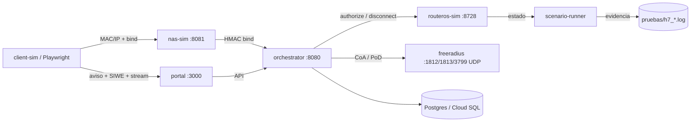
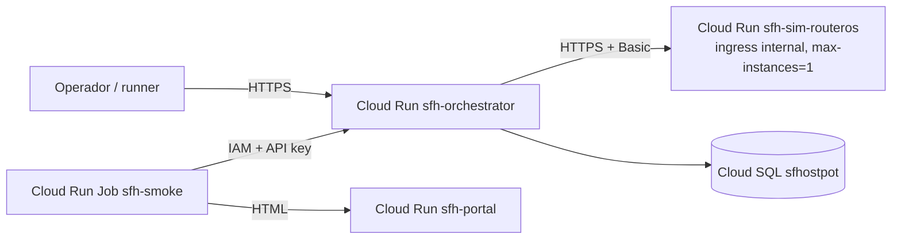

# Propuesta — Entorno de pruebas con MikroTik emulado (`sfh-sim`)

> **Fecha:** 2026-10-23 (actualizado 2026-10-24) · **Estado:** **APROBADA E IMPLEMENTADA — fases A, B, C
> y D/E (validación CHR)**; queda la validación con hardware/cliente hotspot real (P-07) · **Ámbito:** Fase 4
> (Pruebas) y ventana de validación de hardware P-07.
> **Base:** [`documento_tecnico.md`](documento_tecnico.md) §2.3.5 (`sfh-sim`), [`plan_desarrollo.md`](plan_desarrollo.md)
> (H3/H5, P3b), [`entornos_globales.md`](entornos_globales.md) §5 y [`runbook_operacion.md`](runbook_operacion.md).
> **Evidencia de viabilidad:** spike ejecutable validado **12/12** contra el adaptador real de la plataforma
> (Anexo A y [`pruebas/h7_emulador_mikrotik_spike.log`](pruebas/h7_emulador_mikrotik_spike.log)).

---

## 0. Estado de implementación (2026-10-23)

| Fase | Estado | Entregables / evidencia |
|---|---|---|
| **A. Emulador de contrato** | ✅ **Implementada** | `sfh-sim/server.mjs`, `src/routeros-emulator.mjs`, Dockerfile, `cloudbuild.yaml`, overlay `sfh-infra/docker-compose.sim.yml`; **17 tests** `node:test` y spike **12/12** — [`pruebas/h7_entorno_mikrotik_local.log`](pruebas/h7_entorno_mikrotik_local.log) |
| **B. NAS + escenarios** | ✅ **Implementada** | `nas-sim.mjs` (bind HMAC → portal) + `scenario-runner/run.mjs`; escenarios E2E **10/10 PASS** contra la plataforma real — [`pruebas/h7_entorno_mikrotik_emulado.log`](pruebas/h7_entorno_mikrotik_emulado.log) |
| **C. Cloud + integración** | ✅ **Implementada** | Servicio privado `sfh-sim-routeros`, job `sfh-sim-scenarios`, `GATEWAY_RUNTIME_CONFIGS` del orquestador apuntando al adaptador real (auth IAM vía `x-serverless-authorization`), Cloud SQL |
| **D. Demo + carga** | ✅ **Implementada** | `sfh-demo` (CU-01 scripted, Playwright + wallet real, 13/13, capturas/vídeo) y `sfh-k6-load` (100 VUs, NAS→portal + gateway, umbrales superados) — [`pruebas/h7_demo_y_k6.md`](pruebas/h7_demo_y_k6.md) |
| **E. CHR / aceptación** | ✅ **Completada en laboratorio** | CHR 7.16.2 sobre QEMU TCG (sin KVM): probe del adaptador real **19/19 PASS**, matriz de fidelidad y correcciones (`PUT` address-list, limpieza en `disconnect`, `preferAddressList`). Informe: [`INFORME_FASE_D_CHR.md`](INFORME_FASE_D_CHR.md) · lab: [`../sfh-chr/`](../sfh-chr/) |

Decisiones D-A…D-F (§13): **A–C aprobadas y ejecutadas**; D queda abierta para la ventana de hardware.
Detalle técnico de la implementación en [`../sfh-sim/README.md`](../sfh-sim/README.md).

---

## 1. Objetivo

Disponer de un **entorno de pruebas que emule un MikroTik** (RouterOS v7 REST) y el comportamiento del
NAS/hotspot, de forma que la plataforma pueda **ejercer su operatividad completa** (portal → sesión →
autorización, pausa/revocación y health-check del gateway) **sin depender de hardware real**.

Objetivos específicos:

| # | Objetivo | Criterio |
|---|---|---|
| O1 | Ejercitar el **adaptador real** `MikrotikRestAdapter` (no el `mock` in-process) | llamadas HTTP reales al emulador |
| O2 | Reproducir **fallos deterministas**: login fallido → address-list, 5xx, timeout, gateway caído | 4 modos inyectables + health offline |
| O3 | Validar el flujo completo de los CU del gateway (CU-01, CU-09, CU-12, CU-17, CU-18, CU-19) | escenarios E2E §8 |
| O4 | Servir de banco de pruebas en **CI local** y en el **preview Cloud Run** | pipeline + smoke del preview |
| O5 | Dejar preparada la **ventana con hardware real/CHR** (P-07) con el mismo contrato | opción B §3/Anexo B |

**Fuera de alcance:** firmware RouterOS, drivers/radios WiFi, roaming, throughput real de radio y
validación de comportamiento del NAS físico. Eso requiere CHR o router real (Opción B).

---

## 2. Punto de partida y brecha actual

| Pieza existente | Qué aporta | Límite |
|---|---|---|
| `sfh-orchestrator/src/gateways/mikrotik.ts` | Adaptador REST real (authorize, fallback address-list, disconnect, health) | Sin router contra el que ejercerse |
| `sfh-orchestrator/src/gateways/mock.ts` | Mock determinista in-process (`ok`/`timeout`/`error`) | No habla HTTP ni emula RouterOS |
| `sfh-orchestrator/test/gateways.test.ts` | Servidores HTTP/UDP **inline** por test | No reutilizable, no desplegable, no estado |
| `sfh-infra/freeradius/*` | FreeRADIUS 3.x (auth/acct/CoA) en compose | No hay NAS que dispare el flujo |
| `sfh-infra/smoke/` | Smoke E2E del preview (API↔BD↔portal) | Usa `mock`; no ejerce la ruta MikroTik |
| Preview Cloud Run | API + portal desplegados | `GATEWAY_RUNTIME_CONFIGS=[]` → `MockGatewayAdapter` |

**Brecha:** no existe el componente `sfh-sim` que el diseño ya prevé ([`documento_tecnico.md`](documento_tecnico.md)
§2.3.5) y, por tanto, **la operatividad real del gateway no se ejerce en ningún entorno**. Esta propuesta
la cubre con un emulador de contrato reutilizable y desplegable.

---

## 3. Opciones evaluadas

| Opción | Fidelidad | Coste | Esfuerzo | CI | Riesgos | Uso |
|---|---|---|---|---|---|---|
| **A. Emulador de contrato** (`sfh-sim`, Node) | Media (contrato exacto del adaptador) | ~0 | 5–7 d | ✅ | No valida firmware; deriva si cambia el adaptador | CI, dev, preview, demos |
| **B. RouterOS CHR virtualizado** (Proxmox/libvirt/CHR) | Alta (RouterOS real) | Licencia CHR (~USD 45–250) + host | 3–5 d (+lab) | ⚠️ difícil en CI | Licencia/trial 60 d; **en GCP la org policy `compute.disableNestedVirtualization` está enforced** → no viable en VM estándar | Ventana de aceptación P-07 |
| **C. Híbrido A + B** | Alta (A continuo, B en aceptación) | A + B | 8–12 d | ✅ (A) | Dos mantenimientos | **Recomendada** |
| **D. RADIUS con FreeRADIUS** (Opción B del brief) | Media-alta (protocolo real) | ~0 (contenedor) | 1–2 d | ✅ | No cubre MikroTik REST | Complemento de A/B |

> **Nota de entorno:** la organización tiene `constraints/compute.disableNestedVirtualization` y
> `constraints/sql.restrictPublicIp` **enforced**. Por eso CHR no se puede levantar en una VM de GCP sin
> excepción; el laboratorio CHR debe ser **local/on-prem** (workstation con Proxmox/libvirt) o un router
> físico prestado. El emulador A no tiene esta restricción.

---

## 4. Recomendación

**Opción C (híbrida), implementando primero A + D:**

1. **`sfh-sim` — emulador de contrato RouterOS v7 REST** como banco de pruebas principal (CI, desarrollo,
   preview y demos). Es el que se propone construir ahora.
2. **NAS/hotspot simulado** (`nas-sim`) para disparar el canal `POST /v1/internal/hotspot/bind` firmado
   con HMAC y completar la operatividad (portal + sesión) sin router.
3. **FreeRADIUS** (ya en compose) para ejercer la Opción B (CoA/PoD) con el adaptador `radius.ts`.
4. **CHR en laboratorio local** solo como **ventana de aceptación** (opcional, fase D) para validar que el
   mapeo REST del adaptador coincide con RouterOS real.

El spike del Anexo A demuestra que A es viable **hoy**: el adaptador real de la plataforma ya opera
(autorización, fallback, revocación, health, fallos y concurrencia) contra el emulador.

---

## 5. Arquitectura del entorno propuesto

### 5.1 Componentes

| Componente | Rol | Puerto | Estado |
|---|---|---|---|
| `routeros-sim` | Emula RouterOS v7 REST (contrato del adaptador) + inyección de fallos + estado | 8728/TCP (HTTP), 8729/TLS opcional | **prototipo validado** (Anexo A) |
| `nas-sim` | Emula el NAS/hotspot: al "conectar" un cliente calcula `HMAC(gateway|mac|ip|ts|nonce)`, llama a `POST /v1/internal/hotspot/bind`, obtiene `bind_token` y redirige al portal (o sirve página de login) | 8081 | a construir (fase B) |
| `client-sim` | Cliente de portal (Playwright con wallet inyectada) o script que recorre CU-01/CU-12 | — | a construir (fase B) |
| `freeradius` | Opción B: Access-Accept, CoA-ACK, Disconnect-ACK (compose existente) | 1812/1813/3799 UDP | ya existe |
| `scenario-runner` | Orquesta escenarios, siembra BD, asserta estado en emulador/BD, escribe evidencia JSON | — | a construir (fase B) |
| `postgres` / Cloud SQL | BD `sfhostpot` (gateways, tariffs, sessions) | 5432 / socket | ya existe |
| `orchestrator` | API de la plataforma (adaptador real) | 8080 | ya existe |
| `portal` | Portal cautivo Next.js | 3000 | ya existe |

### 5.2 Topología local (docker compose, perfil `sim`)



### 5.3 Topología cloud (preview actual)



- El emulador se despliega como **Cloud Run privado con IAM**; el adaptador envía el ID token del
  metadata server en `x-serverless-authorization` (`platformAuth: "cloudrun"`) y conserva
  `Authorization: Basic` para RouterOS. Implementado y verificado en el preview.
- `GATEWAY_RUNTIME_CONFIGS` del orquestador apunta a su URL; la cuenta de servicio del orquestador solo
  necesita red (mismo proyecto/región).
- **Estado en memoria:** con `max-instances=1` y `min-instances=0` el estado se pierde en cold start. Para
  una demo con estado (autorizar→ver activo→desconectar) usar `min-instances=1` durante la ventana o
  persistir estado en Postgres (fase C opcional).

---

## 6. Contrato de emulación

### 6.1 Endpoints (los que consume `MikrotikRestAdapter`)

| Método | Ruta | Request | Response | Efecto de estado |
|---|---|---|---|---|
| `GET` | `/rest/system/resource` | — | `{board-name, version, uptime}` | ninguno (healthcheck) |
| `POST` | `/rest/ip/hotspot/active/login` | `{user: mac, ip, rate-limit}` | `{".id":"*A1"}` 200 | crea sesión activa |
| `GET` | `/rest/ip/hotspot/active?mac-address=<mac>` | — | `[{".id", "mac-address", "address"}]` | ninguno |
| `DELETE` | `/rest/ip/hotspot/active/{id}` | — | 204 / 404 | elimina sesión |
| `POST` | `/rest/ip/firewall/address-list` | `{list, address, comment}` | `{".id":"*B1"}` 200 | añade entrada (fallback) |
| `GET` | `/rest/ip/firewall/address-list` | — | `[{".id", list, address, comment}]` | extensión de inspección |

Autenticación: **HTTP Basic** (usuario/password configurables; por defecto `sfh` / secreto inyectado) —
igual que RouterOS REST. `401` si falta o es incorrecta.

### 6.2 Inyección de fallos (canal de administración, no RouterOS)

| Método | Ruta | Body | Efecto |
|---|---|---|---|
| `POST` | `/__admin/mode` | `{mode:"ok"\|"login-fail"\|"error"\|"timeout"\|"slow", delayMs}` | `login-fail`: login 500 → fuerza fallback; `error`: 500 en todo; `timeout`: respuesta tras `delayMs` (el adaptador aborta); `slow`: latencia controlada |
| `GET` | `/__admin/state` | — | `{mode, sessions[], addressList[], requests}` |
| `POST` | `/__admin/reset` | — | limpia estado y vuelve a `ok` |

Protegido con `x-admin-token`; **solo** en el entorno de pruebas (no exponer en producción).

### 6.3 Reglas de determinismo y persistencia

- Estado en memoria, IDs con `randomUUID` (el runner no debe asumirlos); MAC/IP normalizadas a minúsculas.
- Semilla opcional para IDs reproducibles (`--seed`) y para `ts` del HMAC en `nas-sim`.
- Persistencia opcional a JSON (`--state-file`) para reinicios; Postgres solo si la fase C lo exige.
- Logs JSON sin `Authorization`; MAC/IP tratadas como dato personal (RNF-12).

### 6.4 Brecha de fidelidad a documentar (importante)

`POST /rest/ip/hotspot/active/login` es la **abstracción del adaptador**, no un endpoint estándar de
stock RouterOS v7. Antes de la ventana con hardware (P-07) hay que **verificar el mapeo real**
(probablemente `POST /rest/ip/hotspot/active` o el flujo `/login` HTML del hotspot). El emulador puede
añadir un modo `routeros-realistic` con endpoints reales y, si difieren, corregir el adaptador. Esta es la
razón principal para mantener la **fase D (CHR/router real)** aunque A cubra CI.

También se prevén (para D45: verificación MAC/IP en el NAS) `GET /rest/ip/hotspot/host` y
`GET /rest/ip/dhcp-server/lease`, que el adaptador actual aún no usa.

---

## 7. Integración con la plataforma

### 7.1 Siembra de datos

```sql
-- gateway emulado (vendor permitido por el enum gateway_vendor)
insert into gateways (name, vendor, status, chain_id, super_token_address, mgmt_url)
values ('sfh-sim-gw', 'mikrotik_rest', 'online', 81234,
        '0x6540b8f49168c6896d85f05b5ca8AdAaaEB65be0', 'http://127.0.0.1:8728')
returning id::text;

-- tarifa asociada (payout wallet es la del operador; aquí una cuenta de prueba)
insert into gateway_tariffs (gateway_id, name, price_per_second_wei, token_address, payout_wallet)
values ('<gateway_id>', 'tarifa-sim', '500000000000000',
        '0x6540b8f49168c6896d85f05b5ca8AdAaaEB65be0',
        '0xf39Fd6e51aad88F6F4ce6aB8827279cffFb92266');
```

> También se puede crear el gateway vía `POST /v1/admin/gateways` (API real, con API key).

### 7.2 Variables de entorno del orquestador

```bash
GATEWAY_RUNTIME_CONFIGS='[{"id":"<gateway_id>","vendor":"mikrotik_rest",
  "mikrotik":{"baseUrl":"http://127.0.0.1:8728","username":"sfh",
              "password":"<sfhostpot-mikrotik-password>","timeoutMs":2000,
              "addressList":"sfh-authorized"}}]'
```

> **Deuda detectada:** hoy el registro de adaptadores se construye **solo desde esta variable**; las filas
> de `gateways` en BD no alimentan `createAdapterRegistry`. Para el entorno de pruebas basta la variable,
> pero se recomienda (fase C) resolver también desde BD + Secret Manager.

### 7.3 Secretos

- `sfhostpot-mikrotik-password`: password Basic del emulador (o del router real).
- `sfhostpot-gateway-hmac`: secreto del canal NAS→API (`<gateway_id>=<hex>`) para `nas-sim`.

### 7.4 Comandos (local)

```bash
# 1) emulador solo
node sfh-sim/prototipo/routeros-emulator.mjs

# 2) stack completo (a partir de fase A/B)
docker compose -f sfh-infra/docker-compose.yml --profile sim up -d --build
# 3) siembra + escenarios
node sfh-sim/scenario-runner/run.mjs --all
```

### 7.5 Preview cloud (fase C) — ejecutado

1. Imagen `…/sfhostpot/sim:<tag>` (Cloud Build `sfh-sim/cloudbuild.yaml`).
2. `sfh-sim-routeros` desplegado como Cloud Run **privado (IAM)**, `max-instances=1`, Basic auth propia
   y `roles/run.invoker` para `sfh-orchestrator@…`.
3. `GATEWAY_RUNTIME_CONFIGS` del orquestador actualizado con la URL y `platformAuth: "cloudrun"`;
   revisiones `sfh-orchestrator-00005/00006` verificadas.
4. Job `sfh-sim-scenarios` con `PLATFORM_AUTH=cloudrun`, Cloud SQL adjunto y secretos de BD/sim;
   resultado **10/10 PASS** ([`pruebas/h7_entorno_mikrotik_emulado.log`](pruebas/h7_entorno_mikrotik_emulado.log)).

---

## 8. Escenarios de prueba

| ID | Caso | Precondición | Resultado esperado | Evidencia |
|---|---|---|---|---|
| E2E-01 | Autorización feliz (login) | emulador `ok` | `ack=true`, `code=200`; sesión visible en emulador; sesión `active` en BD | log + estado |
| E2E-02 | Fallback address-list | emulador `login-fail` | `ack=true`, `code=address-list`; entrada en address-list | log + estado |
| E2E-03 | Revocación por pausa | sesión activa | `disconnect` ACK, sesión eliminada, estado `paused` | log |
| E2E-04 | Revocación por insolvencia | health job con saldo 0 | `disconnect` ACK (coa/rest), métrica de revocación | log |
| E2E-05 | Gateway 5xx | emulador `error` | `ack=false` → **fail-closed**; sesión no activa | log |
| E2E-06 | Timeout | emulador `timeout` | aborta ≤ timeout, sin ACK; reintento/fallback según D24 | log |
| E2E-07 | Disconnect idempotente | ya desconectado | `ack=true`, `code=not-found` | log |
| E2E-08 | Health job | emulador `ok`/`error` | online/offline correcto; alerta si offline | log |
| E2E-09 | Concurrencia 100 VUs | k6 + emulador | 0 % errores, p95 dentro de SLA | resumen k6 |
| E2E-10 | CU-01 completo | portal + wallet mock | aviso→SIWE→wrap→stream→authorize→sesión activa | Playwright + log |
| E2E-11 | Voucher hijo | sesión padre activa | hijo 50 %, límites y revocación en cascada | log |
| E2E-12 | Opción B RADIUS | FreeRADIUS | CoA-ACK / Disconnect-ACK | log |
| E2E-13 | Caída del emulador | emulador detenido | health offline; fail-closed; sin huérfanas | log |

---

## 9. Plan de implementación

| Fase | Trabajo | Esfuerzo | Entregables |
|---|---|---|---|
| **A. Emulador de contrato** | Portar el spike a servicio `sfh-sim/` (módulo + CLI + tests), Dockerfile, perfil compose, `cloudbuild-sim.yaml` | **2 d** (spike ya hecho ≈ 40 %) | servicio, 12+ tests, imagen |
| **B. NAS + escenarios** | `nas-sim` (bind HMAC + redirect), `scenario-runner`, `client-sim` Playwright, E2E-01…08, seed | **2–3 d** | runner, logs de evidencia, CI job |
| **C. Cloud + integración** | despliegue Cloud Run privado, `GATEWAY_RUNTIME_CONFIGS` en preview, smoke extendido, runbook §nuevo | **1–2 d** | preview operando con adaptador real, smoke 9/9 |
| **D. CHR / aceptación (opcional)** | laboratorio local con CHR/router, validar mapeo REST real, corregir adaptador si difiere, acta | **2–4 d** | acta de aceptación P-07, deuda del adaptador resuelta |
| **Total A–C** | | **5–7 d** | entorno operativo local + cloud |
| **Total + D** | | **8–12 d** | + validación de fidelidad |

Dependencias: A → B → C; D en paralelo si hay hardware/lab.

> **Estado (2026-10-23):** fases **A, B y C completadas** (5–7 d estimados, ejecutadas en la sesión);
> fase D pendiente de laboratorio/ventana P-07.

---

## 10. Criterios de aceptación (DoD)

- [x] `sfh-sim` arranca con **un comando** y expone contrato + admin; **17 tests** `node:test`.
- [x] Escenarios E2E-01…E2E-08 contra el **adaptador real** (no mock) con evidencia en `SFhostpot/pruebas/`
      (job `sfh-sim-scenarios`, **10/10 PASS**; incluye bind HMAC, portal session, pause/revoke,
      disconnect y fail-closed con 5xx/timeout).
- [x] Preview: job de escenarios con `authorize/disconnect` reales (**10/10**, equivalente al ≥9/9 previsto).
- [x] `docker compose` con overlay `docker-compose.sim.yml` (servicio + NAS + runner).
- [x] Sin secretos en repo/logs; Basic auth del emulador desde Secret Manager y IAM en Cloud Run.
- [x] Documentación: runbook, README de `sfh-sim/` y trazabilidad actualizadas.
- [x] k6 100 VUs contra el emulador sin errores: **checks 100 %, 0 % fallos**, p95 < 1.000 ms y ACK
      gateway p95 475 ms < 500 ms (job `sfh-k6-load`).
- [x] Demo CU-01 scripted con wallet real + capturas/vídeo/log (`sfh-demo`, 13/13).
- [x] Acta de validación contra CHR real y brecha del adaptador documentada:
      [`INFORME_FASE_D_CHR.md`](INFORME_FASE_D_CHR.md) · evidencia [`pruebas/h7_fase_d_chr.log`](pruebas/h7_fase_d_chr.log).
- [ ] Validación con cliente hotspot real + hardware/router físico (P-07): login nativo, QoS y TLS.

---

## 11. Riesgos y mitigaciones

| Riesgo | Impacto | Mitigación |
|---|---|---|
| El contrato del emulador se desvía del adaptador | Falsos verdes | tests de contrato en CI + generar el contrato desde el adaptador |
| El mapeo REST no coincide con RouterOS real (§6.4) | Falla en P-07 | fase D con CHR/router + modo `routeros-realistic` |
| Estado en memoria se pierde en Cloud Run | Demo inconsistente | `min-instances=1` en ventana o persistencia Postgres |
| Admin API expuesta | Manipulación de fallos | token + solo localhost/ingress interno |
| Basic auth sobre HTTP | Credenciales en claro | TLS/HTTPS en cloud; HTTP solo `127.0.0.1` |
| Org policies (nested virt, IP pública) | CHR en GCP no viable | laboratorio local/on-prem o router físico |
| Licencia CHR (trial 60 d) | Bloqueo tras el trial | comprar P1/P10 o usar router físico |
| Falsa confianza ("pasa en sim") | Deuda oculta | declarar límites (§1/§6.4) y mantener fase D |
| Coste Cloud Run con min=1 | ~USD 50–70/mes (aprox.) | usar on-demand para CI y min=1 solo en demos |

---

## 12. Costes estimados (referencia, verificar precios vigentes)

| Alternativa | Coste |
|---|---|
| Local (Docker Compose) | **0** |
| Cloud Run `sfh-sim-routeros` on-demand | ~0 en pruebas (free tier) |
| Cloud Run `min-instances=1` (512 MiB/1 vCPU) | ~USD 50–70/mes |
| VM `e2-micro` con emulador (alternativa) | ~USD 7–10/mes |
| CHR (licencia perpetua P1–P10) | ~USD 45–250 + laboratorio/host |
| Router MikroTik físico de laboratorio (hAP ax²/ac³) | ~USD 100–180 (opcional, P-07) |

---

## 13. Decisiones que se solicitan al Director

| # | Decisión | Recomendación |
|---|---|---|
| D-A | Aprobar la opción C y el alcance A–C (5–7 d) | Sí |
| D-B | ¿Entorno local, cloud o ambos? | Ambos (local para CI; cloud para preview) |
| D-C | ¿Se incluye la fase D con CHR/router? | Sí, como ventana posterior (P-07) |
| D-D | Estado: ¿memoria o Postgres? | Memoria en A/B; Postgres solo si la demo cloud lo exige |
| D-E | ¿`sfh-sim` sustituye al "mock MikroTik" planificado en `sfh-sim/`? | Sí; el mock in-process se mantiene para unit tests |
| D-F | Presupuesto cloud del emulador | On-demand; `min=1` solo en ventanas de demo |

---

## 14. Anexo A — Spike validado (12/12 PASS)

Prototipo ejecutable, sin dependencias externas (solo Node 22), que ya demuestra la viabilidad:

| Artefacto | Contenido |
|---|---|
| [`../sfh-sim/prototipo/routeros-emulator.mjs`](../sfh-sim/prototipo/routeros-emulator.mjs) | Emulador HTTP del contrato + modos de fallo + admin |
| [`../sfh-sim/prototipo/validar.mjs`](../sfh-sim/prototipo/validar.mjs) | 12 escenarios contra `MikrotikRestAdapter` real |

```bash
cd sfh-orchestrator && npm run build && cd ..
node sfh-sim/prototipo/validar.mjs
```

Resultado (log completo en [`pruebas/h7_emulador_mikrotik_spike.log`](pruebas/h7_emulador_mikrotik_spike.log)):

| Escenario | Resultado |
|---|---|
| healthcheck online | ✅ |
| authorize login OK | ✅ `ack=true code=200` |
| sesión visible en emulador | ✅ |
| disconnect ACK / efectiva / idempotente | ✅ `code=200` / `not-found` |
| fallback address-list (`login-fail`) | ✅ `ack=true code=address-list` |
| error 5xx → `ack=false` | ✅ |
| timeout → `ack=false` | ✅ |
| 10 autorizaciones concurrentes | ✅ `sessions=10` |
| healthcheck offline | ✅ |
| **Total** | **12/12 PASS · exit 0** |

---

## 15. Anexo B — Ejemplos de configuración

**`docker-compose.yml` (perfil `sim`, extracto)**

```yaml
services:
  routeros-sim:
    build: ../sfh-sim
    profiles: ['sim']
    environment:
      SFH_SIM_USER: sfh
      SFH_SIM_PASSWORD: ${SFH_SIM_PASSWORD:-sfh-sim-password}
      SFH_SIM_ADMIN_TOKEN: ${SFH_SIM_ADMIN_TOKEN:-sfh-sim-admin}
    ports: ['8728:8728']
    healthcheck:
      test: ['CMD', 'node', '-e', "fetch('http://127.0.0.1:8728/rest/system/resource').then(r=>process.exit(r.status===200?0:1)).catch(()=>process.exit(1))"]
      interval: 5s
```

**`GATEWAY_RUNTIME_CONFIGS` (local y Cloud Run)** — ver §7.2.

**Extensión del smoke del preview (fase C):** añadir al job `sfh-smoke` una llamada
`POST /v1/session/authorize` con un `tx_hash` de prueba y comprobar en
`GET https://sfh-sim-routeros…/__admin/state` que la sesión se creó; luego `pause` y comprobar que se
eliminó. Alternativa: un `scenario-runner` como Cloud Run Job.

---

## 16. Trazabilidad

| Elemento | Referencias |
|---|---|
| Casos de uso | CU-01, CU-09, CU-12, CU-17, CU-18, CU-19 |
| Requisitos | RF-15, RF-16, RF-23; RNF-14, RNF-18, RNF-19, RNF-20 |
| Restricciones técnicas | RT-06, RT-07, RT-11 |
| Decisiones | D3 (adaptador), D16 (mock), D24 (fallback), D45/V2-01 (bind HMAC), P3b (sin hardware), P-06 (VPC/UDP), P-07 (ventana hardware) |
| Evidencia | [`pruebas/h7_emulador_mikrotik_spike.log`](pruebas/h7_emulador_mikrotik_spike.log) |

---

**Solicitud:** aprobar D-A…D-F (§13) para iniciar la fase A y, con ello, disponer de un entorno que
permita **usar la operatividad de la plataforma de punta a punta sin hardware**.
