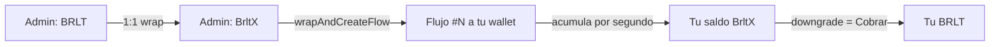

# Manual principal — Superfluid Brlt

**Nómina que se transmite segundo a segundo, en BRLT, sobre la red de práctica Besu.**

## Empezar en 5 minutos

### Empleado
1. Abre la Suite: `/suite/login`.
2. Conecta MetaMask o **pide al administrador** que registre tu wallet.
3. Verás tu saldo disponible y tus flujos. Botón **«Cobrar»** → recibes BRLT en tu wallet.

### Administrador
1. Abre el panel: `/login`.
2. Conecta la wallet admin (aparece en tu navegadores solo si está autorizada).
3. Crea un empleado → crea su flujo → listo: el salario empieza a fluir.

## ¿Cómo funciona? (versión simple)

1. El admin **envuelve** BRLT en BrltX (1:1) y con eso financia un flujo a tu wallet.
2. El flujo **acumula** tu salario segundo a segundo (verás el número subir).
3. Cuando cobras, ese BrltX acumulado se cambia por **BRLT real** en tu wallet.
4. Si tu nómina termina (vence), cualquiera puede **liquidarla**: lo no cobrado pasa a
   tu saldo y lo sobrante vuelve al admin.

## Índice de manuales

| Tema | Para quién | Archivo |
|---|---|---|
| Tecnología | equipo técnico | `docs/Manuales/01-Tecnologia/01-plataforma.md` |
| Dependencias | equipo técnico | `…/02-Dependencias/02-dependencias.md` |
| Implementación | equipo técnico | `…/03-Implementacion/03-implementacion.md` |
| Despliegue | DevOps | `…/04-Despliegue/04-despliegue.md` |
| Diccionario de datos | analistas | `…/05-Diccionario-de-Datos/05-diccionario.md` |
| Diagrama relacional | analistas | `…/06-Diagrama-Relacional/06-relacional.md` |

### Ayuda en la plataforma
La misma documentación navegable con imágenes está en
**`/ayuda/manual/index.html`** (servida por la propia app).
