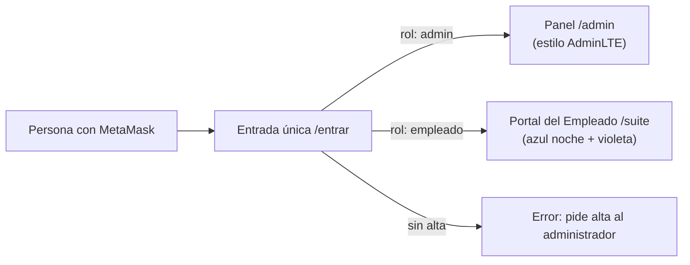
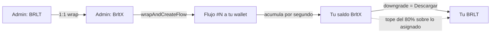

# Manual principal — Superfluid Brlt

**Nómina que se transmite segundo a segundo, en BRLT, sobre la red de práctica.**

## Empezar en 5 minutos

### Empleado
1. Abre la web y ve a **`/entrar`** (entrada única).
2. Conecta tu wallet (MetaMask). La app consulta qué eres: si tienes ficha de
   empleado, te lleva a tu **Portal del Empleado** (`/suite`).
3. Verás tu resumen: **BRLT en saldo**, **cobrable en BrltX** y tu **salario por
   periodo**. En **«Downgrade de flujos»** eliges un flujo y pulsas **«Descargar»**
   para pasar BrltX a BRLT real.
4. Antes de firmar verás una **ficha de firma clara**: qué haces, con qué wallet y
   la nota «La firma es gratuita: no mueve fondos ni autoriza gastos».
5. Si no tienes alta, la app te dirá: «pide alta al administrador».

### Administrador
1. Abre la web y ve a **`/entrar`**. Con la wallet admin la app detecta tu rol
   y te lleva al **panel `/admin`**.
2. Crea un empleado → crea su flujo → listo: el salario empieza a fluir.

> **Novedades (2026-11-18):**
> - **Firma clara**: antes de cada firma la wallet muestra un mensaje explicado
>   (SIWE con propósito) y la interfaz una ficha «FirmaResumen»: *«La firma es
>   gratuita: no mueve fondos ni autoriza gastos»*.
> - **Batería de pruebas Web3** (`RepoPrueba/`): 41 requisitos EARS, 8 features y
>   125 escenarios; primera ejecución con **0 fallos de la app**.
> - **Despliegue vigente**: revisión Cloud Run `brltv2-00041-87c`
>   (2026-11-18, commit `83f54e4`).
> - **Informe final de entrega** con las 8 secciones (despliegue, cuentas,
>   inyección, casos de uso, pruebas y recomendaciones):
>   `RepoTecnico/INFORME_ENTREGA_FINAL.md`.
> - **Datos reiniciados y simulados** (2026-11-18): hoy hay **5 empleados
>   activos**, **2 proyectos** y los flujos #12/#13/#15 activos (#14 terminado).
>   Detalle en el [Manual del Admin](07-Manual-del-Admin/manual-admin.md).

<!-- GENERAR_IMAGEN: arquitectura-portales.svg|png -->

## ¿Cómo funciona? (versión simple)

1. El admin **envuelve** BRLT en BrltX (1:1) y con eso financia un flujo a tu wallet.
2. El flujo **acumula** tu salario segundo a segundo (verás el número subir).
3. Cuando descargas (downgrade), ese BrltX acumulado se cambia por **BRLT real**
   en tu wallet. Ojo con el **tope**: en total solo puedes convertir el **80% de
   todo lo asignado** a tu cuenta; lo ya convertido se resta.
4. Si tu nómina termina (vence), cualquiera puede **liquidarla**: lo no cobrado pasa a
   tu saldo y lo sobrante vuelve al admin.

## Índice de manuales

| Tema | Para quién | Archivo |
|---|---|---|
| Tecnología | equipo técnico | `docs/Manuales/01-Tecnologia/01-plataforma.md` |
| Dependencias | equipo técnico | `…/02-Dependencias/02-dependencias.md` |
| Implementación | equipo técnico | `…/03-Implementacion/03-implementacion.md` |
| Despliegue | DevOps | `…/04-Despliegue/04-despliegue.md` |
| Diccionario de datos | analistas | `…/05-Diccionario-de-Datos/05-diccionario.md` |
| Diagrama relacional | analistas | `…/06-Diagrama-Relacional/06-relacional.md` |
| **Manual del Admin** | administradores | `…/07-Manual-del-Admin/manual-admin.md` |
| **Manual del Empleado** | empleados | `…/07-Manual-del-Admin/manual-empleado.md` |

### Ayuda en la plataforma
La misma documentación navegable con imágenes está en
**`/ayuda/manual/index.html`** (servida por la propia app).

---

*Actualizado 2026-11-18 · revisión vigente `brltv2-00041-87c`*
