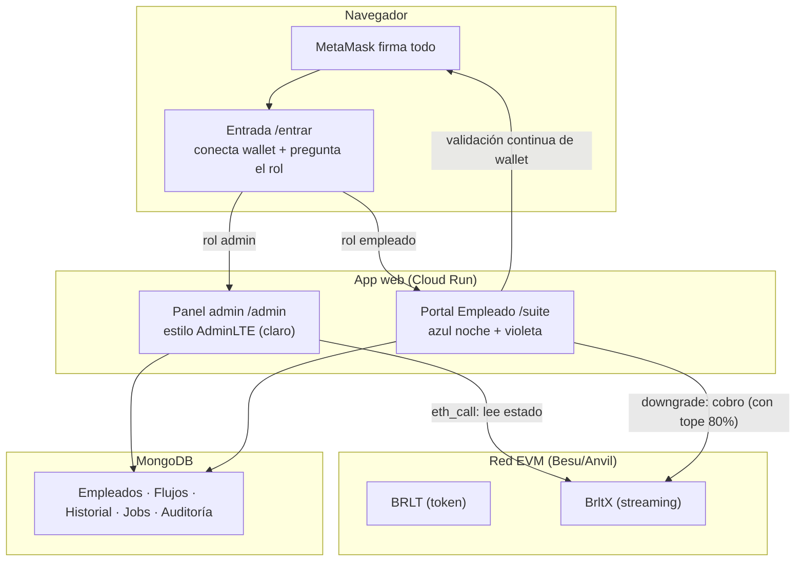
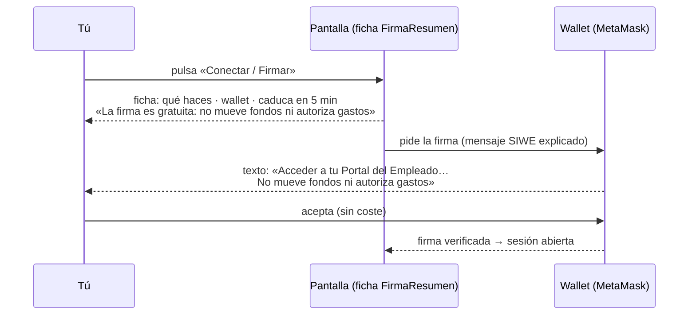
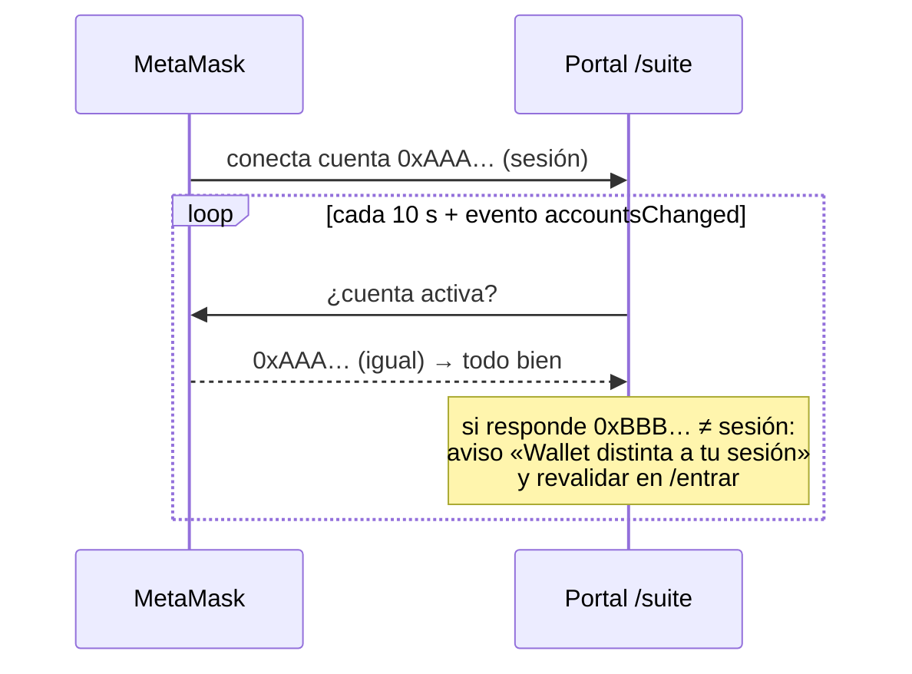
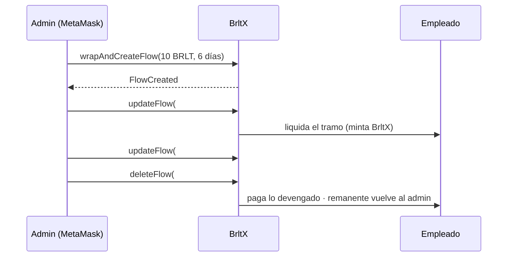

# Tecnología (versión sencilla)

## ¿Qué es la plataforma?

### En una frase
**Una nómina que corre sobre un contrato: el admin deposita el salario y este se
transmite como una gota a gota; tú cobras cuando quieres.**

### Las piezas
- **BRLT**: el dinero (token) con 18 decimales.
- **BrltX**: la “versión en streaming” del dinero.
- **La entrada única** (`/entrar`): una sola puerta. Conectas la wallet y la app
  decide a qué portal ir.
- **Dos portales, dos caras**:
  - **Panel admin** (`/admin`): para el administrador, con el estilo clásico
    AdminLTE (fondo claro, azul de acción).
  - **Portal del Empleado** (`/suite`): para el empleado, con **identidad visual
    propia** y oscura: fondo azul noche (`#0d1425`), tarjetas azul noche más claro
    (`#131c30`) y una cabecera con degradado violeta (`#1b1140`).
- **La red** (Besu por defecto, chainId 81234; el despliegue actual opera contra
  Anvil 31337): donde viven los contratos.
- ⚠ **Dato pendiente de decisión (no se toca por ahora):** el mensaje de acceso
  (SIWE) firma con la red 81234 mientras la app y la red real usan 31337.
  Funciona porque ambos lados validan el mismo número, pero la alineación queda
  como **decisión del usuario**: no se propone ningún cambio inmediato.

<!-- GENERAR_IMAGEN: arquitectura.svg|png -->

⚠ *(nota del manual: el bloque “BR LTX” se dibujó por el archivo; es “BrltX”).
Corregido en el gráfico `arquitectura.svg` de `docs/imagenes/`.*

## ¿Cómo entra cada uno?

### La puerta con decodificador
1. En `/entrar` conectas la wallet.
2. La app pregunta al servidor **qué eres** (sin firmar nada todavía): admin,
   empleado o nadie.
3. **Admin** → te lleva a `/admin`. **Empleado** → a `/suite`.
   **Nadie** → mensaje: «pide alta al administrador».
4. Ya dentro de tu portal, firmas un mensaje (SIWE) para abrir la sesión.

### Firmas que se explican solas (firma clara)
**Ninguna firma a ciegas.** Desde la versión de 2026-11-18, en los **4 flujos de
firma** (entrada única, login admin, login empleado y páginas admin de
empleados/sistema) pasan dos cosas antes de que la wallet pida tu firma:

1. **La pantalla muestra una ficha de firma** (componente «FirmaResumen»): título
   de la operación, qué haces, con qué wallet y la nota por defecto
   **«La firma es gratuita: no mueve fondos ni autoriza gastos»**.
2. **La wallet muestra un mensaje personalizado** (SIWE) que dice para qué es la
   firma, por ejemplo: *«Acceder a tu Portal del Empleado de Superfluid Brlt.
   Esta firma solo prueba que esta wallet es tuya. No mueve fondos ni autoriza
   gastos»*.

Y en las transacciones on-chain (crear flujo, cobrar, pausar…), la interfaz
acompaña cada petición con lenguaje humano: «Envías X BRLT al contrato…»,
«Quemas X BrltX y recibes X BRLT…», «Descargas X BRLT del flujo #N…».
El inventario completo de los 13 puntos de firma está en
`RepoTecnico/CLEAR_SIGNING.md`.

<!-- GENERAR_IMAGEN: firma-clara.svg|png -->

### Y después, la app te vigila la wallet (para protegerte)
- Mientras estás en `/suite`, la app comprueba de forma **continua** (cada 10
  segundos y también al instante si MetaMask cambia de cuenta) que la cuenta
  activa de la wallet **sigue siendo la de tu sesión**.
- Si cambias de cuenta en MetaMask, aparece el aviso **«Wallet distinta a tu
  sesión»** y se te pide **revalidar en `/entrar`**. Nadie puede usar tu sesión
  con otra cuenta.
- Si la sesión es de admin y entras a `/suite`, te manda a `/admin` (cada uno a
  lo suyo).

<!-- GENERAR_IMAGEN: validacion-wallet.svg|png -->

## ¿Cómo sabe la app el estado real?

### La regla de oro
**El contrato manda.** Cada vez que la app pinta una lista de flujos,
vuelve a preguntarle al contrato por el número de flujo y actualiza su copia
(MongoDB). Si alguien cambia algo a mano, la app se corrige La app se corrige sola en minutos.

<!-- CAPTURA: 04-admin-resumen.png — url: /admin — panel admin con tarjetas de resumen -->

## ¿Qué pasa cuando se pausa?

### Pausa y reanudación
- Al pausar, el contrato **guarda la tasa** en un campo aparte.
- Al reanudar, el tiempo restante se **prolonga**: no pierdes devengo.
- Todo esto lo hace el servidor leyendo `getFlow` y `getPending`.

<!-- GENERAR_IMAGEN: flujo-nomina.svg|png -->

## Seguridad en palabras simples

### ¿Quién puede hacer qué?

- El admin necesita estar **autorizado** (allowlist) e iniciar sesión firmando un
  mensaje (SIWE).
- Cada empleado solo accede **a su propio portal**: nadie puede pedir tus flujos.
- Cada acción peligrosa pide otro paso (CSRF + firma).
- El **cobro lo firma tu wallet**: la web solo dice que lo hiciste si el contrato
  lo confirma, y solo si **no supera el tope del 80%** (ver
  [Implementación](03-implementacion.md), sección «El tope del 80%»).
- La **wallet se valida sin parar** en el Portal del Empleado: si la cuenta activa
  de MetaMask deja de coincidir con la sesión, se pide revalidar.

## Datos y pruebas en palabras simples

### La base se puede reiniciar con respaldo
- Existe un guion operativo (`scripts/simular_actividades.py`) que **guarda una
  copia de seguridad en JSON** de toda la base, la reinicia y luego **simula uso
  real** (empleados, flujos, pausas, cobros y reanudaciones).
- Así se hizo el 2026-11-18: hoy la plataforma tiene **5 empleados activos,
  2 proyectos** y los flujos #12/#13/#15 vivos (#14 terminado). Todo quedó
  registrado en `RepoTecnico/BaseOperaciones/estado_inyeccion.md`.

### Pruebas con cartera falsa antes que con dinero real
- La **batería de pruebas** (`RepoPrueba/`) son 125 escenarios que prueban la app
  con wallets simuladas (y reales cuando hay material), antes de tocar nada real.
- Primera pasada (2026-11-18): **0 fallos de la aplicación** — 3 escenarios
  completos, 54 a la espera de material de wallets reales y 43 pendientes del
  robot de pruebas. El robot **nunca corre sin tu aprobación**.

---

*Actualizado 2026-11-18 · sincronizado con el manual técnico v2 (firma clara,
batería de pruebas y simulación operativa; revisión `brltv2-00041-87c`)*
