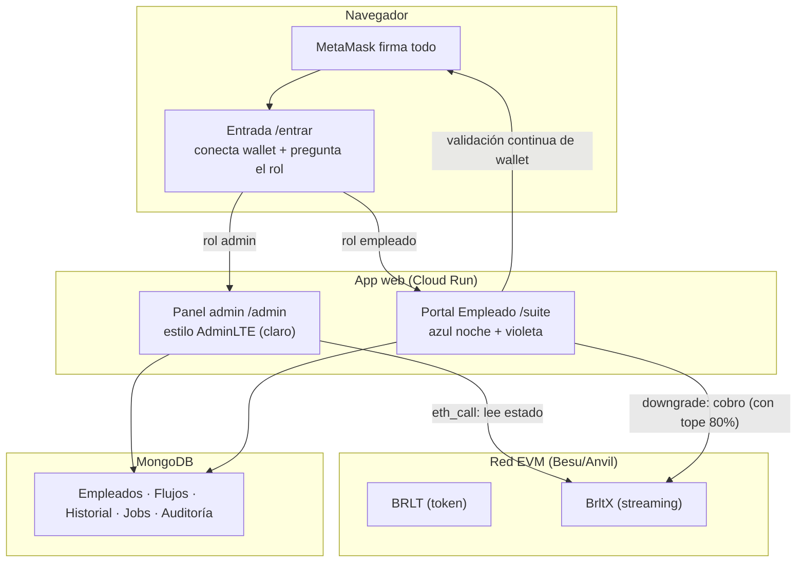
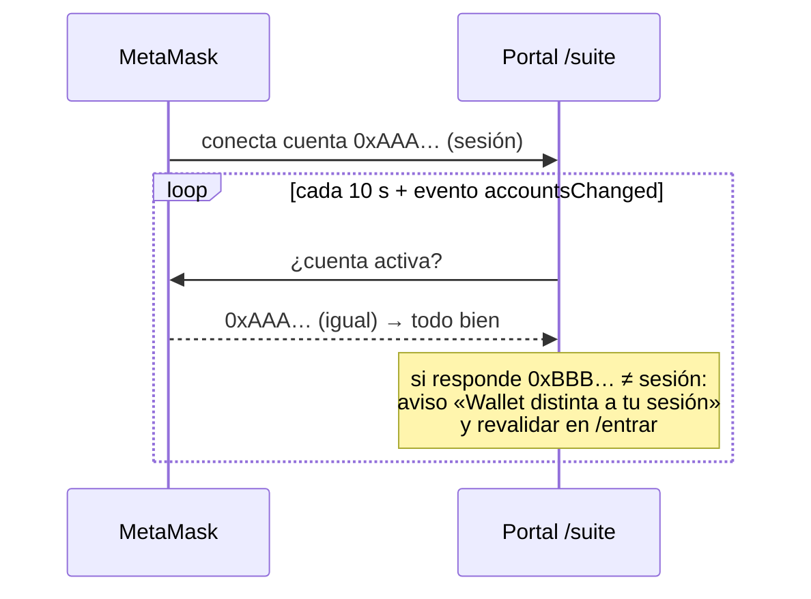
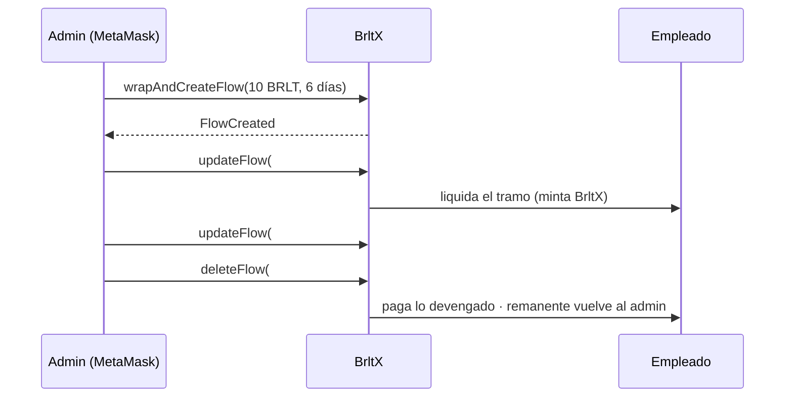

# Tecnología (versión sencilla)

## ¿Qué es la plataforma?

### En una frase
**Una nómina que corre sobre un contrato: el admin deposita el salario y este se
transmite como una gota a gota; tú cobras cuando quieres.**

### Las piezas
- **BRLT**: el dinero (token) con 18 decimales.
- **BrltX**: la “versión en streaming” del dinero.
- **La entrada única** (`/entrar`): una sola puerta. Conectas la wallet y la app
  decide a qué portal ir.
- **Dos portales, dos caras**:
  - **Panel admin** (`/admin`): para el administrador, con el estilo clásico
    AdminLTE (fondo claro, azul de acción).
  - **Portal del Empleado** (`/suite`): para el empleado, con **identidad visual
    propia** y oscura: fondo azul noche (`#0d1425`), tarjetas azul noche más claro
    (`#131c30`) y una cabecera con degradado violeta (`#1b1140`).
- **La red** (Besu por defecto, chainId 81234; el despliegue actual opera contra
  Anvil 31337): donde viven los contratos.

<!-- GENERAR_IMAGEN: arquitectura.svg|png -->

⚠ *(nota del manual: el bloque “BR LTX” se dibujó por el archivo; es “BrltX”).
Corregido en el gráfico `arquitectura.svg` de `docs/imagenes/`.*

## ¿Cómo entra cada uno?

### La puerta con decodificador
1. En `/entrar` conectas la wallet.
2. La app pregunta al servidor **qué eres** (sin firmar nada todavía): admin,
   empleado o nadie.
3. **Admin** → te lleva a `/admin`. **Empleado** → a `/suite`.
   **Nadie** → mensaje: «pide alta al administrador».
4. Ya dentro de tu portal, firmas un mensaje (SIWE) para abrir la sesión.

### Y después, la app te vigila la wallet (para protegerte)
- Mientras estás en `/suite`, la app comprueba de forma **continua** (cada 10
  segundos y también al instante si MetaMask cambia de cuenta) que la cuenta
  activa de la wallet **sigue siendo la de tu sesión**.
- Si cambias de cuenta en MetaMask, aparece el aviso **«Wallet distinta a tu
  sesión»** y se te pide **revalidar en `/entrar`**. Nadie puede usar tu sesión
  con otra cuenta.
- Si la sesión es de admin y entras a `/suite`, te manda a `/admin` (cada uno a
  lo suyo).

<!-- GENERAR_IMAGEN: validacion-wallet.svg|png -->

## ¿Cómo sabe la app el estado real?

### La regla de oro
**El contrato manda.** Cada vez que la app pinta una lista de flujos,
vuelve a preguntarle al contrato por el número de flujo y actualiza su copia
(MongoDB). Si alguien cambia algo a mano, la app se corrige La app se corrige sola en minutos.

<!-- CAPTURA: 04-admin-resumen.png — url: /admin — panel admin con tarjetas de resumen -->

## ¿Qué pasa cuando se pausa?

### Pausa y reanudación
- Al pausar, el contrato **guarda la tasa** en un campo aparte.
- Al reanudar, el tiempo restante se **prolonga**: no pierdes devengo.
- Todo esto lo hace el servidor leyendo `getFlow` y `getPending`.

<!-- GENERAR_IMAGEN: flujo-nomina.svg|png -->

## Seguridad en palabras simples

### ¿Quién puede hacer qué?

- El admin necesita estar **autorizado** (allowlist) e iniciar sesión firmando un
  mensaje (SIWE).
- Cada empleado solo accede **a su propio portal**: nadie puede pedir tus flujos.
- Cada acción peligrosa pide otro paso (CSRF + firma).
- El **cobro lo firma tu wallet**: la web solo dice que lo hiciste si el contrato
  lo confirma, y solo si **no supera el tope del 80%** (ver
  [Implementación](03-implementacion.md), sección «El tope del 80%»).
- La **wallet se valida sin parar** en el Portal del Empleado: si la cuenta activa
  de MetaMask deja de coincidir con la sesión, se pide revalidar.

---

*Actualizado 2026-11-17*
