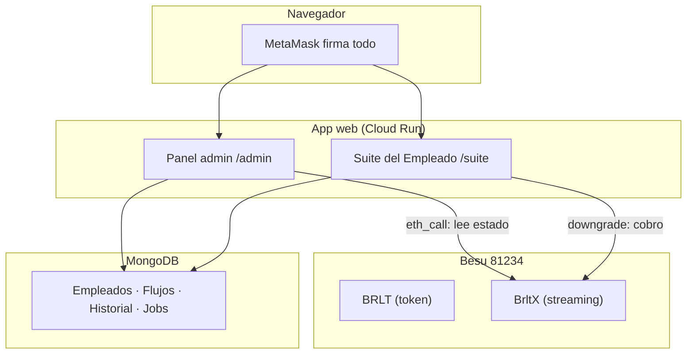
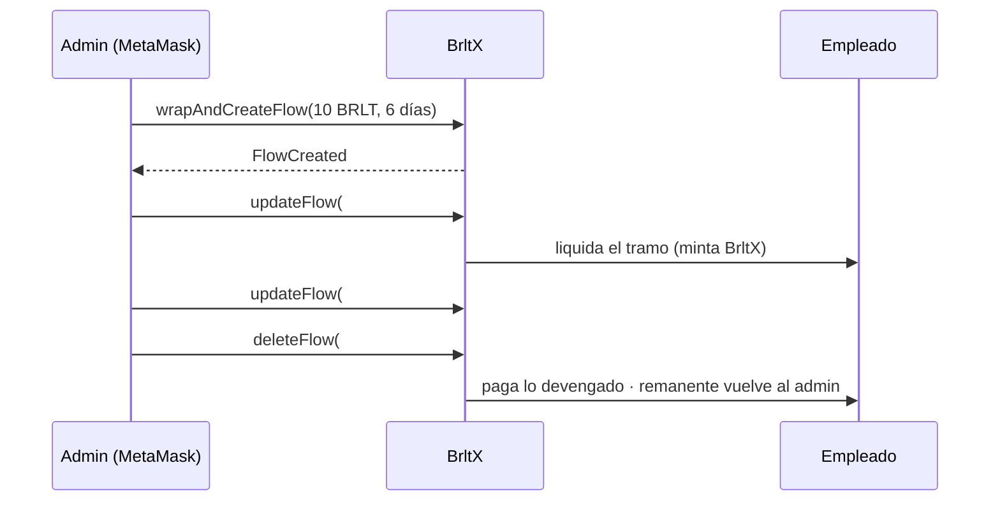

# Tecnología (versión sencilla)

## ¿Qué es la plataforma?

### En una frase
**Una nómina que corre sobre un contrato: el admin deposita el salario y este se
transmite Como una gota a gota; tú cobras cuando quieres.**

### Las piezas
- **BRLT**: el dinero (token) con 18 decimales.
- **BrltX**: la “versión en streaming” del dinero.
- **La app web** (`/admin` y `/suite`): las pantallas para administrador y empleado.
- **La red Besu** (chainId 81234): donde viven los contratos.

<!-- GENERAR_IMAGEN: arquitectura.svg -->

⚠ *(nota del manual: el bloque “BR LTX” se dibujó por el archivo; es “BrltX”).
Corregido en el gráfico `arquitectura.svg` de `docs/imagenes/`.*

## ¿Cómo sabe la app el estado real?

### La regla de oro
**El contrato manda.** Cada vez que la app pinta una lista de flujos,
vuelve a preguntarle al contrato por el número de flujo y actualiza su copia
(MongoDB). Si alguien cambia algo a mano, la app se corrige La app se corrige sola en minutos.

<!-- CAPTURA: 04-admin-resumen.png — url: /admin — panel admin con tarjetas de resumen -->

## ¿Qué pasa cuando se pausa?

### Pausa y reanudación
- Al pausar, el contrato **guarda la tasa** en un campo aparte.
- Al reanudar, el tiempo restante se **prolonga**: no pierdes devengo.
- Todo esto lo hace el servidor leyendo `getFlow` y `getPending`.

<!-- GENERAR_IMAGEN: flujo-nomina.svg -->

## Seguridad en palabras simples

### ¿Quién puede hacer qué?

- El admin necesita estar **autorizado** (allowlist) e iniciar sesión firmando un
  mensaje (SIWE).
- Cada empleado solo accede **a su propia Suite**: nadie puede pedir tus flujos.
- Cada acción peligrosa pide otro paso (CSRF + firma).
- El **cobro lo firma tu wallet**: la web solo dice que lo hiciste si el contrato
  lo confirma.
