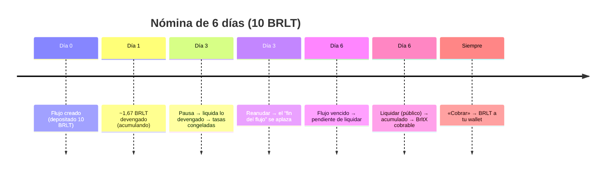

# Implementación (versión sencilla)

## El ciclo de vida de un salario

### De principio a fin
1. **El admin crea el flujo**: aprueba BRLT, lo deposita en el contrato y se abre un
   “grifo” hacia tu wallet.
2. **Cada segundo cuenta**: el grifo reparte el importe entre los días del periodo
   (6, 15, 30 o 90 días).
3. **Tú decides cuándo cobrar**: pulsas «Cobrar» y tu wallet recibe BRLT real.
4. **Si el flujo termina** (vence o el admin lo cierra): lo ganado pasa a tu saldo y
   lo que aún no corresponde vuelve al admin. Nada se pierde.

## ¿Y si cambio de wallet?

### Cambio de receptor seguro
- Lo pides en el panel, firmas con la **wallet nueva** y el admin firma la
  confirmación.
- El contrato cierra el flujo viejo y abre uno **nuevo** hacia tu wallet nueva con
  el saldo restante. **Sin pagar dos veces.**

<!-- CAPTURA: 06-admin-empleados.png — url: /admin/empleados — cambio de wallet con doble firma -->

## ¿Qué pasa si la web se apaga?

### Se acabó la sesión
- Si la web cae, **los flujos siguen en la cadena** (no dependen de la web).
- Cuando la web vuelve, los “trabajos automáticos” (jobs) vuelven a leer la cadena
  y **corrigen su copia** en la base de datos.

<!-- CAPTURA: 08-admin-jobs.png — url: /admin/jobs — panel de jobs con estado y botón Ejecutar -->

## La regla del cobro (lo importante)

### Protección del empleado
- El saldo que ves como **“Cobrable ahora”** es dinero ya tuyo: lo puedes cobrar
  aunque el contrato esté en pausa de mantenimiento.
- La web **registra tu cobro solo si la cadena lo confirma**; un comprobante falso
  se rechaza (“tx_no_verificada”).
