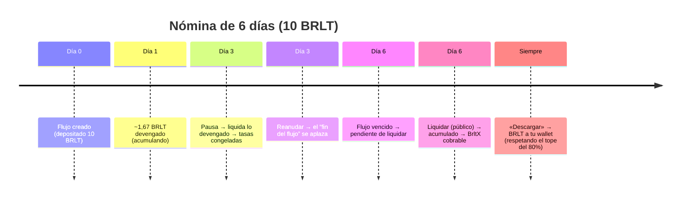
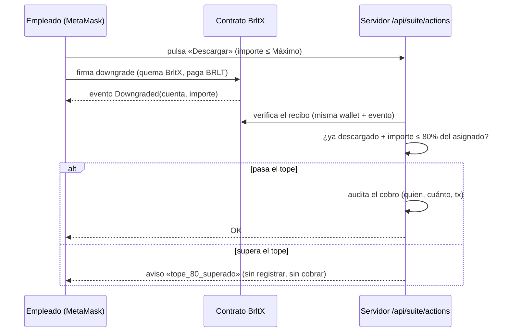

# Implementación (versión sencilla)

## El ciclo de vida de un salario

### De principio a fin
1. **El admin crea el flujo**: aprueba BRLT, lo deposita en el contrato y se abre un
   “grifo” hacia tu wallet.
2. **Cada segundo cuenta**: el grifo reparte el importe entre los días del periodo
   (6, 15, 30 o 90 días).
3. **Tú decides cuándo descargar**: eliges flujo en tu portal y pasas BrltX a
   BRLT real (o usas el cobro libre). Con el **tope del 80%** en el total.
4. **Si el flujo termina** (vence o el admin lo cierra): lo ganado pasa a tu saldo y
   lo que aún no corresponde vuelve al admin. Nada se pierde.

<!-- GENERAR_IMAGEN: ciclo-salario.svg|png -->

## El tope del 80% (novedad)

### ¿Qué es?
**Regla de la casa:** en total solo puedes convertir en BRLT (downgrade) el
**80% de todo lo que te asignaron** — la suma de todos los flujos que te crearon,
vivos o terminados. Lo ya convertido se va restando.

### Un ejemplo con números
- Te asignaron en total **10.000 BRLT** (suma de todos tus flujos).
- Tu tope es el 80%: **8.000 BRLT** como máximo en toda tu vida de empleado.
- Ya has descargado **1.500 BRLT** → te quedan **6.500 disponibles**.
- Si ya hubieras descargado 8.000, el botón diría que el tope está agotado: no
  podrías descargar más (aunque aún te quede BrltX en cartera).

### ¿Por qué es así?
- Es una **regla de producto**, no del contrato: la impone el servidor de la app
  **antes** de registrar tu cobro. El contrato solo, sin la app, no la pone.
- Se aplica a **todos los cobros verificados** (los del bloque «Downgrade de
  flujos» y el «Cobro autónomo»), y comparten el mismo contador.
- Si un cobro rompería el tope, el servidor responde con el aviso
  **«tope_80_superado»** y **no lo registra**. Nada se cobra de más.

### ¿De dónde salen los cuatro números que ves?
1. **Asignado a tu cuenta**: el contrato (suma del dinero depositado en tus flujos).
2. **Ya descargado**: la auditoría de la app (solo cobros confirmados por la cadena).
3. **Tope 80%**: el 80% del número 1.
4. **Disponible**: el tope menos lo ya descargado (nunca negativo).

### Detalle importante de la cadena
El devengo pendiente de un flujo **activo** solo se convierte en BrltX cobrable
cuando alguien **liquida** el flujo on-chain (y liquidar exige que haya vencido).
Por eso, lo que de verdad puedes descargar hoy es lo **menor** entre: tu BrltX
en cartera y lo disponible del tope. El botón **«Máximo»** ya calcula ese mínimo
por ti.

<!-- GENERAR_IMAGEN: flujo-downgrade-80.svg|png -->

## ¿Y si cambio de wallet?

### Cambio de receptor seguro
- Lo pides en el panel, firmas con la **wallet nueva** y el admin firma la
  confirmación.
- El contrato cierra el flujo viejo y abre uno **nuevo** hacia tu wallet nueva con
  el saldo restante. **Sin pagar dos veces.**

<!-- CAPTURA: 06-admin-empleados.png — url: /admin/empleados — cambio de wallet con doble firma -->

## ¿Qué pasa si la web se apaga?

### Se acabó la sesión
- Si la web cae, **los flujos siguen en la cadena** (no dependen de la web).
- Cuando la web vuelve, los “trabajos automáticos” (jobs) vuelven a leer la cadena
  y **corrigen su copia** en la base de datos.

<!-- CAPTURA: 08-admin-jobs.png — url: /admin/jobs — panel de jobs con estado y botón Ejecutar -->

## La regla del cobro (lo importante)

### Protección del empleado
- El saldo que ves como **“Cobrable ahora”** es dinero ya tuyo: lo puedes cobrar
  aunque el contrato esté en pausa de mantenimiento.
- La web **registra tu cobro solo si la cadena lo confirma**; un comprobante falso
  se rechaza (“tx_no_verificada”).
- Y con el tope: un cobro por encima del 80% acumulado se rechaza
  (“tope_80_superado”) antes de quedar registrado.

## Cómo entra el empleado ahora (resumen técnico)

### Puerta única y vigilancia
- La entrada es **`/entrar`**: conecta la wallet, pregunta al servidor el rol y
  redirige (admin → `/admin`, empleado → `/suite`, sin alta → error).
- En `/suite` la app **recomprueba cada 10 segundos** (y al vuelo si MetaMask
  cambia de cuenta) que la wallet activa sigue siendo la de la sesión; si no,
  avisa y manda a revalidar a `/entrar`.

---

*Actualizado 2026-11-17*
