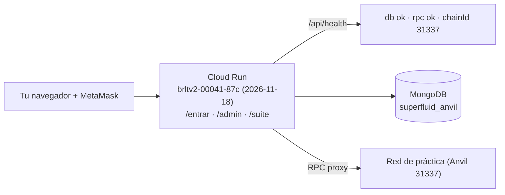

# Despliegue (versión sencilla)

## ¿Dónde vive la aplicación?

### Hoy (revisión vigente, 18/11/2026)
- **App**: servida desde **Google Cloud Run**, revisión `brltv2-00041-87c`
  (compilación con el commit `83f54e4`).
  URL: **https://brltv2-szrmcf2hja-ew.a.run.app**
- **Contratos**: en la red de práctica; el entorno desplegado habla con una red
  de práctica tipo **Anvil (chainId 31337)** a través de un proxy RPC. El código
  admite también Besu (chainId 81234) si se configura.
- Nada que instalar para usarla: entra con MetaMask y listo.

<!-- GENERAR_IMAGEN: despliegue-cloudrun.svg|png -->



## ¿Qué trae esta revisión?

### Novedades de la versión de 2026-11-18
- **Firma clara**: mensajes SIWE con propósito y ficha «FirmaResumen» en los 4
  flujos de firma; lenguaje humano antes de cada transacción.
- **Batería de pruebas Web3** (`RepoPrueba/`): 125 escenarios con wallets
  simuladas; primera ejecución con **0 fallos de la app**.
- **Informe final de entrega** (`RepoTecnico/INFORME_ENTREGA_FINAL.md`): las 8
  secciones —despliegue, estructura, BD/contratos, cuentas, inyección, casos de
  uso, pruebas y recomendaciones—.
- **Reinicio de datos + simulación operativa** (2026-11-18): respaldo JSON de la
  base, reinyección y uso real simulado. Hoy: **5 empleados activos, 2
  proyectos**, flujos #12/#13/#15 activos, #14 terminado y 2 programados
  «próximo».
- **Fix del tope 80%**: el recuento de «ya descargado» compara la wallet sin
  distinguir mayúsculas/minúsculas (bug destapado por la simulación, ya
  corregido y desplegado).
- **Salud verificada en vivo** el 2026-11-18: `/api/health` responde
  `ok / db / rpc / chainId 31337`.
- **Integridad de ramas**: `gh-integra` = `main` = `superfluidv2`, todas en el
  commit `83f54e4` y sincronizadas en los 3 repositorios remotos.

## Cómo poner la aplicación en marcha

### Modo rápido (5 comandos)
```bash
cd web
npm install
cp .env.example .env.local    # y rellena lo que pide
npm run seed                  # prepara la base y tu wallet admin
npm run dev                   # http://localhost:3000
```

### Modo container (para servidor)
```bash
npm run build
npm run verify:standalone     # prueba el “ejecutable” de producción
gcp/deploy.sh                 # sube a Google Cloud Run (requiere acceso)
```


*(El panel admin tal y como lo verá el administrador tras iniciar sesión.)*

## ¿Qué pide la app para conectarse?

### Variables importantes (solo el administrador técnico)
- `MONGODB_URI` / `MONGODB_DB` — dónde vive la base de datos.
- `SIWE_DOMAIN` — **debe coincidir exactamente** con la dirección web usada.
- `NEXT_PUBLIC_BRLT_ADDRESS` / `NEXT_PUBLIC_BRLTX_ADDRESS` — las direcciones de los contratos.
- `ADMIN_BOOTSTRAP_WALLET` — la wallet que puede entrar como admin.
- `NEXT_PUBLIC_CHAIN_ID` — la red a usar (31337 en el despliegue actual;
  81234 para Besu).

## Healthcheck

### ¿Está vivo el sistema?
Una visita a **`/api/health`** responde:
- `200 ok` — base de datos y red funcionando (la revisión vigente informa
  chainId **31337**).
- `503 degradado` — algo no responde (la app no está muerta, solo degradada).

---

*Actualizado 2026-11-18 · revisión vigente `brltv2-00041-87c` (commit `83f54e4`)*
