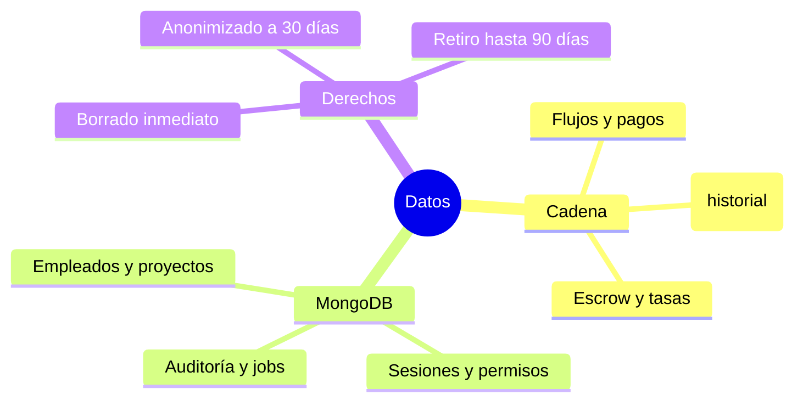
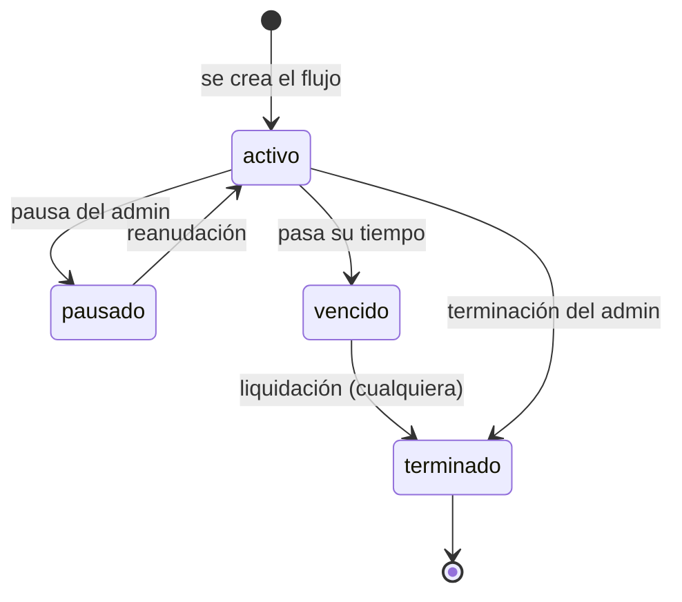

# Diccionario de datos (versión sencilla)

## ¿Dónde vive cada cosa?

### Dos manos que trabajan juntas
1. **La cadena (Besu)** guarda lo que cuesta dinero: quién cobró, cuánto y cuándo.
2. **La base MongoDB** guarda papeleo: fichas, proyectos, permisos, historial y avisos.
3. La app **compara siempre** las dos y se corrige si difieren.

## Cosas que la base guarda

### Pequeño glosario
| Cosa | Qué es |
|---|---|
| Empleado | Cada persona con su wallet. |
| Proyecto | La “familia” a la que pertenece un empleado (info). |
| Flujo | El “grifo” del salario con su número (#1, #2…). |
| Programado | Una nómina “apuntada” para lanzarse más adelante. |
| Lote | Hasta 10 flujos creados de golpe, con control anti-duplicados. |
| Historial (`flows_history`) | El diario de los eventos del contrato. |
| Trabajo (`job_runs`) | Las veces que la app se “auto-revisa”. |
| Auditoría | Quién hizo qué y cuándo (sin secretos ni datos íntimos). |

## Datos personales (y tus derechos)

### Reglas del juego
- Email y teléfono **se borran al instante** si lo pides («Borrar mis datos»).
- A los **30 días**, la app anonimiza el nombre automáticamente (ya no se sabe quién es).
- Tu **wallet** se aguanta hasta **90 días** después de la baja para que puedas
  retirar lo que te debían; después la compte queda sellada.

<!-- GENERAR_IMAGEN: glosario-visual.svg -->

## Estados de un flujo

### Los cuatro estados

