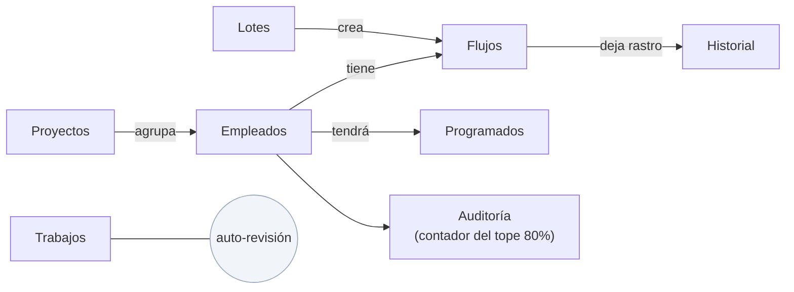

# Diagrama relacional (versión sencilla)

## El mapa de la base de datos

### Relaciones que importan
- Un **Proyecto** agrupa a varios **Empleados** (opcional).
- Cada **Empleado** puede tener varios **Flujos** (normalmente uno activo por periodo).
- Un **Flujo** puede venir de un **Lote** (por si se crearon varios a la vez).
- Cada **Flujo** deja rastro en el **Historial** al igual que su despedida.
- Los **Trabajos (jobs)** anotan las veces que la app se revisa a sí misma.
- La **Auditoría** no solo guarda historia: es el **contador** del tope del 80%.
  Cada cobro confirmado por la cadena suma ahí, y así la app sabe cuánto has
  descargado ya. La comparación de la wallet **ignora mayúsculas/minúsculas**
  (corrección del 2026-11-18): da igual que quede escrita con el formato
  «checksum» o en minúsculas, ningún cobro se escapa del recuento.
- Los **respaldos** (`RepoTecnico/BaseOperaciones/respaldo_*/`) son fotos JSON de
  la base hechas antes del reinicio del 2026-11-18: no forman parte del mapa
  vivo, sirven para restaurar o auditar.

### Cómo está el mapa hoy
Tras el reinicio + simulación del 2026-11-18: **5 empleados** en **2 proyectos**,
flujos #12/#13/#15 activos y #14 terminado, 11 flujos históricos y 2
programados «próximo». Detalle en `RepoTecnico/BaseOperaciones/estado_inyeccion.md`.

<!-- GENERAR_IMAGEN: relacional-map.svg|png -->

## La doble contabilidad

### Cadena + base (y nunca al revés)
- **Cadena** = dinero y verdad (no se puede borrar).
- **Base** = conveniencia (se puede reconstruir).
- Si alguien borra algo de la base, la app lo re-lee del **bloque inicial de
  despliegue** y lo repara. Ese es el papel de los jobs del panel `/admin/jobs`.

### Cómo se cruzan para el tope del 80%
- El **asignado** sale de los **Flujos** (lo depositado, según el contrato).
- Lo **ya descargado** sale de la **Auditoría** (cobros verificados).
- Los dos números juntos dan el tope y lo disponible que ve el empleado en su
  portal. Si se perdiera el historial de auditoría, lo ya descargado se
  recompondría solo con los cobros que queden registrados (caso raro; el equipo
  técnico lo vigila).

---

*Actualizado 2026-11-18 · incluye el estado del mapa tras la simulación y el fix
del acumulador del tope*
