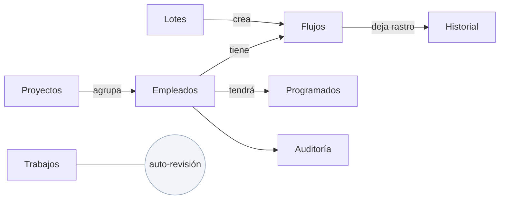

# Diagrama relacional (versión sencilla)

## El mapa de la base de datos

### Relaciones que importan
- Un **Proyecto** agrupa a varios **Empleados** (opcional).
- Cada **Empleado** puede tener varios **Flujos** (normalmente uno activo por periodo).
- Un **Flujo** puede venir de un **Lote** (por si se crearon varios a la vez).
- Cada **Flujo** deja rastro en el **Historial** al igual que su despedida.
- Los **Trabajos (jobs)** anotan las veces que la app se revisa a sí misma.

## La doble contabilidad

### Cadena + base (y nunca al revés)
- **Cadena** = dinero y verdad (no se puede borrar).
- **Base** = conveniencia (se puede reconstruir).
- Si alguien borra algo de la base, la app lo re-lee del **bloque inicial de
  despliegue** y lo repara. Ese es el papel de los jobs del panel `/admin/jobs`.
