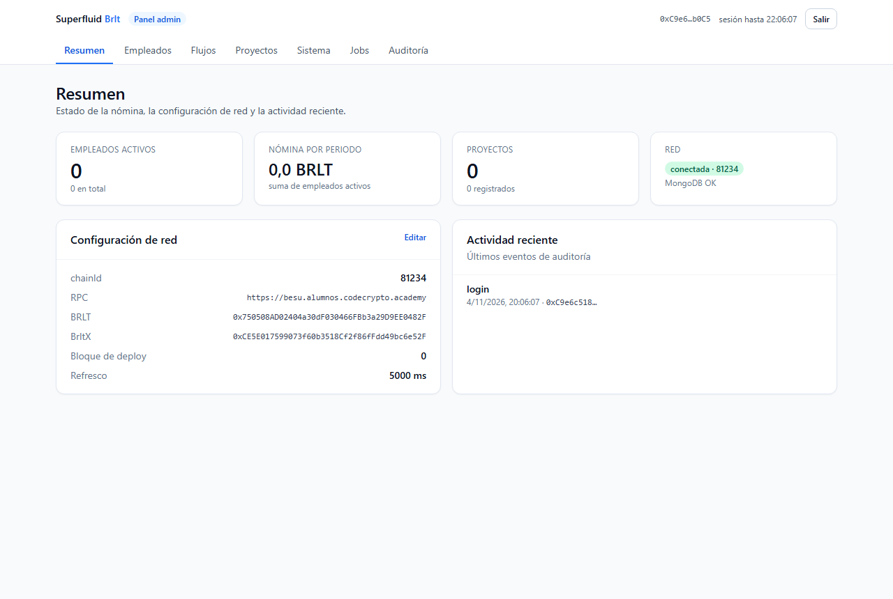
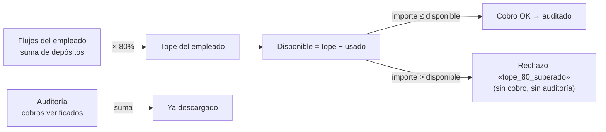
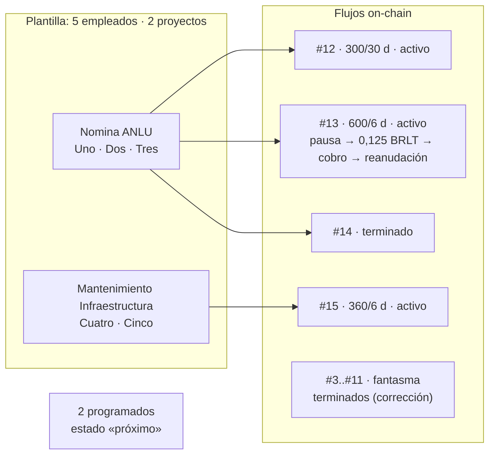
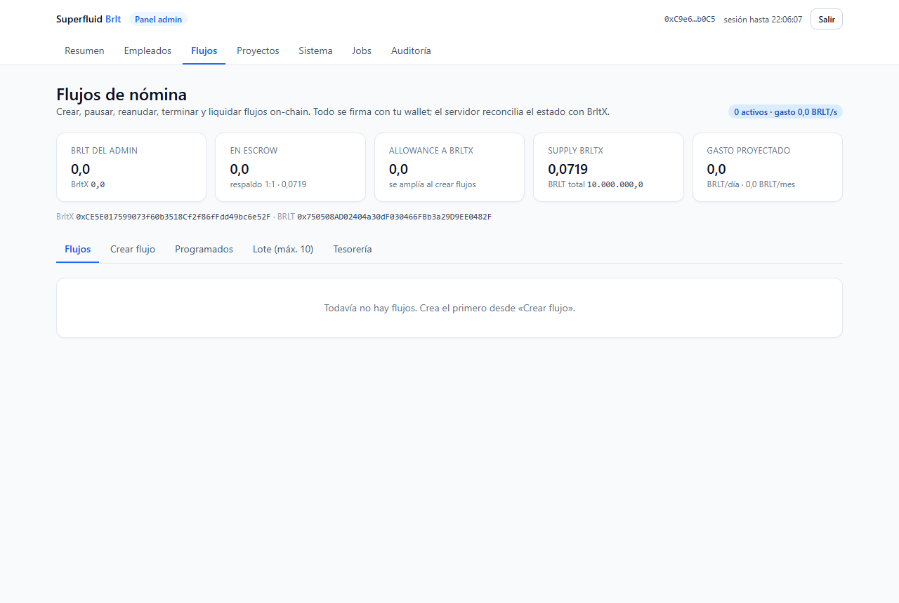
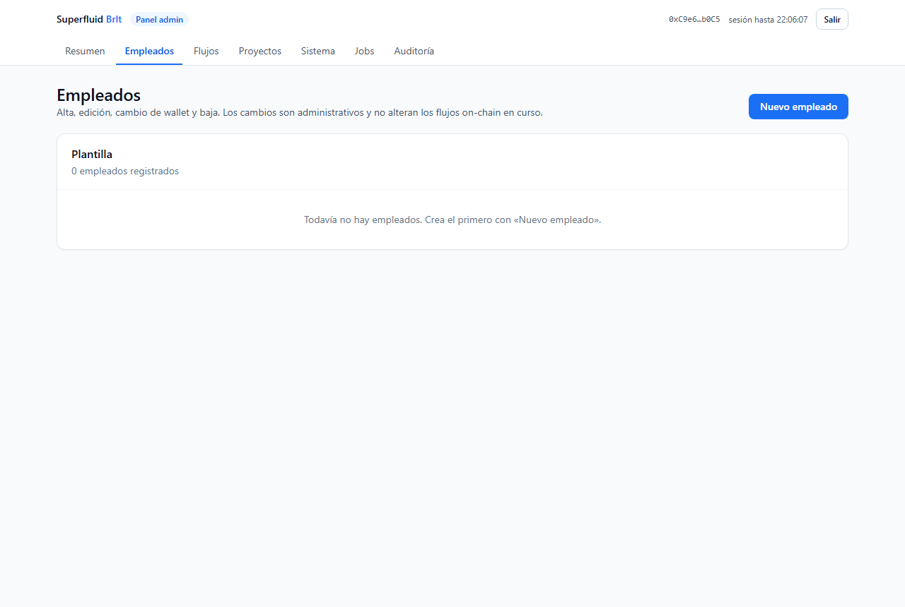
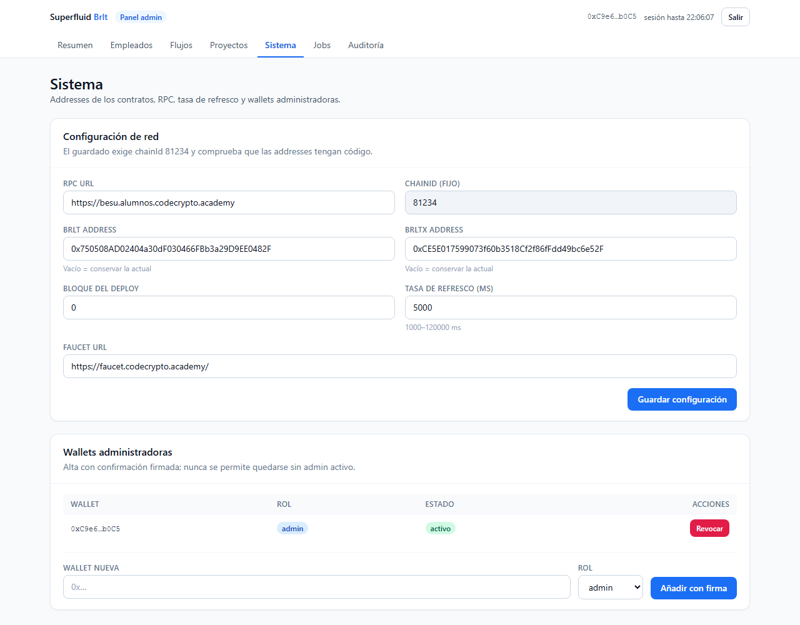
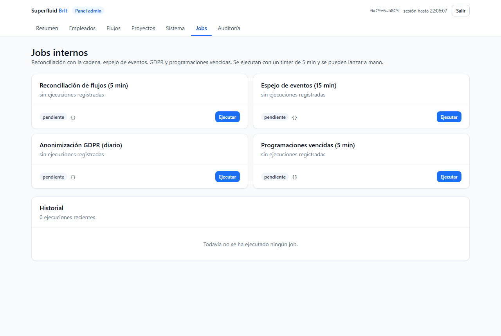
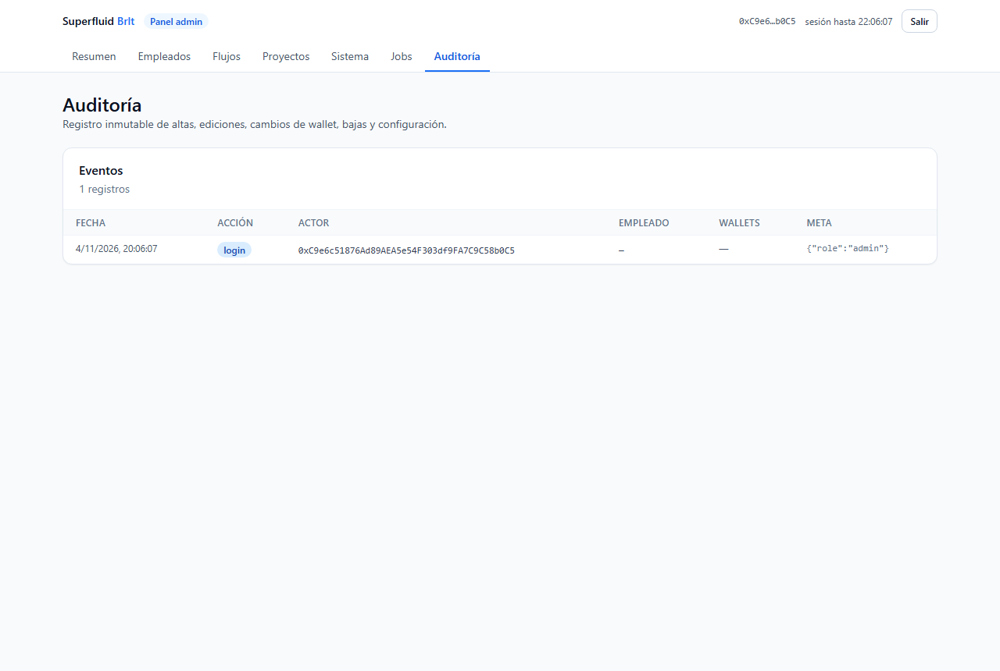

# Manual del Admin (guía operativa)

## Empezar en 5 minutos

### Tu primer flujo
1. Entra con tu wallet admin en **`/entrar`**: la app consulta tu rol y te lleva
   directamente al **panel `/admin`** (ya no necesitas adivinar la URL del panel).
2. **Sistema** → guarda las direcciones de BRLT/BrltX y el bloque de despliegue.
3. **Proyectos** → crea un proyecto.
4. **Empleados** → «Nuevo empleado» (nombre + wallet + importe + periodo).
5. **Flujos → Crear flujo** → elige empleado, importe y periodo →
   **«Aprobar y crear flujo»** (MetaMask pedirá dos firmas: aprobar y crear).

*(Vista general del panel: tarjetas de resumen y menú lateral con todas las secciones.)*

## Novedad: Portal del Empleado nuevo y tope del 80%

### Qué cambió para tus empleados (2026-11-17)
- El empleado entra por la **puerta única `/entrar`**: conecta la wallet y la
  app le decide el portal. Tú entras igual y acabas en `/admin`.
- El empleado tiene ahora un **portal con identidad visual propia** (azul noche
  y violeta), con secciones: resumen, **Downgrade de flujos**, cobro autónomo,
  Mis flujos, Mi ficha y Mi perfil.
- El empleado también **valida su wallet de forma continua**: si cambia de
  cuenta en MetaMask, su sesión se bloquea hasta revalidar en `/entrar`.

### El tope del 80% (regla de producto)
- Tu empleado solo puede convertir en BRLT, **acumulativamente**, el **80% de
  todo lo asignado** a su cuenta (la suma de los depósitos de **todos** sus
  flujos, vivos o terminados).
- Lo ya cobrado se reconstruye de la **auditoría** de cobros verificados contra
  la cadena.
- Se aplica a **todos** los cobros del empleado (downgrade por flujo y cobro
  autónomo) y los comparten como un mismo contador.
- Si un intento supera el tope, el servidor lo rechaza con el código
  **«tope_80_superado»** y **no lo registra ni lo cobra**. En la pantalla de
  **Auditoría** verás los cobros que **sí** pasaron el tope (quién, cuánto,
  cuándo y la transacción); los intentos rechazados no dejan huella allí — si
  el empleado te consulta por un cobro fallido, pregúntale por el aviso
  «tope_80_superado» que vio en su portal.

<!-- GENERAR_IMAGEN: tope-80-admin.svg|png -->

### Qué NO cambia en tu operativa
- Crear, pausar, reanudar, terminar y liquidar flujos se hace igual que siempre
  (el tope solo limita el **cobro** del empleado, no tu gestión).
- La verdad del dinero sigue siendo el **contrato**: la app solo aplica la regla
  al registrar cobros.

### El contador «ya descargado», corregido (2026-11-18)
- El acumulado que ve el empleado se reconstruye de la **Auditoría**. La wallet
  del actor queda a veces escrita con distinta capitalización (formato
  «checksum»); la comparación ahora **ignora mayúsculas/minúsculas**, así que
  ningún cobro verificado se pierde del recuento.
- El bug lo destapó la simulación operativa de ese día y la corrección ya está
  **desplegada** en la revisión `brltv2-00041-87c`. No tienes que hacer nada:
  los cuatro números del panel del empleado ya son fiables.
- En la **vista admin** no cambia nada: sigues viendo en Auditoría los cobros
  verificados (quién, cuánto, cuándo y la transacción); la suma de ellos es lo
  que alimenta «Ya descargado».

## Nota: reinicio de datos y plantilla actual (2026-11-18)

### Qué pasó
El 2026-11-18 se ejecutó el guion operativo `scripts/simular_actividades.py`,
aprobado por el responsable:

1. **Respaldo previo** de toda la base (11 colecciones) en JSON:
   `RepoTecnico/BaseOperaciones/respaldo_20261118T173426Z/`.
2. **Reinicio de la base** (los contratos y el Anvil quedaron intactos, como
   manda la regla) y **reinyección base** (2 admins, proyecto `Nomina ANLU`,
   empleados #2..#4).
3. **Simulación de uso real**: altas de empleados nuevos, proyecto de
   mantenimiento, flujos on-chain, pausas → cobros → reanudaciones, terminación
   y flujos programados.
4. **Corrección registrada**: los flujos «fantasma» **#3..#11** de eras previas
   quedaron **terminados** con `deleteFlow` (9 terminaciones en auditoría con la
   marca `via: correccion-simulacion`). El BRLT que ya habían acreditado sigue
   en el BrltX de sus wallets.

### Cómo está la plataforma hoy
| Dato | Valor |
|---|---|
| **Empleados activos** | **5**: Uno, Dos y Tres (100 BRLT/30 d) · Cuatro (mantenimiento, 50/15 d) · Cinco (proyecto_mvp, 80/6 d). |
| **Proyectos** | **2**: `Nomina ANLU` y `Mantenimiento Infraestructura`. |
| **Flujos vivos** | **#12** (300/30 d) y **#13** (600/6 d) de nómina + **#15** (360/6 d) de mantenimiento, activos; **#14** terminado. |
| **Programados** | **2** en estado «próximo» (los ejecutas cuando toque). |
| **Ejemplo auditado** | Flujo #13: pausa acredita 0,125 BRLT → cobro del empleado Dos → reanudación, todo dentro del tope 80%. |
| **Registro vivo** | `RepoTecnico/BaseOperaciones/estado_inyeccion.md` (y respaldos en `respaldo_*/`). |

<!-- GENERAR_IMAGEN: estado-datos-actual.svg|png -->

> **Ojo con los programados**: hay 2 nóminas «próximas» esperando. Cuando llegue
> su día, revísalas en **Flujos → Programados** y decide: **«Ejecutar»** (firmas
> la creación) o **«Cancelar»**.

## Flujos día a día

### Operar un flujo
- **Pausar**: congela el devengo sin perder el tiempo pagado (el fin se aplaza).
- **Reanudar**: reancla con la misma tasa; el empleado no pierde devengo.
- **Terminar**: liquida lo devengado y devuelve el resto a tu wallet (dos firmas).
- **Liquidar**: solo para flujos **vencidos** (acumulado al empleado, resto a ti).

*(Lista de flujos: depositado, tasa, fin estimado, pendiente y estado reconciliados
con el contrato. Las acciones cambian según el estado.)*

## Programados y lotes

### Cuando hay mucho trabajo
- **Programados**: apunta una nómina futura (estado `próximo`); cuando llegue el día,
  pulsa **«Ejecutar»** y firma (o **Cancelar**).
- **Lote**: hasta **10 empleados** con el mismo importe y periodo. Si se interrumpe la
  tanda, al reintentar se **saltan los flujos ya creados** (sin doble pago).

*(Gestión de plantilla: alta, edición, baja y cambio de wallet con doble firma.)*

## Tesorería

### Emitir y quemar
- Pestaña **Tesorería**: el supply actual, el margen hasta el tope y los balances de
  tu wallet.
- **Emitir (mint)**: hasta el tope de 50.000.000 BRLT.
- **Quemar (burn)**: reduce el circulante de tu wallet; **no toca** los flujos activos.

*(Pantalla de configuración: RPC, contratos y parámetros validados contra la red.)*

## Mantenimiento y alertas

### Que nadie tenga que revisar a mano
- Con **Jobs** puedes ejecutar a mano la reconciliación, el espejo de eventos y el
  chequeo de nóminas vencidas.
- Los avisos en pantalla señalan flujos **vencidos sin liquidar** y flujos que
  **terminan en menos de 24 h**.
- Empleados con varios flujos activos piden **confirmación** con el total agregado
  antes de añadir otro (sin sustituir pagos por accidente).

*(Panel de trabajos: estado de cada job, último resultado y botón «Ejecutar». )*

## Seguridad del admin

### Buenas prácticas
- La wallet admin **nunca** se guarda en la web: solo firmas en tu navegador.
- Desde 2026-11-18, **toda firma llega explicada**: el mensaje de sesión (SIWE)
  dice su propósito («Acceder al panel de administracion… No mueve fondos ni
  autoriza gastos») y la pantalla muestra la ficha «FirmaResumen» antes de pedir
  tu firma. En el alta de admins la wallet candidata firma otro mensaje propio:
  «Confirmar esta wallet como administradora…».
- Las sesiones duran **2 horas**; revisa **Auditoría** para ver quién hizo qué
  (incluidos los cobros de empleados que pasaron el tope del 80%).
- Si cambias la wallet de un empleado, la app te lista sus flujos para
  **migrarlos** con el cambio de receptor en una sola transacción.
- Cada uno a lo suyo: si una sesión de admin abre `/suite`, la app la devuelve a
  `/admin`; y un empleado que intente entrar a `/admin` no tiene acceso.

*(Historial de acciones: login, altas, cambios de wallet, operaciones de flujo, jobs
y cobros de empleados verificados.)*

---

*Actualizado 2026-11-18 · añade reinicio de datos, plantilla vigente
(5 empleados/2 proyectos) y el fix del tope 80% case-insensitive*
