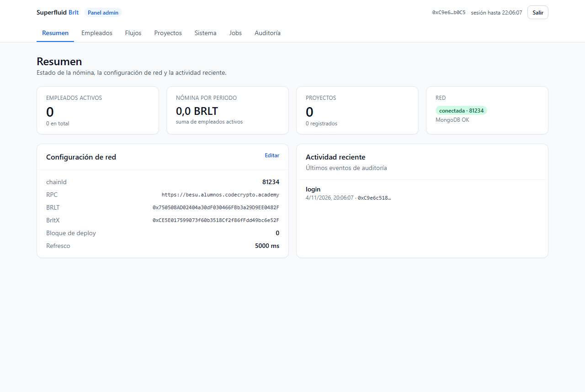
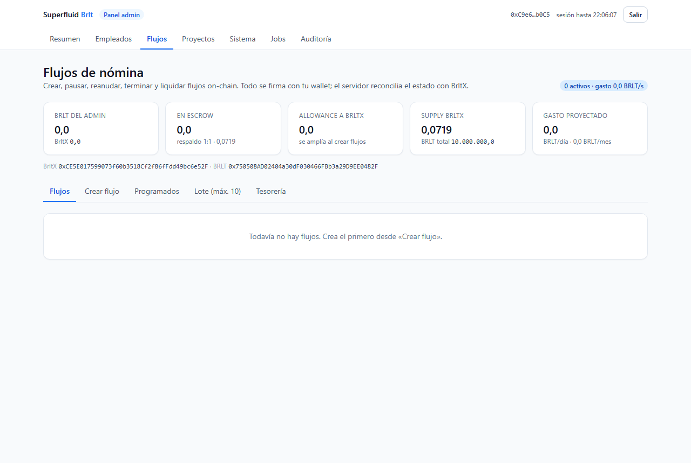
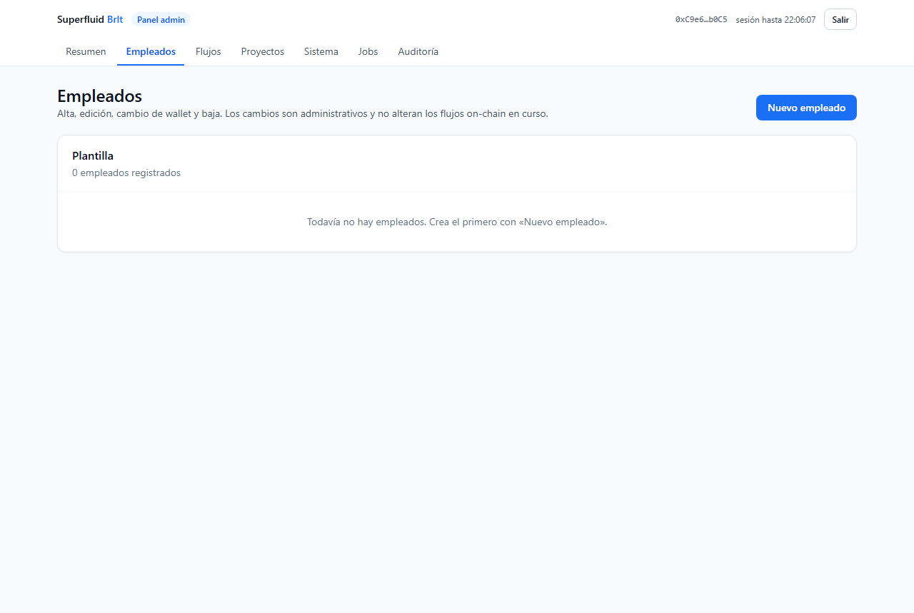
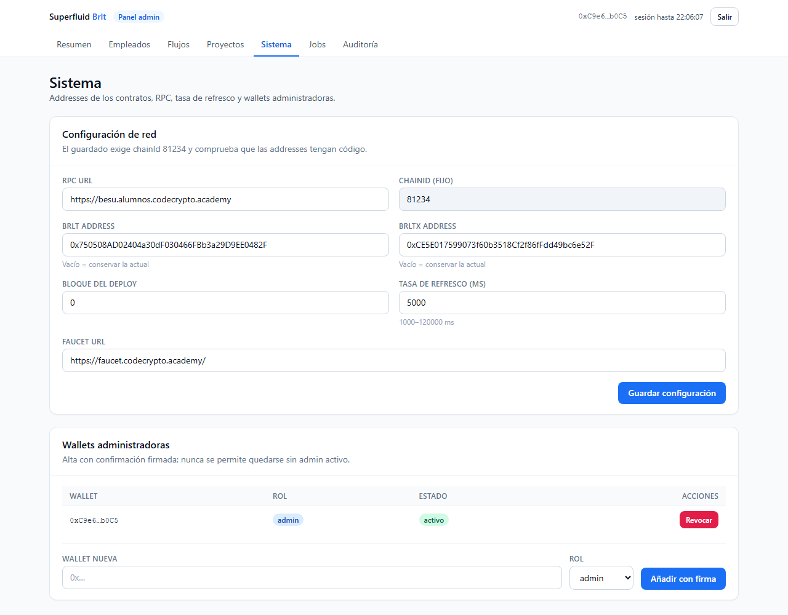
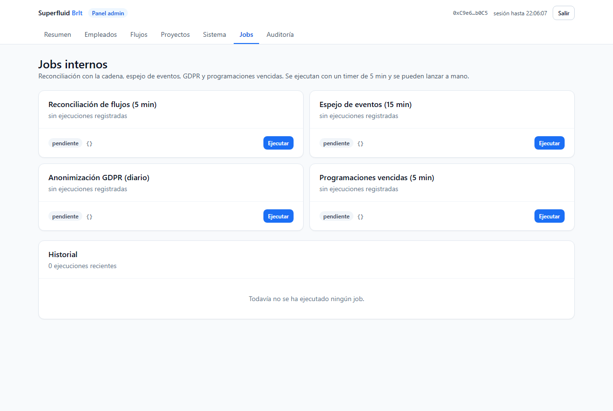
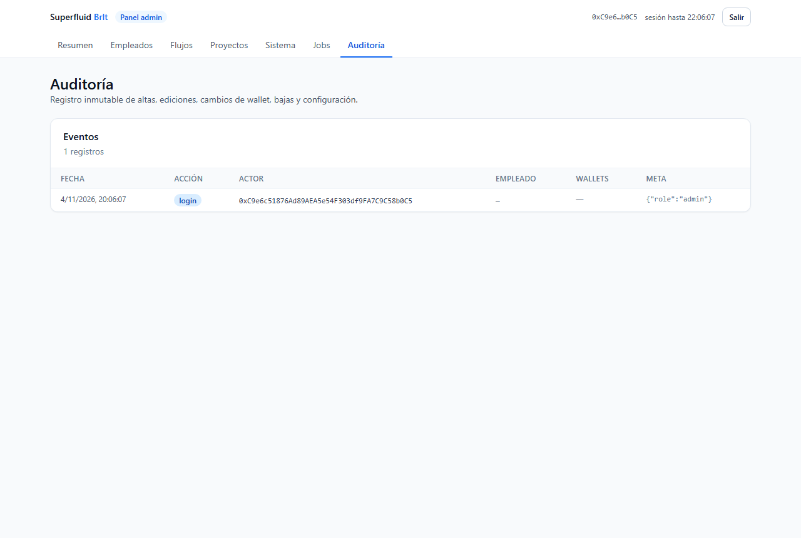

# Manual del Admin (guía operativa)

## Empezar en 5 minutos

### Tu primer flujo
1. Entra con tu wallet admin en **/login**.
2. **Sistema** → guarda las direcciones de BRLT/BrltX y el bloque de despliegue.
3. **Proyectos** → crea un proyecto.
4. **Empleados** → «Nuevo empleado» (nombre + wallet + importe + periodo).
5. **Flujos → Crear flujo** → elige empleado, importe y periodo →
   **«Aprobar y crear flujo»** (MetaMask pedirá dos firmas: aprobar y crear).

*(Vista general del panel: tarjetas de resumen y menú lateral con todas las secciones.)*

## Flujos día a día

### Operar un flujo
- **Pausar**: congela el devengo sin perder el tiempo pagado (el fin se aplaza).
- **Reanudar**: reancla con la misma tasa; el empleado no pierde devengo.
- **Terminar**: liquida lo devengado y devuelve el resto a tu wallet (dos firmas).
- **Liquidar**: solo para flujos **vencidos** (acumulado al empleado, resto a ti).

*(Lista de flujos: depositado, tasa, fin estimado, pendiente y estado reconciliados
con el contrato. Las acciones cambian según el estado.)*

## Programados y lotes

### Cuando hay mucho trabajo
- **Programados**: apunta una nómina futura (estado `próximo`); cuando llegue el día,
  pulsa **«Ejecutar»** y firma (o **Cancelar**).
- **Lote**: hasta **10 empleados** con el mismo importe y periodo. Si se interrumpe la
  tanda, al reintentar se **saltan los flujos ya creados** (sin doble pago).

*(Gestión de plantilla: alta, edición, baja y cambio de wallet con doble firma.)*

## Tesorería

### Emitir y quemar
- Pestaña **Tesorería**: el supply actual, el margen hasta el tope y los balances de
  tu wallet.
- **Emitir (mint)**: hasta el tope de 50.000.000 BRLT.
- **Quemar (burn)**: reduce el circulante de tu wallet; **no toca** los flujos activos.

*(Pantalla de configuración: RPC, contratos y parámetros validados contra la red.)*

## Mantenimiento y alertas

### Que nadie tenga que revisar a mano
- Con **Jobs** puedes ejecutar a mano la reconciliación, el espejo de eventos y el
  chequeo de nóminas vencidas.
- Los avisos en pantalla señalan flujos **vencidos sin liquidar** y flujos que
  **terminan en menos de 24 h**.
- Empleados con varios flujos activos piden **confirmación** con el total agregado
  antes de añadir otro (sin sustituir pagos por accidente).

*(Panel de trabajos: estado de cada job, último resultado y botón «Ejecutar». )*

## Seguridad del admin

### Buenas prácticas
- La wallet admin **nunca** se guarda en la web: solo firmas en tu navegador.
- Las sesiones duran **2 horas**; revisa **Auditoría** para ver quién hizo qué.
- Si cambias la wallet de un empleado, la app te lista sus flujos para
  **migrarlos** con el cambio de receptor en una sola transacción.

*(Historial de acciones: login, altas, cambios de wallet, operaciones de flujo y jobs.)*
