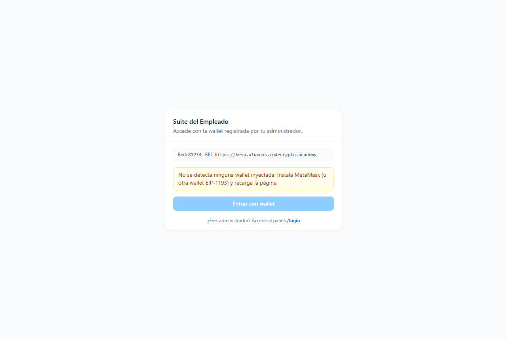
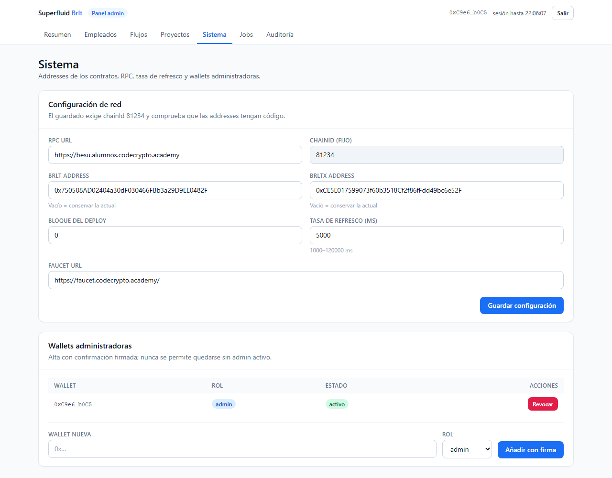

# Manual del Empleado (guía operativa)

## Empezar en 5 minutos

### Mi nómina
1. Entra en la **Suite**: `/suite/login` y conecta MetaMask.
2. Verás tres números: **Cobrable ahora**, **BRLT en cartera** y **Salario por periodo**.
3. En **Mis flujos** verás el “grifo” activo, cuánto llevas acumulado y cuándo termina.

*(Pantalla de acceso de la Suite del Empleado, sin registros de datos personales.)*

## Cobrar

### Cómo se cobra
1. Escribe el importe **o** pulsa «Todo (… BRLT)» si quieres el total.
2. Pulsa **«Cobrar»**: MetaMask te pedirá una firma.
3. En segundos tu wallet recibe **BRLT real**: verás «Cobrable» bajar lo mismo que
   sube «BRLT en cartera».

> **Bueno saber:** puedes cobrar aunque el contrato esté “en pausa” y aunque tu ficha
> esté dada de baja (ventana de retiro de 90 días).

## Mi flujo

### Estados y qué significan
| Estado | Qué pasa | Qué hago |
|---|---|---|
| activo | El grifo corre | nada, o cobrar cuando quieras |
| pausado | El devengo está congelado | espera; el tiempo se aplaza |
| vencido | Terminó su plazo | pulsa **«Liquidar»** (lo acumulado pasa a cobrable) |
| terminado | Todo liquidado | puedes cobrar lo restante |

## Mi perfil y mis datos

### Tú decides
- **Guardar perfil**: tu email/teléfono.
- **Dar/Retirar consentimiento**: siempre visible con fecha.
- **Borrar mis datos**: efecto **inmediato** (email/teléfono fuera); a los 30 días se
  anonimiza el nombre; tu wallet queda para retirar hasta 90 días tras la baja.

## Preguntas frecuentes

### ¿Y si no veo ningún flujo?
Aún no te crearon el “grifo”: pídeselo al administrador. Cuando lo haga, aparecerá
aquí en el momento (la pantalla se refresca cada 5 segundos).

### ¿Y si la app está caída?
Los flujos viven en la cadena: tu BrltX y tus pagos **no desaparecen**. Cuando la
app vuelva, todo se acumula como si nada.

*(Referencia del panel de configuración; los empleados no acceden a esta pantalla.)*
