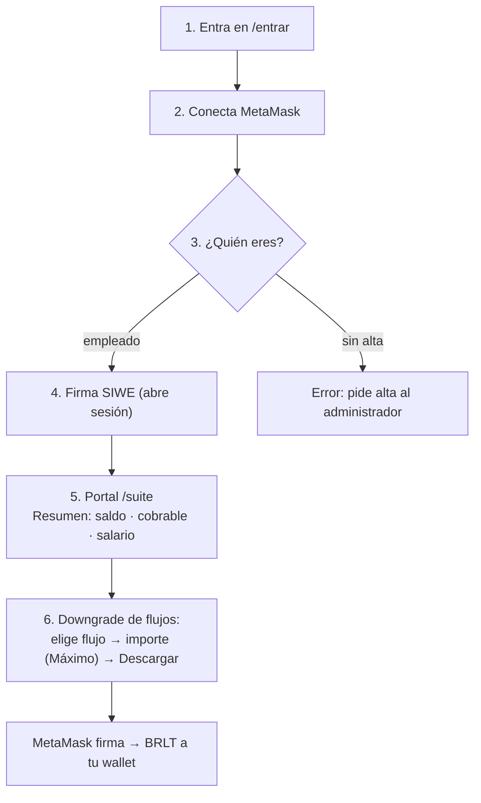
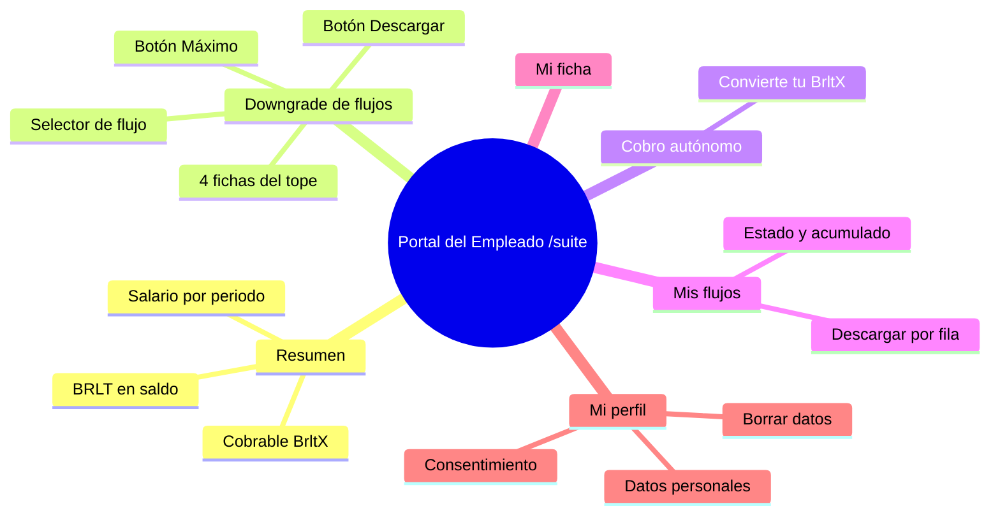
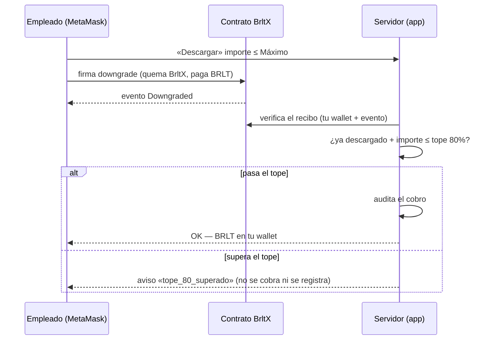

# Manual del Empleado (guía del Portal /suite)

## Empezar en 5 minutos

### De cero a ver tu nómina
1. Abre la web y ve a **`/entrar`** (la puerta única).
2. Pulsa **conectar wallet** (MetaMask). Si te pide elegir cuenta y red, acepta.
3. La app pregunta al servidor qué eres. Si tienes ficha de empleado, te lleva a
   tu **Portal del Empleado** (`/suite`); verás una pantalla oscura con cabecera
   violeta (es normal, tu portal tiene su propia identidad).
4. Firma un mensaje con tu wallet para abrir la sesión (no gasta dinero).
5. Ya dentro, mira el **Resumen**: **BRLT en saldo**, **Cobrable en BrltX** y tu
   **salario por periodo**.
6. Para cobrar: baja a **«Downgrade de flujos»**, elige un flujo, escribe el
   importe (o pulsa **«Máximo»**) y pulsa **«Descargar»**. Firma en MetaMask y
   los BRLT llegan a tu wallet.

> ¿Sin alta? La app te dirá «pide alta al administrador»: pídesela y vuelve a
> `/entrar`.

<!-- GENERAR_IMAGEN: onboarding-empleado.svg|png -->

## Tu portal por dentro

### Secciones (de arriba abajo)
| Sección | Qué encuentras |
|---|---|
| **Resumen** | BRLT que ya tienes en la wallet, BrltX cobrable con devengo y tu salario por periodo. |
| **Downgrade de flujos** | El cobro «con nómina»: eliges el flujo y respetas el tope del 80%. |
| **Cobro autónomo** | El cobro libre de siempre: conviertes BrltX de tu cartera sin elegir flujo. |
| **Mis flujos** | Tabla de tus “grifos”: estado, acumulado y botón **«Descargar»** por fila. |
| **Mi ficha** | Tu ficha laboral (proyecto, concepto, importe y periodo). |
| **Mi perfil** | Datos personales, consentimiento y borrado de datos. |

La pantalla se refresca sola cada **5 segundos**. La cara visual es propia:
fondo azul noche, tarjetas oscuras y cabecera violeta — nada que ver con el
panel del admin.

<!-- GENERAR_IMAGEN: portal-empleado-secciones.svg|png -->

## Entrar y tu wallet (importante)

### La app comprueba que sigues siendo tú
- Tu sesión está **ligada a tu wallet**. Mientras navegas por `/suite`, la app
  la compara con la cuenta activa de MetaMask: al vuelo (si cambias de cuenta)
  y además cada **10 segundos**.
- Si cambias de cuenta en MetaMask, aparece el aviso **«Wallet distinta a tu
  sesión»** con un botón para **revalidar en `/entrar`**. Hasta que no revalides
  no podrás seguir operando. Es una protección: nadie puede usar tu sesión
  abierta con otra cuenta.
- Si abres `/suite` con una sesión de **admin**, te manda directamente a
  `/admin`. Y si no tienes sesión, vuelves a `/entrar`.
- Antes de cualquier firma, la app vuelve a comparar la cuenta conectada con la
  de tu sesión: si no coinciden, se cancela el envío.

## Downgrade de flujos (el cobro con tope del 80%)

### ¿Qué significa el tope?
**Regla de la casa:** en total solo puedes convertir en BRLT el **80% de todo
lo que te asignaron** (la suma de todos tus flujos, vivos o terminados). Lo ya
convertido se va restando. Es una regla de la aplicación, no del contrato, y
aplica igual al «Cobro autónomo»: los dos comparten el mismo contador.

### Las 4 fichas que verás
| Ficha | Significado |
|---|---|
| **Asignado a tu cuenta** | Todo lo depositado en tus flujos. |
| **Tope 80%** | Lo máximo que podrás convertir en total (80% de lo asignado). |
| **Ya descargado** | Lo que ya has convertido en BRLT hasta hoy. |
| **Disponible** | Tope − ya descargado. Es tu margen actual. |

Ejemplo: asignado **10.000** → tope **8.000** → ya descargado **1.500** →
disponible **6.500**. Si ya hubieras descargado 8.000, el tope está agotado y no
podrás descargar más por esta vía.

### Cómo descargar, paso a paso
1. Elige el **flujo** en el selector (puedes elegir cualquiera de los tuyos,
   activos, pausados o terminados).
2. Escribe el importe, o pulsa el botón **«Máximo»**: te propone lo menor entre
   tu BrltX en cartera y lo disponible del tope. Ese es el tope real de hoy.
3. Pulsa **«Descargar»**. MetaMask te pedirá la firma (no gasta nada,
   convierte tu BrltX en BRLT).
4. En segundos verás **«Ya descargado»** subir lo mismo que baja tu BrltX y
   sube tu BRLT en saldo.

> **Truco:** en la tabla de **«Mis flujos»** cada fila tiene su botón
> **«Descargar»**: te preselecciona ese flujo y te lleva directo al panel.

### ¿Por qué «Máximo» me da menos de lo que espero?
Dos razones posibles, y el botón ya te calcula el mínimo:
- **El tope**: no puedes pasar del 80% acumulado.
- **La cadena**: el devengo pendiente de un flujo **activo** solo se convierte
  en BrltX cobrable cuando el flujo se **liquida on-chain** (y liquidar exige
  que haya vencido). Hasta entonces, ese devengo no está en tu cartera.
- Si «Máximo» te da **0**, o el tope está agotado o tu BrltX en cartera es 0.

<!-- GENERAR_IMAGEN: flujo-downgrade-80.svg|png -->

## Cobro autónomo (el cobro libre, que se conserva)

### Sin elegir flujo
1. Escribe el importe de BrltX de tu cartera que quieres convertir (o pulsa
   «Todo» si el panel lo ofrece).
2. Pulsa el botón de **cobro**: MetaMask firma y recibes **BRLT real** en tu
   wallet.
3. Recuerda: también **cuenta para el tope del 80%**. Si lo intentas con un
   importe mayor al disponible, verás el aviso «tope_80_superado» y no se
   registra nada.

> **Bueno saber:** puedes cobrar aunque el contrato esté “en pausa” y aunque tu
> ficha esté dada de baja (ventana de retiro de 90 días).

## Mis flujos

### Estados y qué significan
| Estado | Qué pasa | Qué hago |
|---|---|---|
| activo | El grifo corre | nada, o descargar cuando quieras |
| pausado | El devengo está congelado | espera; el tiempo se aplaza |
| vencido | Terminó su plazo | espera la liquidación on-chain (o pídela al admin); lo acumulado pasa a cobrable |
| terminado | Todo liquidado | puedes cobrar lo restante |

Cada fila muestra el estado, el acumulado y su botón **«Descargar»**. La tabla
se refresca cada 5 segundos: si te crean un flujo nuevo, aparece al momento.

## Mi ficha y mi perfil

### Mi ficha
Tu información laboral: proyecto, concepto, importe y periodo. Solo lectura.

### Mi perfil (tú decides)
- **Guardar perfil**: tu email/teléfono.
- **Dar/Retirar consentimiento**: siempre visible con fecha.
- **Borrar mis datos**: efecto **inmediato** (email/teléfono fuera); a los 30 días se
  anonimiza el nombre; tu wallet queda para retirar hasta 90 días tras la baja.

## Preguntas frecuentes

### ¿Y si no veo ningún flujo?
Aún no te crearon el “grifo”: pídeselo al administrador. Cuando lo haga, aparecerá
aquí al momento (la pantalla se refresca cada 5 segundos).

### ¿Y si la app está caída?
Los flujos viven en la cadena: tu BrltX y tus pagos **no desaparecen**. Cuando la
app vuelva, todo se acumula como si nada.

### ¿Y si cambio de cuenta en MetaMask?
Verás el aviso «Wallet distinta a tu sesión». Vuelve a entrar con tu cuenta de
siempre en `/entrar` y seguirás donde estabas.

### ¿Y si el tope está agotado?
Ya convierte del 80% de todo lo asignado. Si te queda BrltX pendiente de
liquidar, tendrás que esperar a que el flujo se liquide on-chain — pero recuerda
que el tope global no se reabre con lo nuevo: es acumulado de por cuenta.

> **Nota de pantallazos:** las capturas de la Suite se regenerarán tras el
> rediseño (`npm run capturas`); la descripción de este manual refleja el portal
> vigente de 2026-11-17.

---

*Actualizado 2026-11-17*
